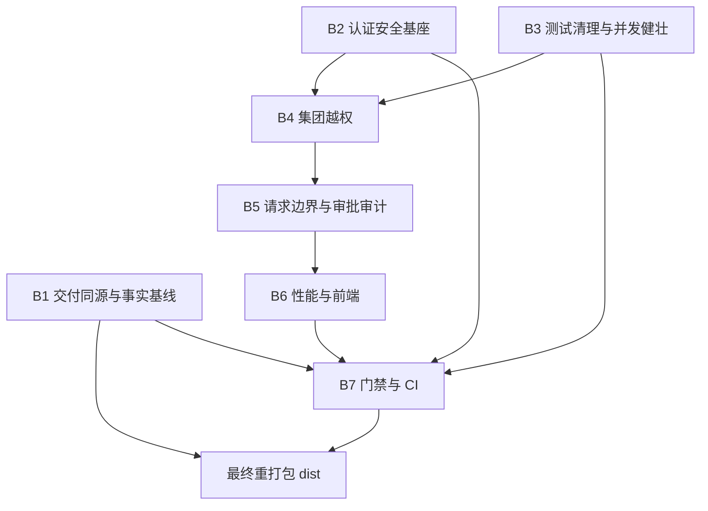

# 能碳管理平台 v1.0.1 · 23 项缺陷修复设计（任务分解与方案裁决）

> 编写：架构师（高见远）　日期：2026-11-27　依据：《能碳平台-全栈测试与代码审查报告-2026-11-27》
> 本文是**修复设计**，不是 PRD。所有行号均为 2026-11-27 当日源码实测行号，与审查报告不一致处在 §7「行号漂移与口径修正」逐条给出。
> 基准事实（实测）：`mvn test` 26 个套件 / 104 条用例 / 0 失败 / 0 跳过；迁移 32 个（至 V114）；测试类 26；main 源文件 182；`dist/carbonbal-1.0.1.zip` 的 MANIFEST 为 `files=337 / flyway=105`。

---

## 1. 修复总览表

路径基准：`D:/能碳12/`。`BE` = `platform/backend`，`FE` = `自研原型`。

### 1.1 P0（3 项，阻断发版）

| 编号 | 缺陷 | 修改文件（相对 D:/能碳12） | 修改要点 | 验证方式 |
|---|---|---|---|---|
| P0-1 | 测试清理可删真实租户，且在 H2 下**整段静默失效** | `BE/src/test/java/com/carbonbal/ApiTestSupport.java:128-152`<br>`BE/src/test/java/com/carbonbal/CleanupSafetyTest.java`（新增） | ① 用 `DataSource` 元数据 `DatabaseProductName` 判定 H2，非 H2 直接 `IllegalStateException`（fail-fast，不做 `assumeTrue` 静默跳过）；② 8 条 `delete ... join` + `date_sub` 改为**按外键顺序的单表 DELETE**（见 §4.5），时间条件改为 JDBC 参数 `LocalDateTime`；③ 遍历执行全部语句并**汇总失败后统一抛出**，不再首条失败即中断、不再 `catch` 吞掉；④ 清理后断言残留计数 = 0 | `mvn -o test` 日志 0 条 `bad SQL grammar`、0 条 `[cleanup]`；临时把 `app.test.allow-non-h2=true` 指向 MySQL 实例时测试类必须启动失败 |
| P0-2 | 开发/演示默认 JWT 密钥公开，黑名单只拦 1 个 | `BE/src/main/resources/application.yml:93`（dev）、`:10`（`profiles.active: dev`）<br>`platform/env.sh:7`<br>`BE/src/main/java/com/carbonbal/auth/JwtService.java:19-29`<br>`BE/src/main/java/com/carbonbal/auth/JwtSecretPolicy.java`（新增）<br>`BE/src/test/java/com/carbonbal/TokenClaimTest.java`（新增） | ① 删除 yml 与 env.sh 两处默认密钥；② 新增 `JwtSecretPolicy`：长度 ≥32 + 熵下限（去重字符数 ≥12 且非单调重复）+ 已知前缀黑名单（`carbonbal-dev-secret`/`dev-only-key`/`local-dev-`/`please-replace`/`changeme`/`change-me`/`secret`），命中即启动失败；③ 空密钥且 `app.jwt.dev-auto-secret=true`（**仅 dev profile 定义**）时用 `SecureRandom` 生成 48 位随机密钥并 `WARN` 打印"本次启动已生成临时密钥，重启后令牌失效"，不打印密钥值；④ `spring.profiles.active: dev` → `spring.profiles.default: dev` | 用旧默认密钥自签令牌 → `GET /api/auth/me` 401；`SPRING_PROFILES_ACTIVE=prod` 且无 `JWT_SECRET` → 启动失败并给出中文提示；`mvn -o test` 104 条全绿 |
| P0-3 | 交付包与受审源码不同源 | `platform/tools/lib-facts.sh`（新增）<br>`platform/tools/package-source.sh:40-41,46-57`<br>`HANDOVER.md:3,28,30,86,115,117`<br>`platform/README.md:208,292`<br>`BE/tools/check-docs.sh`<br>`.gitignore`（新增，仓库根） | ① `package-source.sh` 不再硬编码 `flyway=105`，改由 `lib-facts.sh` 计算 `flyway_version/migrations/test_classes/test_cases/java_main/files`；② 打包前做**同源断言**：源码迁移数=暂存包迁移数、`VERSION` 一致、`sync-frontend.sh --check` 通过，任一不符即 `exit 1`；③ 删除重复的 `cp VERSION`（40-41 两行相同）；④ 旧包改名 `carbonbal-1.0.1-rc.20261125.zip` 后重打 | `bash platform/tools/package-source.sh` → MANIFEST 为 `flyway=114 / migrations=32 / test_classes=26 / test_cases=104`；`sha256sum -c SHA256SUMS` 全 OK；包内含 `functional-cases.py`、`run-prod.sh` |

### 1.2 P1（10 项）

| 编号 | 缺陷 | 修改文件 | 修改要点 | 验证方式 |
|---|---|---|---|---|
| P1-1 | 同集团兄弟企业数据越权 | `BE/src/main/java/com/carbonbal/group/GroupService.java:43-52`<br>`BE/src/main/java/com/carbonbal/identity/PageCatalog.java:18-23,71`<br>`BE/src/main/resources/db/migration/V115__group_page_privileged.sql`（新增）<br>`BE/src/test/java/com/carbonbal/GroupScopeTest.java`（新增） | ① `PageCatalog` 增加 `PRIVILEGED = Set.of("group.overview")` 与 `isPrivileged()`；② `RoleService.ensureDefault` 只回补非特权页面（见 P2-4，同一文件）；③ `GroupService` 仅在"用户对集团父企业拥有 admin 级成员关系"时才展开兄弟企业，否则只返回本人 active 成员关系的企业；④ V115 把 `group.overview` 从所有默认角色解绑并 bump 非平台账号 `token_version` 强制重登 | 普通成员 `GET /api/group/summary` → 403 `PAGE_FORBIDDEN`；管理员 → 200 且 `orgCount` 仅含授权工厂；`GroupScopeTest` 3 条用例 |
| P1-2 | pages 声明缺失 fail-open | `BE/src/main/java/com/carbonbal/auth/JwtAuthFilter.java:79-83,97-103` | ① `pages` 缺失/空白 → 视为空集（403），不再默认 `"*"`；② `uid/org` 缺失的"老令牌兼容分支"改为 401 `SESSION_REVOKED`（提示重新登录），关闭第二条放行路径；③ `imp` 代管分支上移并只允许 `platformAdmin`，仍按 `pages=*` 且写审计 | `TokenClaimTest`：无 `pages` 令牌访问 `/api/products` → 403；无 `uid/org` 令牌 → 401；`imp` 令牌非平台账号 → 403 |
| P1-3 | X-Forwarded-For 伪造绕过锁定 | `BE/src/main/java/com/carbonbal/auth/AuthController.java:91-93,140-141,652-655`<br>`BE/src/main/java/com/carbonbal/auth/LoginAttemptService.java:23-55`<br>`BE/src/test/java/com/carbonbal/AuthLockoutTest.java` | ① `clientIp()`：只有 `remoteAddr` 命中 `app.auth.trusted-proxies`（默认空=不信任任何 XFF）才解析 XFF，且**从右向左**取首个非信任地址；② 锁定键增加账号维度 `acct|<account>`，阈值 20/15min（防 DoS），删除时用 `fail(key, limit)` 重载；③ 成功登录同时清两个键 | `AuthLockoutTest` 新增 1 条：轮换 6 个不同 XFF、每次正确图形码，第 6 次仍 429；原 3 条保持 200/401 |
| P1-4 | multipart / 大 body 幂等放行 | `BE/src/main/java/com/carbonbal/common/IdempotencyFilter.java:34,39,49-57,68-72,99`<br>`BE/src/main/java/com/carbonbal/common/IdempotencySupport.java`（新增）<br>`BE/src/test/java/com/carbonbal/IdempotencyTest.java` | 分层：① ≤1MB JSON 走内存（阈值从 `256*1024` 提到 `1MB`，配置化）；② >1MB 流式 spool 到临时文件并算 SHA-256，用 `CachedFileRequest` 回放，`finally` 删除临时文件（不再 `readAllBytes` 无上限）；③ multipart 用 `req.getParts()` 遍历：`name/originalFilename/contentType/size` + **文件内容流式摘要**（每部分 ≤10MB，受 `spring.servlet.multipart.max-file-size` 约束）生成同构 hash，**不包装请求**（容器已缓存 parts）；④ `response_body` 落库上限同步提到 1MB | 同键 300KB JSON 重复提交只落一条；同键 multipart 重复上传只落一条；同键不同文件 → 409；现有 3 条用例保持绿 |
| P1-5 | 前端存储型 XSS（桑基图/提示框） | `FE/assets/pages-generic.js:1041,1059,1068` | ① 1041 行 `${txt}` → `${esc(txt)}`（`esc` 已覆盖 `& < > " '`）；② 1059/1068 行 `tip.innerHTML` 改为 `tip.replaceChildren()` + `textContent`（先 `<b>`、再 `<span>` 两节点），彻底断开 `dataset` → HTML 的通道；③ 不新增转义函数，统一复用 `UI.esc` | 以 `` 命名供应商/产品后打开能流分析与悬浮 → 无脚本执行（`page.on('dialog')` 不触发）；`pages-generic.js` 无 `innerHTML` 拼接 `dataset` |
| P1-6 | bootstrap 载入 Report.content BLOB | `BE/src/main/java/com/carbonbal/bootstrap/BootstrapService.java:631-651`<br>`BE/src/main/java/com/carbonbal/report/ReportService.java:208-217`<br>`BE/src/test/java/com/carbonbal/BootstrapTest.java` | ① `reportRows()` 改 `.select(Report::getId, Report::getFileName, Report::getReportType, Report::getPeriodLabel, Report::getFileSize, Report::getGeneratedAt, Report::getDisabled)`（MyBatis-Plus 投影，不改表结构）；② `ReportService.detail()` 不再调 `download()`（会 select 全字段含 BLOB），改为元数据投影查询；③ `bundle()` 保留全量（业务需要），但加 50 份上限并返回 400 明确提示 | 造 100 份报告后 `/api/bootstrap` ≤60KB（perf PT-03）；`BootstrapTest` 新增 1 条：报告 50 份时 bootstrap 响应体不含 `content` 且 size 稳定 |
| P1-7 | smoke.sh 因验证码改造失效 | `BE/tools/smoke.sh:12-15`<br>`BE/tools/e2e.sh:15-45`（抽公共函数） | 抽出 `tools/lib-auth.sh`（`cap_token()` / `login()` / `jget()`）供 smoke 与 e2e 共用；smoke 登录改为"取码 → 带 `captchaId/captchaCode` 登录"，并复用 `login_username` 兼容入口 | 启动服务后 `bash tools/smoke.sh` 9/9；任一项失败退出码非 0 |
| P1-8 | E2E 长期红灯 + 审批链无 UI 覆盖 | `BE/tools/e2e.sh:130-150,524-525`<br>`FE/tools/ui-flows.cjs`（新增 1 条流程）<br>`platform/docs/test-plan-2026-11-27.md` | ① 2 条短信用例**不 skip**：进入短信段前先 `delete from sms_code where phone='13800000002'`（e2e 本就依赖 `MYSQL_BIN`；无客户端才打 `[SKIP]` 并计入 skipped）；② 门禁语义改为 `failed=0` 才算 PASS，`skipped` 单列打印（`RESULT: PASS (102 passed, 0 failed, 2 skipped)`）；③ ui-flows 补 1 条 `L40 核算审批链（提交→复核→批准→锁定按钮可见且状态推进）`，跑在 reset-demo 之前、报告生成用例之后 | `bash tools/e2e.sh` → failed=0；`node tools/ui-flows.cjs` → 39/39 且含 L40 |
| P1-9 | 无覆盖率 / 无 CI / 无版本控制 | `BE/pom.xml:117-143`（JaCoCo 置于 `coverage` profile）<br>`platform/tools/ci.sh`（新增）<br>`.github/workflows/ci.yml`（新增）<br>`.gitignore`（新增，与 P0-3 同一文件） | ① JaCoCo 只在 `-Pcoverage` 激活：`BUNDLE LINE ≥0.60`，另加 `PACKAGE` 规则对 `com.carbonbal.accounting.*/identity.*/auth.*` 要求 `BRANCH ≥0.50`，绑 `verify`；② `ci.sh` 串 7 段：facts+check-docs → sync-frontend --check → `mvn -o test` → gate-l0 → （可选 `--with-service`）smoke/e2e/ui-flows → package-source --check；**跳过的段必须打印 `[SKIP] 原因` 且结论为 `PARTIAL`，禁止假绿**；③ `git init -b main` + 首次提交 + 打 tag `v1.0.1` | `bash platform/tools/ci.sh` 非 0 时退出码非 0；联网后 `mvn test -Pcoverage` 生成 `target/site/jacoco/index.html` 且达阈值；`git log --oneline` 有首commit |
| P1-10 | 测试之间无隔离、顺序依赖 | `BE/src/test/java/com/carbonbal/ApiTestSupport.java`（同 P0-1）<br>`BE/src/test/java/com/carbonbal/CleanupSafetyTest.java`（新增） | ① 以 P0-1 的"真清理 + 残留断言"为地基（这是根因，报告已确认清理从未生效）；② 每类测试数据统一 `TST-` 前缀 + 手机号段 `135/1372/1375/1398`；③ **保留** `@Order`（AccountingFlowTest 是链路设计而非顺序污染），但 `AccountingFlowTest` 改为在 `@BeforeAll` 内把 2026-11 强制回 `draft`（把 e2e 的自愈逻辑搬进来）；④ `pom.xml` surefire 配 `runOrder=alphabetical` 固定基线；随机顺序探测放 `ci.sh` 的可选段，仅告警 | 连续两次 `mvn -o test` 后 `data-check.sh` 租户/账号数与首次相同；单类运行（`-Dtest=AccountingFlowTest`）全绿 |

### 1.3 P2 / P3（10 项）

| 编号 | 缺陷 | 修改文件 | 修改要点 | 验证方式 |
|---|---|---|---|---|
| P2-1 | 解锁自审批 | `BE/src/main/java/com/carbonbal/accounting/AccountingService.java:287-288`<br>`BE/src/main/java/com/carbonbal/accounting/AccountingController.java`（请求体） | 最小改法：`approvedBy` 不再写当前操作人，改为 `null` + `approval_status='pending'`？**不引入**（改动面大）。本轮采用**语义校正**：`requested_by=操作人`、`approved_by=null`、新增列不需要（`period_unlock.approved_by` 允许 NULL，V1 已如此），并在 `view()` 输出 `selfApproved=true`；审计写明"单人解锁"。文档同步 `docs/state-machines.md` | 解锁后 `GET /accounting-periods/{p}` 返回 `selfApproved` 字段；`AccountingFlowTest.unlockRequiresReasonAndRestoresDraft` 保持绿 |
| P3-1 | 核算页死代码（AC_TABS 等） | `FE/assets/pages-core.js:318-462`（注释行 + `AC_TABS`…`acMeta`，保留 464 起的 `acDetail`） | 整段删除（已实测无任何调用点：`grep -rn "acPane\|acTabsBlock\|bindAcTabs\|acMeta\|AC_TABS"` 仅命中定义自身），同步跑 `sync-frontend.sh` | `node tools/gate-l0.cjs` 11/11；`node tools/check-ui.cjs` 5/5；`bash platform/tools/sync-frontend.sh --check` 通过 |
| P2-3 | check-docs 漏检、文档数字六处不一致 | `BE/tools/check-docs.sh:8-30,33-46,62-67`<br>`platform/tools/lib-facts.sh`（新增，同 P0-3）<br>`HANDOVER.md`、`platform/README.md`、`platform/docs/architecture.md:168,443`、`platform/docs/release-and-rollback.md:14` | 见 §2.5 裁决：断言式同源。`check-docs.sh` 增加"事实断言"段，对登记在册的「文件 + 正则 + 期望来源」逐条比对 `lib-facts.sh` 的值；同时把 architecture.md 两处自相矛盾的"当前统计"（168 行 27 张表/116 API vs 443 行 37 张表/177 API）删到只留一处 | `bash tools/check-docs.sh` 改前 FAIL（能抓到 `Flyway 105`/`95 条断言`/`108（26 个迁移）`），改后 PASS |
| P2-4 | 默认角色并发重复 / 重复建 | `BE/src/main/java/com/carbonbal/identity/RoleService.java:231-253`<br>`BE/src/test/java/com/carbonbal/RoleApiTest.java` | 见 §2.6 裁决：**不加** `(org_id,is_default)` 唯一索引（报告建议有误，会禁止多个非默认角色）；改为 `ensureDefault` 捕获 `DuplicateKeyException`（现有 `uk_tenant_role_org_name` 已能兜住同租户同名"运营"），冲突后重查并按需回补页面；同时 `ensureDefault` 只补非特权页 | 并发 10 线程建角色/列角色 → 无 500；`RoleApiTest` 新增 1 条并发用例 |
| P2-5 | 巨型类 | `BE/src/main/java/com/carbonbal/analysis/AnalysisService.java`（1001 行）<br>`BE/src/main/java/com/carbonbal/bootstrap/BootstrapService.java`（849 行） | **不整体拆分**（见 §6）。最小改法：本轮只做 P1-6 的行映射投影优化；在两文件头加技术债注释（拆分边界：analysis 按 8 个页面收敛为 `EnergyAnalysisService/CarbonAnalysisService/QuotaAnalysisService`）；新增代码禁止继续堆入 | 仅 `mvn -o test` 回归 |
| P2-6 | 无障碍 / 跨浏览器 | `FE/tools/check-ui.cjs:13,31-38` | 最小改法：① `SKIP` 集合显式打印为 `[SKIP] 路由` 并在 RESULT 里报 `skipped=N`；② 新增 1 项纯 DOM 断言（不引依赖）：统计无 `aria-label`/无可见文本的 `button` 数量，>0 记 WARN 不阻断。axe/Firefox/Safari **本轮不做**（离线无依赖） | `node tools/check-ui.cjs` 输出含 skipped 数与 a11y WARN |
| P2-7 | 无压测 / 长稳 | `BE/tools/perf.sh` | 只加 1 个场景：用 API 造 100 份报告后测 `/api/bootstrap` 体积与 P95（覆盖 P1-6 的闭环证据）；k6/24h 长稳**本轮不做** | `bash tools/perf.sh` 场景数 14→15，PT-03 达标 |
| P2-8 | 无 SAST/SCA | `platform/tools/ci.sh`（同 P1-9） | 只留 stage 占位：`[SKIP] SAST/SCA 需联网（Semgrep/OWASP DC），未执行`，并在结论里列为 PARTIAL 原因；不伪造通过 | `ci.sh` 输出可见该 SKIP |
| P2-9 | 前端 123 用例不在源码树 | `FE/tools/frontend-full.mjs`（新增，来源 `D:/能碳12/.workbuddy/review/artifacts/test-run-backup/frontend-full.mjs`，1221 行） | 移入源码树并把 3 处硬编码（`BASE`、`CHROME`、`createRequire('d:/能碳12/...')`）改为环境变量 + 相对路径，纳入 `ci.sh --with-service` 段 | `node tools/frontend-full.mjs` 能起跑；`gate-l0` 不因新增文件报错 |
| P2-10 | 日志记录手机号 | `BE/src/main/java/com/carbonbal/auth/DataSeeder.java:78,106`<br>`BE/src/main/java/com/carbonbal/auth/AuthController.java:147-151` | `DataSeeder` 改用既有 `Hashes.maskPhone()`；`logLogin` 落库保持明文（审计与"最近登录"需要），但**接口出参**统一 `maskPhone`（`UserService` 已对成员列表脱敏，登录流水列表补齐） | `grep -rn "log.info" --include=*.java` 无明文手机号；`/api/users/{id}/login-logs` 返回 `138****0001` |

---

## 2. 方案裁决（7 项）

### 2.1 P1-1 集团越权：新增 `group.manage` 权限点 vs `group_admin` 标记

**结论：都不选。选「特权页面（privileged page） + 数据范围二次校验」的双层方案。**

理由：
1. 本系统的权限模型只有一层——**页面集合**（`PageCatalog.CODES` 32 个 code，`tenant_role_page` 绑定，令牌 `pages` 声明携带）。引入 `group.manage` 这类"动作权限点"等于在 v1.0.1 补一个权限框架（表、API、UI、缓存失效、令牌结构），改动面远超一个 P1。
2. 给 `user_tenant` 加 `group_admin` 列也不行：需要 DDL + 成员管理 UI + 与 `role/user_type` 的语义重叠（现有已有 `role=admin` / `user_type=tenant_admin` 两种"管理员"表达），再加第三种只会更乱。
3. 现有 `member.role` 已能判"admin 级成员关系"（`AuthStateService.member()` 把 `role=admin` 与 `user_type=tenant_admin` 归一为 tier），**零新增字段**即可支撑数据范围判定。

落地内容：
- `PageCatalog.PRIVILEGED = Set.of("group.overview")`，`isPrivileged(code)`。
- `RoleService.ensureDefault()` 只回补 `非特权` 页面 ⇒ 默认角色【运营】**不再**自动获得 `group.overview`（这是本缺陷的根因：`RoleService:250-252` 每次列表访问都把全部 32 个页面补齐到默认角色）。
- 租户管理员仍可在角色里**显式勾选** `group.overview` 授予"集团管理员角色"——`pagesFrom()` 不改，只改默认回补逻辑。
- 前端**零改动**：`menu.js:6` 已带 `page: 'group.overview'`，`framework.js:canSeePage()` 按 `state.pages` 过滤，页面移除后菜单自动隐藏。

期望行为（明确回答）：

| 主体 | `GET /api/group/summary` |
|---|---|
| 普通成员（默认角色，无 `group.overview`） | **403 `PAGE_FORBIDDEN`**（`JwtAuthFilter:97-102` 页面门禁，默认拒绝） |
| 被显式授予 `group.overview` 但非集团管理员 | 200，`orgs` **仅含本人 active 成员关系的企业**（只有 1 家就是 `orgCount=1`），绝不返回兄弟企业 |
| 集团管理员（对该集团父企业在 `user_tenant` 里为 `role=admin` 或 `user_type=tenant_admin`） | 200，含父企业 + 该父企业下全部子企业 |
| 平台超管代管（`imp`） | 200 全量 |

存量数据兼容：`V115__group_page_privileged.sql`
```sql
-- 集团汇总降为特权页面：默认角色不再自动拥有（页面仍可由管理员显式授予）
DELETE FROM tenant_role_page
 WHERE page_code = 'group.overview'
   AND role_id IN (SELECT id FROM tenant_role WHERE is_default = 1);

-- 页面集合写在令牌里，升级后强制重新登录（同时闭合 P1-2 的老令牌窗口）
UPDATE app_user SET token_version = token_version + 1 WHERE platform_admin = 0;
```
> 注意：**必须单表 DELETE**。H2（`MODE=MySQL`）不支持 MySQL 的 `DELETE rp FROM ... JOIN` 语法——这正是 P0-1 的成因，迁移里再犯一次会让全部测试套件失败。升级需在发布说明写明"升级后所有用户需重新登录"。

### 2.2 P1-4 幂等：multipart 取哈希与 256KB 放开

**结论：分层处理 + 配置化阈值，不引入业务唯一约束。**

现状三重缺陷（`IdempotencyFilter`）：`shouldNotFilter:53-54` 直接放行 multipart；`doFilterInternal:68` 先 `readAllBytes()` 全量读（无上限 → OOM 风险）；`:69-72` 超阈值时**静默 `chain.doFilter` 且不进占位表**（重放完全不设防）。

设计：
1. **阈值配置化**：`app.idempotency.max-inline-bytes: 1048576`（1MB，原 256KB 太小，正常创建类 JSON 远小于此）、`app.idempotency.max-body-bytes: 10485760`、`ttl-hours: 24`。
2. **≤1MB JSON**：保持现有内存路径（占位 → 执行 → 回写响应）。
3. **>1MB**：`IdempotencySupport.spoolToTemp(req)` 边读边 `MessageDigest.update` 边写 `Files.createTempFile`，得到 `sha256` + `Path`；用 `CachedFileRequest`（`FileChannel` 回放）包装后 `chain.doFilter`；`finally` 删除临时文件。**不允许** `readAllBytes()` 处理超限请求。
4. **multipart**：不再 `shouldNotFilter` 放行；在 `doFilterInternal` 里用 `req.getParts()`：
   - 每部分记录 `name / submittedFileName / contentType / size`；
   - 文件部分**流式**摘要（`getInputStream()` → `DigestInputStream`），不落内存（受 `spring.servlet.multipart.max-file-size: 10MB` 约束，摘要一次 10MB 可接受）；
   - `hash = sha256(method + path + "\n" + join(partDescriptor + ":" + partDigest))`；
   - **不包装请求**（Servlet 容器已缓存 parts，Spring 的 `StandardServletMultipartResolver` 会复用同一份解析结果），只在占位失败时走 `replayOrReject`。
   - 例外：`/api/files`、`/api/import/*` 等大文件接口仍允许，只是现在**会**被幂等保护（前端 `api-client.js:61` 只在有 `idem` 时发头，不影响既有调用）。
5. **不新增业务唯一约束**：`uk_idem_org_key`（V105 已有）足以防重放；给 product/device 等业务表加唯一键会与现有脏数据/软删逻辑冲突，且不是本缺陷的必需条件——登记为 v1.1。

新增 `IdempotencySupport`（单一工具类，避免 Filter 继续膨胀）：
```java
static String sha256Hex(String s)
static String sha256Hex(byte[] b)
static Spooled spoolToTemp(HttpServletRequest req, int maxBytes)   // record Spooled(Path file, String hash, long size)
static String multipartKey(HttpServletRequest req)                  // 元数据 + 流式摘要
static final class CachedFileRequest extends HttpServletRequestWrapper { ... }
```

### 2.3 P0-1 测试清理：H2 判定与正确清理

**结论：`DataSource` 元数据判定 + fail-fast（不做 `assumeTrue` 静默跳过）+ 按外键顺序单表 DELETE + 失败汇总上抛 + 残留断言。**

1. **环境判定不看 profile 字符串**（`-Dspring.profiles.active=prod` 也可能连 H2，反之亦然）：
```java
private String product() {  // 一次性缓存
    try (var c = jdbc.getDataSource().getConnection()) {
        return c.getMetaData().getDatabaseProductName();   // "H2" / "MySQL"
    } catch (SQLException e) { throw new IllegalStateException(e); }
}
@BeforeAll void guard() {
    if (!"H2".equalsIgnoreCase(product())) {
        throw new IllegalStateException(
            "测试清理会删除 org_id<>1 的全部数据，只允许在 H2 内存库运行；当前数据库=" + product()
            + "。请使用 H2（默认 dev）或独立测试库。");
    }
}
```
   为什么不是 `assumeTrue`：`assumeTrue` 会把整个类标成 skipped，门禁看到的是"跳过"而不是"拒绝"，等于又给了一个假绿通道。用 `IllegalStateException` 让类直接失败，语义正确（"此环境禁止跑该测试"）。
2. **外键顺序**（实测 schema 有 7 个 FK：`device→org`、`device_reading→device`、`accounting_line/report/period_unlock→accounting_period`、`carbon_trade→carbon_asset`、`footprint→product`）。当前脚本漏了 `device_reading`/`footprint`/`carbon_trade`/`accounting_*`，**在 MySQL 上也只是"恰好没脏数据"才不报错**。正确顺序见 §4.5。
3. **聚合失败**：把 12 条语句放进 `List<String>`，逐条 `try/catch` 收集 `DataAccessException`，最后若有失败 → `throw new IllegalStateException("测试清理失败 " + n + " 条: " + 明细)`。这样一次就能看到全部坏语句，而不是首条中断后"看起来只错了一条"。
4. **残留断言**：清理后 `select count(*)` 断言 `org`（id<>1）= 0、`tenant_role`（org<>1）= 0、`device`/`device_reading`/`product`/`carbon_asset`/`accounting_period`（org<>1）= 0，任一非 0 抛异常。
5. `date_sub(now(), interval 1 hour)` → `jdbc.update("delete from captcha where created_at < ?", LocalDateTime.now().minusHours(1))`（H2/MySQL 通吃）。

### 2.4 P1-9 CI 载体：本机无远端

**结论：双载体 + 一条本地一键脚本。**

- `platform/tools/ci.sh`（唯一权威门禁编排，本地/远端共用一套逻辑）
- `.github/workflows/ci.yml`（只做"调用 ci.sh"，未来推 GitHub 即用；不在本轮可用范围内）
- `git init -b main` + 首次提交 + `git tag v1.0.1`（提交前先落 `.gitignore`，否则 `target/` 与 `node_modules/` 会把仓库撑爆）

`.gitignore`（仓库根）必须包含：
```
target/
node_modules/
.tools/
dist/
data/
logs/
backup/
.screenshots/
platform/.tmp_pkg/
platform/backend/data/
platform/backend/logs/
platform/backend/backup/
.workbuddy/
*.log
.DS_Store
```

**JaCoCo 的离线约束（重要，必须在发版前知晓）**：本机 `~/.m2` **没有** `org.jacoco:jacoco-maven-plugin`，且无 `settings.xml`，而审查是 `MAVEN_ARGS=-o` 离线跑的。若把 JaCoCo 直接挂到默认 `build/plugins`，会让 `mvn -o test` 立刻失败。因此：
- JaCoCo 放在 `<profile id="coverage">` 里，默认构建完全不加载；
- `ci.sh` 的覆盖率段先探测 `~/.m2/repository/org/jacoco/jacoco-maven-plugin`，不存在则打印
  `[SKIP] 覆盖率未执行：jacoco 插件不在本地仓库，请联网一次执行 mvn -Pcoverage dependency:go-offline`
  并让结论变成 `PARTIAL`；
- 发版门禁要求"覆盖率段必须真实执行"，写进 `docs/release-and-rollback.md` 的发布台账。

`ci.sh` 分段与退出语义：
```
[1] facts + check-docs           必跑
[2] sync-frontend.sh --check     必跑
[3] mvn -o test                  必跑
[4] coverage（mvn -Pcoverage verify，需插件）  探测→可能 SKIP
[5] gate-l0.cjs                  必跑（无 node 依赖则 SKIP）
[6] --with-service: smoke/e2e/ui-flows/frontend-full   默认 SKIP
[7] SAST/SCA                     固定 SKIP（需联网）
[8] package-source.sh --check    可选
RESULT: PASS | PARTIAL | FAIL     只有"全部必跑段通过且无 SKIP"才是 PASS
```

### 2.5 P2-3 文档数字单一来源

**结论：不搞"生成式文档"，搞"断言式同源"。**

理由：`HANDOVER.md`/`README.md`/`architecture.md` 是手写交付文档，用脚本整体重写会把叙述与表格一起冲掉，风险远高于收益（而且 `docs/` 下还有 40+ 历史报表，不可能全生成）。

落地方案：
1. `platform/tools/lib-facts.sh`——**唯一事实源**，从源码计算并导出：
```bash
FACTS_VERSION         # cat 自研原型/VERSION
FACTS_FLYWAY_VERSION  # db/migration/V*.sql 最大编号        → 114
FACTS_MIGRATIONS      # db/migration/V*.sql 个数            → 32
FACTS_TEST_CLASSES    # src/test/**/*Test.java 个数         → 26
FACTS_TEST_CASES      # grep -rE '^\s*@Test\b' 个数         → 104（注意 \b 排除 @TestMethodOrder）
FACTS_JAVA_MAIN       # src/main/java/**/*.java 个数        → 182
FACTS_FILES           # 打包时暂存区文件数（仅 package-source 内计算）
```
2. `package-source.sh` 用 facts 生成 `MANIFEST.txt`（机器可读的唯一权威）。
3. `check-docs.sh` 新增「事实断言」段：登记表 `文件|正则|期望来源`，逐条比对，不符即 FAIL。本轮至少覆盖：
   - `HANDOVER.md:3` `Flyway (\d+)（(\d+) 个迁移）` → FACTS_FLYWAY_VERSION / FACTS_MIGRATIONS
   - `HANDOVER.md:28` `V1–V(\d+)` → FACTS_FLYWAY_VERSION
   - `HANDOVER.md:30`、`platform/README.md:208,292` `(\d+) 条断言` → FACTS_TEST_CASES
   - `HANDOVER.md:86` `(\d+) 个迁移` → FACTS_MIGRATIONS
   - `HANDOVER.md:115` `mvn test | (\d+)/(\d+)` → FACTS_TEST_CASES（两数相等且等于实际值）
   - `docs/release-and-rollback.md:14` `(\d+)（(\d+) 个迁移）` → FACTS_FLYWAY_VERSION / FACTS_MIGRATIONS
   - `docs/architecture.md:168,443` → 两处"当前统计"合并为一处，且与 facts 一致
4. 现有 `docs/` 下 40+ 份历史报表**不纳入**断言（已在 `check-docs.sh:4` 注释里声明为历史批次，保持不动）。

### 2.6 P2-4 是否需要 `(org_id, is_default)` 唯一索引

**结论：不要加。审查报告这条建议在技术上不成立。**

- `UNIQUE (org_id, is_default)` 会禁止同一租户出现**两个 `is_default=0`** 的角色 —— 即每个租户最多只能有 2 个角色（一个默认 + 一个自定义），直接与"每租户 ≤30 个角色"（`RoleService.MAX_ROLES`）冲突。
- MySQL 8 可用"生成列 + 唯一"绕过（`default_flag AS (CASE WHEN is_default=1 THEN 1 ELSE NULL END) STORED` + `UNIQUE (org_id, default_flag)`），但 H2 的生成列语法与 MySQL 不一致，跨库迁移风险大于收益。
- 实测现状已有一个兜底：`V108:15` 的 `uk_tenant_role_org_name UNIQUE (org_id, name)`。并发两次 `ensureDefault` 都插 `name='运营'`，**第二个必然撞唯一键**，所以"产生两个默认角色"实际不会发生；真实症状是第二个请求抛 `DuplicateKeyException` → 500。

最小正确改法：`ensureDefault` 捕获 `DuplicateKeyException` 后重查并继续（幂等重试一次），不引入任何 DDL。补充一条并发用例（10 线程并发 `GET /api/roles` 与 `POST /api/roles` → 无 500）。**存量重复数据无需清理**（不存在）。

### 2.7 P1-8 的 2 条 e2e 失败：到底是环境问题还是脚本问题

**结论：是脚本问题，不能改 skip，必须修脚本。**

实测链路（`BE/tools/e2e.sh:136-150` + `SmsService.java:50-97`）：
- e2e 每次运行对 `13800000002` 发 1 次验证码（+1 次故意触发的频控请求）；
- `SmsService.send()` 有**自己的** App 级限额：同号 60 秒 1 条、**每天 10 条**（`SmsService:60-65`）——这不是"短信实名通道日配额"，而是应用自身的防刷限额；
- 因此每天第 5 次跑 e2e 起，「短信发送」必 429 → `demoCode` 拿不到 → `LOGINCODE` 回落 `123456`，而 prod profile 下 `app.sms.fixed-code` 为空、`expose-code=false`，验证码不匹配 → 「短信登录」必失败。
- 历史报表把它记成"环境外因素"，但**同一个手机号 + 同一个库 + 每天 10 条**是脚本可完全控制的变量，属脚本设计缺陷（缺陷第二次复发，正是闻朔指出的"度量失真"根因）。

修法（不降低断言强度）：进入短信段前清理该号的验证码与频控记录：
```bash
if [ -n "$MYSQL_BIN_PATH" ]; then
  sql_exec "delete from sms_code where phone = '13800000002'"   # 复位 60s 频控与日限额
  sql_exec "delete from login_log where phone = '13800000002' and result <> 'ok'"
else
  echo "[SKIP] 未找到 mysql 客户端，短信配额无法复位，跳过 2 项短信用例"; SKIP=$((SKIP+2))
fi
```
门禁语义：`failed=0` 才 PASS；`skipped` 单独计数并逐条打印原因；`RESULT: PASS (100 passed, 0 failed, 2 skipped)` 的 skipped 必须在验收记录里逐项签字，不能只写"豁免"。

---

## 3. 任务分解（7 个实现批次）

每批 3–6 个文件、可独立编译、可独立验证。批次间依赖见 §3.9。**冲突规避**：同一文件只在一个批次里改（`RoleService.java` 全归 B3，`application.yml` 全归 B2，`pom.xml` 全归 B8，`ApiTestSupport.java` 全归 B3）。

### B1 交付同源与事实基线（P0-3 + P2-3 + git）
文件（6）：
1. `platform/tools/lib-facts.sh`（新）
2. `platform/tools/package-source.sh`
3. `platform/backend/tools/check-docs.sh`
4. `HANDOVER.md`
5. `platform/README.md`
6. `.gitignore`（新，仓库根）

步骤要点：先写 `lib-facts.sh` 并 `source` 验证 6 个变量（114/32/26/104/182）；再改 `package-source.sh`（去掉 `flyway=105`、去重复 `cp`、加同源断言）；再改 `check-docs.sh`（事实断言表）；最后按 facts 修 `HANDOVER.md`/`README.md` 的 6 处数字与 `Flyway V1–V109`→`V1–V115`。`git init -b main` 放到最后（等前面文件都落地，首个提交就是干净基线）。

验证：
```bash
source platform/tools/lib-facts.sh && echo $FACTS_FLYWAY_VERSION $FACTS_MIGRATIONS $FACTS_TEST_CLASSES $FACTS_TEST_CASES
bash platform/backend/tools/check-docs.sh                      # 改前 FAIL，改后 PASS
bash platform/tools/package-source.sh                          # MANIFEST: flyway=114 migrations=32 test_classes=26 test_cases=104
cd dist && sha256sum -c carbonbal-1.0.1/SHA256SUMS 2>/dev/null | tail -3
```
> 注：V115 由 B4 引入，**B1 打包时 flyway=114**；B4 落地后需**重跑一次** `package-source.sh`（最终交付包在 B8 末尾重打）。

### B2 认证安全基座（P0-2 + P1-2）
文件（6）：
1. `platform/backend/src/main/resources/application.yml`
2. `platform/backend/src/main/java/com/carbonbal/auth/JwtSecretPolicy.java`（新）
3. `platform/backend/src/main/java/com/carbonbal/auth/JwtService.java`
4. `platform/backend/src/main/java/com/carbonbal/auth/JwtAuthFilter.java`
5. `platform/env.sh`
6. `platform/backend/src/test/java/com/carbonbal/TokenClaimTest.java`（新）

验证：
```bash
mvn -o test                                    # 104 + TokenClaimTest 全绿
JWT_SECRET=dev-only-key-please-replace-in-production-0123456789 \
  java -cp target/classes ...                  # 期望：启动失败并提示"检测到已知默认密钥"
```
手工闭环：用旧默认密钥自签 `{"uid":1,"org":1,"role":"admin","pages":"*"}` 令牌 → `GET /api/auth/me` 必须 401。

### B3 测试清理与并发健壮性（P0-1 + P1-10 + P2-4）
文件（4）：
1. `platform/backend/src/test/java/com/carbonbal/ApiTestSupport.java`
2. `platform/backend/src/test/java/com/carbonbal/CleanupSafetyTest.java`（新）
3. `platform/backend/src/main/java/com/carbonbal/identity/RoleService.java`
4. `platform/backend/src/test/java/com/carbonbal/RoleApiTest.java`

验证：
```bash
mvn -o test 2>&1 | tee /tmp/b3.log
grep -c "bad SQL grammar" /tmp/b3.log      # 期望 0
grep -c "\[cleanup\]"     /tmp/b3.log      # 期望 0
mvn -o test -Dtest=AccountingFlowTest      # 单类可跑
mvn -o test -Dtest=RoleApiTest
```
回归检查：把 `spring.profiles.active` 改为指向 MySQL 的测试库跑一次 → 必须 `IllegalStateException` 而非删数据。

### B4 集团越权（P1-1）
文件（4）：
1. `platform/backend/src/main/java/com/carbonbal/identity/PageCatalog.java`
2. `platform/backend/src/main/java/com/carbonbal/group/GroupService.java`
3. `platform/backend/src/main/resources/db/migration/V115__group_page_privileged.sql`（新）
4. `platform/backend/src/test/java/com/carbonbal/GroupScopeTest.java`（新）

验证：
```bash
mvn -o test -Dtest=GroupScopeTest,RoleApiTest,TenantIsolationTest
# 用例：默认角色成员 GET /api/group/summary → 403 PAGE_FORBIDDEN
#      授予页面但非管理员 → 200 且 orgs 只有本企业
#      父企业 admin → 200 且含兄弟企业
```
前端回归：`node 自研原型/tools/check-ui.cjs`（`/group/overview` 在 SKIP 集合内，不会误伤）。

### B5 请求边界与审批审计（P1-3 + P1-4 + P2-1 + P2-10）
文件（6）：
1. `platform/backend/src/main/java/com/carbonbal/auth/AuthController.java`
2. `platform/backend/src/main/java/com/carbonbal/auth/LoginAttemptService.java`
3. `platform/backend/src/test/java/com/carbonbal/AuthLockoutTest.java`
4. `platform/backend/src/main/java/com/carbonbal/common/IdempotencyFilter.java`
5. `platform/backend/src/main/java/com/carbonbal/common/IdempotencySupport.java`（新）
6. `platform/backend/src/test/java/com/carbonbal/IdempotencyTest.java`
（P2-1 的 `AccountingService` + `DataSeeder` 挪到 B6，避免超 6 文件）

验证：
```bash
mvn -o test -Dtest=AuthLockoutTest,IdempotencyTest
# 幂等：300KB JSON 同键重放、multipart 同键重放、同键异体 409
```

### B6 性能与前端（P1-6 + P1-5 + P3-1 + P2-9 + P2-1 + P2-10）
文件（6）：
1. `platform/backend/src/main/java/com/carbonbal/bootstrap/BootstrapService.java`
2. `platform/backend/src/main/java/com/carbonbal/report/ReportService.java`
3. `platform/backend/src/test/java/com/carbonbal/BootstrapTest.java`
4. `自研原型/assets/pages-generic.js`
5. `自研原型/assets/pages-core.js`
6. `自研原型/tools/frontend-full.mjs`（新，从 `.workbuddy/review/artifacts/test-run-backup/` 迁入并去硬编码）
（`AccountingService` 的 `approvedBy` 语义校正 + `DataSeeder` 脱敏若放不下，作为本批"追加小改"单独提交，不动编译依赖）

验证：
```bash
mvn -o test -Dtest=BootstrapTest
node 自研原型/tools/gate-l0.cjs          # 11/11
node 自研原型/tools/check-ui.cjs         # 5/5
bash platform/tools/sync-frontend.sh && bash platform/tools/sync-frontend.sh --check
# XSS 手工：产品名/供应商名设为 ，打开 #/analysis/flow 与悬浮
```

### B7 门禁与 CI（P1-7 + P1-8 + P1-9 + P2-6 + P2-7 + P2-8）
文件（6）：
1. `platform/backend/tools/smoke.sh`
2. `platform/backend/tools/e2e.sh`
3. `自研原型/tools/ui-flows.cjs`
4. `自研原型/tools/check-ui.cjs`
5. `platform/backend/pom.xml`（JaCoCo profile + surefire `runOrder`）
6. `platform/tools/ci.sh`（新） + `.github/workflows/ci.yml`（新）

验证：
```bash
bash platform/tools/ci.sh                  # 无服务时：必跑段全绿，结论 PARTIAL（服务段 SKIP）
bash platform/backend/tools/smoke.sh       # 需服务，9/9
bash platform/backend/tools/e2e.sh         # 需服务 + MySQL，failed=0
node 自研原型/tools/ui-flows.cjs           # 39/39（含 L40 审批链）
mvn -o test                                 # pom 改动后离线仍须通过（JaCoCo 在 profile 内不生效）
```

### 3.9 批次依赖图



- B1 与 B2/B3 **可并行**（文件无交集）。
- B4 依赖 B2（页面门禁语义）与 B3（`RoleService` 只在 B3 改）。
- B7 必须在 B2/B3/B6 之后（要跑真实门禁）。
- B8note（重打包 + `git tag v1.0.1`）是收尾动作，不是独立批次。

### 3.10 与 5 任务卡的映射（给主理人跟踪用）

| 任务卡 | 覆盖批次 | 主题 |
|---|---|---|
| T01 | B1 | 基建与交付同源（含 git 初始化、事实源脚本） |
| T02 | B2 + B3 | 安全基座 + 测试隔离（P0-2/P0-1/P1-2/P1-10） |
| T03 | B4 + B5 | 权限与请求边界（P1-1/P1-3/P1-4/P2-1/P2-4/P2-10） |
| T04 | B6 | 性能与前端（P1-5/P1-6/P3-1/P2-9） |
| T05 | B7 | 门禁与 CI（P1-7/P1-8/P1-9/P2-6/P2-7/P2-8） |

---

## 4. 共享约定（工程师不得各写一套）

### 4.1 新增配置项（全部走环境变量兜底）
```yaml
app:
  jwt:
    dev-auto-secret: ${JWT_DEV_AUTO_SECRET:true}      # 仅 dev profile 定义
  auth:
    trusted-proxies: ${TRUSTED_PROXIES:}              # 逗号分隔，空=不信任任何 XFF
    max-attempts-account: ${AUTH_MAX_ATTEMPTS_ACCOUNT:20}
    lock-minutes: 15                                  # 已有，复用
  idempotency:
    max-inline-bytes: ${IDEM_MAX_INLINE:1048576}
    max-body-bytes:   ${IDEM_MAX_BODY:10485760}
    ttl-hours: 24
  test:
    allow-non-h2: ${APP_TEST_ALLOW_NON_H2:false}      # 仅测试用，默认 false
```

### 4.2 新增常量 / 工具
| 名称 | 位置 | 语义 |
|---|---|---|
| `PageCatalog.PRIVILEGED` | `identity/PageCatalog.java` | `Set.of("group.overview")`，默认角色不自动拥有 |
| `PageCatalog.isPrivileged(String)` | 同上 | 供 `RoleService.ensureDefault` 过滤 |
| `JwtSecretPolicy.validate(String)` / `isKnownBad(String)` | `auth/JwtSecretPolicy.java`（新） | 长度 + 熵 + 前缀黑名单，唯一判定入口 |
| `IdempotencySupport` | `common/IdempotencySupport.java`（新） | sha256 / spool / multipartKey / CachedFileRequest |
| `LoginAttemptService.check(key)` `.fail(key)` `.fail(key,int limit)` `.success(key)` | `auth/LoginAttemptService.java` | 双键共用一套实现，`limit` 重载支持账号维度 |
| `Hashes.maskPhone(String)` | 已有 | **日志与出参脱敏唯一入口**，禁止自写 `substring` 拼接 |
| `UI.esc(String)` | `自研原型/assets/framework.js:5` | **前端唯一转义入口**，已覆盖 `& < > " '` |
| `FACTS_*` | `platform/tools/lib-facts.sh`（新） | 文档/清单数字唯一来源 |

### 4.3 权限点 / 页面编码
- **不新增页面编码**，`PageCatalog.CODES` 保持 32 个。
- `group.overview` 语义从"普通页面"升级为"特权页面"：默认角色不含，需显式授予。
- 前端菜单 `menu.js:6` 的 `page: 'group.overview'` **不改**。

### 4.4 错误码
- **不新增错误码**（`ErrorCode` 契约"只增不改"，本轮无需扩展）：
  - 集团越权 → `PAGE_FORBIDDEN`(403)
  - 老令牌/缺 pages → `SESSION_REVOKED`(401) / `PAGE_FORBIDDEN`(403)
  - 锁定 → `AUTH_RATE_LIMITED`(429)
  - 幂等 → `IDEMPOTENCY_CONFLICT` / `IDEMPOTENCY_IN_PROGRESS`(409)
  - 报告打包超限 → `VALIDATION`(400，message 写"单次最多打包 50 份")

### 4.5 迁移规范与清理语句
- Flyway 下一个编号 **V115**；命名 `V{编号}__{snake_case_用途}.sql`；文件头一行中文注释说明"为什么"。
- **禁止**在迁移里使用：`DELETE/UPDATE ... JOIN`（H2 不兼容）、`DATE_SUB()`、`NOW()`/`CURDATE()`（用字面量或由应用层传参）、`DROP COLUMN`。
- `ApiTestSupport.cleanupTestTenants()` 的语句顺序（外键安全）：
```sql
1  delete from tenant_role_page where role_id in (select id from tenant_role where org_id <> ?)
2  delete from tenant_role       where org_id <> ?
3  delete from device_reading    where device_id in (select id from device where org_id <> ?)
4  delete from device            where org_id <> ?
5  delete from footprint         where product_id in (select id from product where org_id <> ?)
6  delete from product           where org_id <> ?
7  delete from carbon_trade      where asset_id in (select id from carbon_asset where org_id <> ?)
8  delete from carbon_asset      where org_id <> ?
9  delete from accounting_line   where period_id in (select id from accounting_period where org_id <> ?)
10 delete from report            where period_id in (select id from accounting_period where org_id <> ?)
11 delete from period_unlock     where period_id in (select id from accounting_period where org_id <> ?)
12 delete from accounting_period where org_id <> ?
13 delete from user_tenant       where org_id <> ?
14 delete from app_user          where platform_admin = 0 and id not in (select user_id from user_tenant)
15 delete from user_tenant       where status = 'removed' and user_id in (select id from app_user where phone like '135%')
16 delete from app_user          where phone like '135%' and id not in (select user_id from user_tenant)
17 delete from org               where id <> ?
18 delete from captcha           where created_at < ?        -- 参数：now-1h
```
> 第 15/16 条原脚本用 `join`，同样必须单表化。若某条语句在 H2 报"table not found"（例如该表在 H2 初始化中被跳过），应记为该条失败并汇总上报，不得静默跳过。

### 4.6 测试数据约定
- 业务数据统一前缀 `TST-`（`e2e`/`data-check`/`purge-test-data.sh` 已依赖，勿改）。
- 测试手机号段：`135%`（一次性账号）、`1372%/1375%`（页面门禁用例）、`1398%`（`limitedUser`）。
- 测试期间固定 `2026-11`；每类 `@BeforeAll` 前先确保其为 `draft`（复用 e2e 的自愈片段）。

---

## 5. 风险与回滚点

| 风险 | 触发点 | 影响 | 缓解 / 回滚 |
|---|---|---|---|
| **P0-2 密钥策略收紧导致全员令牌失效** | B2 上线 | dev 环境重启即失效（预期）；prod 若密钥本身属"弱熵"会在启动时被拒 | 发版前用 `deploy/gen-secret.sh` 复核现网 `JWT_SECRET` 熵；提供 `JWT_SECRET_LEGACY_ACK=true` 一次性豁免开关（仅限本次升级） |
| **P1-2 关闭 fail-open 导致老令牌 403/401** | B2 | 所有 8h 内已发令牌需重登 | V115 已 bump `token_version`；发布说明写明"升级后需重新登录" |
| **V115 单表 DELETE 写错表名** | B4 | 迁移失败 → 应用起不来（比静默错误好，但要一次过） | 在 H2 与 MySQL 各跑一次 `mvn flyway:info`；迁移先 `SELECT` 演练（`select count(*) from tenant_role_page ...`） |
| **P0-1 清理改为"失败即抛"** | B3 | 任何残留脏数据会让整类测试红（这是**期望**行为，但会打断发布节奏） | 先在 B3 内跑 3 次 `mvn -o test` 确认稳定；若某类历史脏数据无法清理，登记到 `docs/problem-library.md` 并单独修该类，不放宽守卫 |
| **P1-4 幂等覆盖 multipart 后影响上传** | B5 | 前端未带 `Idempotency-Key` 时行为不变（`shouldNotFilter` 仍按键判断）；带了键的上传会多一次占位写 | 保留 `app.idempotency.enabled` 开关；上线后立即验证 `/api/files`、`/api/import/*` 各 1 次 |
| **P1-6 投影查询漏字段** | B6 | bootstrap 报告列表缺字段（前端渲染空白） | `reportRows()` 映射用到的字段必须全列在 `.select(...)`；`BootstrapTest` 断言列表项字段非空 |
| **前端改动未同步产物** | B6 | jar 里仍是旧页面（历史已发生过） | `ci.sh` 第 2 段强制 `sync-frontend.sh --check`；`package-source.sh` 也调用它 |
| **JaCoCo 离线不可用** | B7 | `mvn -o test` 若误把 JaCoCo 放进默认 build 会整体失败 | 只放 `coverage` profile；`ci.sh` 探测后 SKIP 并标 PARTIAL |
| **e2e 清 `sms_code` 依赖 MySQL 客户端** | B7 | 无客户端环境仍会 2 项失败 | 无客户端时改为 `[SKIP]` 并计入 skipped，结论仍为 PASS 但 skipped 必须签字 |
| **`@Order` 保留（P1-10 未完全闭环）** | B3 | 顺序依赖仍在，随机顺序可能失败 | 已明确登记为"部分闭环"；`AccountingFlowTest` 加 `@BeforeAll` 期间自愈降低脆弱性 |

**必须同步修改的测试（否则会红）**：
- `ApiTestSupport.java`（自身）
- `AuthLockoutTest`（新增 XFF 用例；阈值从 5 扩到 5+20 双键，原断言不变）
- `IdempotencyTest`（阈值 256KB→1MB；新增 multipart/大 body 用例）
- `BootstrapTest`（新增投影断言）
- `RoleApiTest`（新增并发用例）
- `PageGateTest`（`login("admin")` 拿到 `pages="*"` 不受影响，**不需改**——但新增 `TokenClaimTest` 覆盖 fail-open）
- `TenantIsolationTest`（**不需改**，但建议补 1 条跨集团断言；若补，归 B4）

**不需要改的测试**：`AccountingFlowTest`（除 `@BeforeAll` 自愈）、`CsvTest`、`PdfLayoutTest`、`ExportTest`、`DetailApiTest`、`FacilityTest`、`SupplierTreeTest`。

---

## 6. 不修清单（本轮不动，含替代最小改法）

| 项 | 为什么本轮不动 | 替代最小改法 |
|---|---|---|
| **P2-5 巨型类整体拆分**（`AnalysisService` 1001 行、`BootstrapService` 849 行） | 拆服务需要重排 8 个分析页面的 DTO 与事务边界，回归面覆盖全部 104 条测试 + 8 个前端页面；在"修复 23 项缺陷"的窗口里做重构，把确定性修复与不确定性重构混在一起，违反"一批可独立验证"的原则 | 只做热点：`BootstrapService.reportRows()` 投影（P1-6 已覆盖）。两文件头加技术债注释写明拆分边界（`EnergyAnalysisService` / `CarbonAnalysisService` / `QuotaAnalysisService`），并约定**新代码不得继续堆入**；登记 v1.1 |
| **设备列定义两处重复**（`pages-core.js` 与后端常量） | 跨语言单一来源需要构建期代码生成（前端 JS + Java 常量从一份 YAML 生成），属工具链改造 | 本轮不动；在 `自研原型/docs/字段与口径.md` 标注"列定义唯一来源=后端 `DeviceDtos`，前端改动须同步" |
| **P2-6 axe/Lighthouse、Firefox/Safari/真机** | 需新增 npm 依赖（离线不可用）与真机资源 | 只做 `check-ui.cjs` 的 SKIP 显式化 + 1 项无依赖的 aria 统计（WARN 级）；矩阵测试列入"发布前人工矩阵"，由发布检查单承载 |
| **P2-7 k6/JMeter 压测、24h 长稳、故障注入** | 需外部压测工具与长时间窗口，不在本次修复窗口 | `perf.sh` 增 1 个 100 报告场景（同时作为 P1-6 的闭环证据）；压测/长稳登记 v1.1 发布前动作 |
| **P2-8 SAST/SCA/DAST** | 需联网与工具链授权（审查报告已注明"需联网授权"） | `ci.sh` 保留 stage 并固定打印 `[SKIP]` 原因；不伪造结论 |
| **P2-1 第二审批人流程**（真正的双人解锁） | 需要新表/新状态机/前端审批页，属功能新增而非缺陷修复；且与"单人解锁"的现有设计取舍相关，需产品决策 | 语义校正 + 输出 `selfApproved` 标记 + 文档如实描述；把"双人解锁"作为 v1.1 需求提交 |
| **P1-10 移除 `@Order`、Testcontainers MySQL** | 移除 `@Order` 要把 `AccountingFlowTest` 的静态版本链拆成独立 fixture；Testcontainers 需 Docker 与联网拉镜像 | 保留 `@Order` + `@BeforeAll` 期间自愈 + 清理正确化 + 残留断言；Testcontainers 登记 v1.1 |
| **P2-9 前端 123 用例全量纳入门禁** | 用例本身依赖真实服务与浏览器，CI 无头环境易成新红灯源 | 迁入源码树并在 `ci.sh --with-service` 下运行，默认段 SKIP；先保证"源码树里有一份"，杜绝"唯一副本在构建产物里" |
| **审查报告第七节的契约测试/UAT/变异测试** | 属覆盖能力建设，不在 23 项缺陷清单内 | 登记 v1.1；本轮只做 `ci.sh` 占位 |

---

## 7. 行号漂移与口径修正（我核实后与报告不一致的地方）

| 报告写法 | 实测 | 说明 |
|---|---|---|
| `ApiTestSupport:128-151` | **128-152**（`@AfterAll` 在 128，方法 129-152；首条多表 DELETE 在 **131**；`catch` 在 148-151） | 主结论不变 |
| `pages-generic.js:1036` | **1041** | 桑基节点文本 `${txt}` 实际在 1041 |
| `pages-generic.js:1060-1062` | **1059 与 1068**（两处 `tip.innerHTML`） | 两条 tooltip 注入点 |
| `platform/env.sh:5` | **7** | `export JWT_SECRET=...` 在第 7 行 |
| `JwtService:21-25` | **19-29**（构造器 19-29，长度校验 21-24，黑名单 25-27） | 主结论不变 |
| `IdempotencyFilter:34,39,53-54` | **34**（javadoc）、**38-39**（`MAX_KEY`/`MAX_BODY`）、**53-54**（multipart 放行）、**68-72**（大 body 静默放行） | 补充 68-72 这条更关键的路径 |
| `BootstrapService:631-632` | **631-651**（`reportRows` 全文，`selectList` 在 632-634） | 主结论不变 |
| `AuthController:652-655` | **652-655**（`clientIp`，XFF 取首段在 654） | 一致 |
| `e2e.sh:524-525` | **524-525**（`RESULT` + `[ $FAIL -eq 0 ] || exit 1`） | 一致 |
| 报告称"测试清理仅在 H2 下失效" | **更严重**：清理还漏了 `device_reading`/`footprint`/`carbon_trade`/`accounting_*` 等 7 个外键子表，**在 MySQL 上也只是"恰好没有脏数据"才不报错**；且首条语句失败后整段跳过，等于清理从未真正执行过 | 见 §2.3 |
| 报告称"2 条 E2E 失败为短信实名通道日配额（环境外）" | **是应用自身 `SmsService:60-65` 的每号每天 10 条限额**，脚本每次运行消耗 2 条 → 每天第 5 次起必失败；**属脚本缺陷，可修** | 见 §2.7 |
| 报告建议"加 `(org_id,is_default)` 唯一索引" | **技术上不成立**：会禁止同租户存在多个非默认角色 | 见 §2.6 |
| 报告称"前端 123 用例唯一副本在 `target/test-run/frontend-full.mjs`" | 该路径**已不存在**（`target` 被 clean）；现存唯一副本在 `D:/能碳12/.workbuddy/review/artifacts/test-run-backup/frontend-full.mjs`（1221 行） | 迁入 `自研原型/tools/` 时注意 3 处硬编码 |
| 报告称"测试类 26 / 用例 104" | **一致**（surefire 汇总 `tests=104 skipped=0 failures=0`） | `grep -rE '^\s*@Test\b'` 恰好 104（`\b` 排除 `@TestMethodOrder`，勿用 `@Test` 前缀匹配） |

---

## 8. 每批完成后的最小验证命令汇总

```bash
# 通用前置
source D:/能碳12/platform/env.sh

# B1
source platform/tools/lib-facts.sh
bash platform/backend/tools/check-docs.sh
bash platform/tools/package-source.sh

# B2 / B3 / B4 / B5 / B6（后端回归）
cd platform/backend && mvn -o test

# B4 专项
mvn -o test -Dtest=GroupScopeTest,TenantIsolationTest,RoleApiTest

# B5 专项
mvn -o test -Dtest=AuthLockoutTest,IdempotencyTest

# B6 专项
mvn -o test -Dtest=BootstrapTest
cd 自研原型 && node tools/gate-l0.cjs && node tools/check-ui.cjs
bash ../platform/tools/sync-frontend.sh --check

# B7 全门禁
bash platform/tools/ci.sh
bash platform/backend/tools/smoke.sh
bash platform/backend/tools/e2e.sh
node 自研原型/tools/ui-flows.cjs

# 收尾（发版）
bash platform/tools/package-source.sh
cd D:/能碳12 && git init -b main && git add -A && git commit -m "fix(v1.0.1): 修复 23 项审查缺陷" && git tag v1.0.1
```
