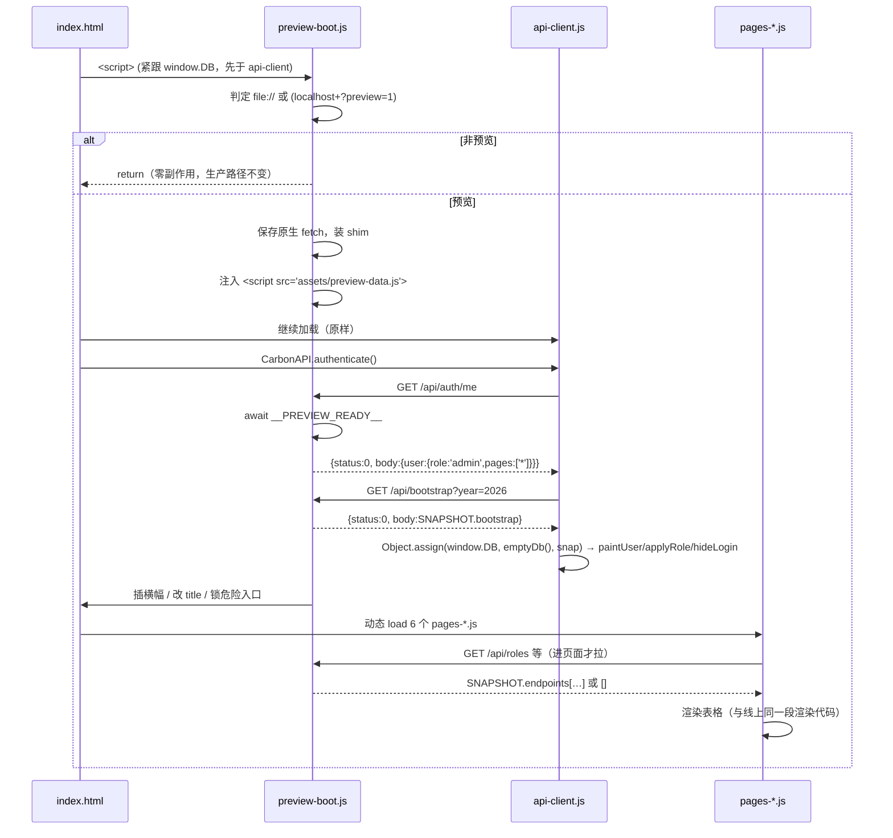
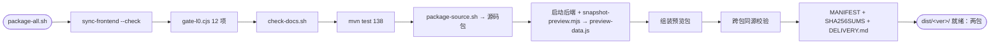
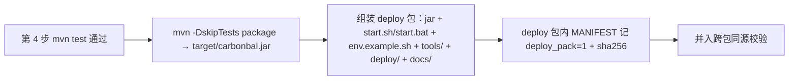
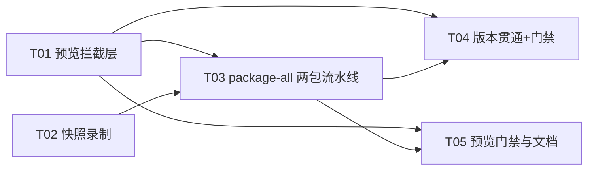

# 交付打包与静态预览方案

> 版本：对应 `carbonbal-web/VERSION` = 1.0.1　状态：**方案（待拍板）**
> **v2（2026-11-27）：按客户决定取消默认制品包，改为 `--with-deploy` 可选**
> 目标读者：客户决策人（技术负责人 + 业务负责人）、实施工程师
> 一句话：**同一次打包，产出两个包**——源码部署包（给甲方 IT 自行构建、审计、接手）+ 静态预览包（给业务人员双击就看，不装任何环境）；可运行制品包降级为**默认关闭的可选开关** `--with-deploy`，只在甲方明确需要时一条命令加上。

**客户决策（本方案的前提，不再讨论）**

1. **不交付可运行制品包**：甲方按源码自行构建部署。理由：减少交付物数量、去掉 ~37MB 大文件带来的分发成本（邮件发不出、网盘/U 盘周转），且甲方有自己的构建流水线与安全审查，jar 反而要额外过一遍来源审计。
2. **但必须保留"按需出包"的能力**：如果甲方现场无外网、无 Maven，或明确要求"给个 jar 直接跑"，一条命令能加上制品包 —— 即 `package-all.sh --with-deploy`。**这是本方案的关键平衡点**：默认不产出，但能力不能删，且必须写清"什么情况下必须打开它"（见 §2.5）。

---

## 0. 结论摘要

| 问题 | 结论 |
|---|---|
| 现在为什么双击看不了 | 前端 100% 依赖后端。`index.html` 启动就调 `GET /api/auth/me`，`file://` 下 `fetch` 直接被浏览器拒绝 → 走 `showLogin()` → 停在登录页 |
| 怎么解 | **不改业务代码**，新增 1 个前端文件 `assets/preview-boot.js`：在 `file://` 下把 `window.fetch` 换成本地快照应答，登录、首屏数据、41 个菜单全部照常跑通 |
| 为什么只拦 `fetch` 就够 | 全部网络出口只有两处：`api-client.js` 里的 `request()` 和 `download()`，两者都走 `fetch`；且 `authenticate()` 走的是**闭包内部**的 `request`，从外部改 `CarbonAPI.request` 拦不到 → `fetch` 是唯一可靠拦截点 |
| 数据从哪来 | 打包时用 Playwright 录一遍真实前端（复用 `ui-flows.cjs` 的登录与导航能力），把 22 个 GET 接口的真实响应录成 `assets/preview-data.js`（`window.__PREVIEW_SNAPSHOT__=...`，`<script>` 注入，不用 fetch） |
| 预览能写吗 | 推荐**只读**：写操作返回"演示模式"提示。内存 CRUD 留 P2 |
| 预览包会污染生产吗 | 不会。激活条件是 `file://` 协议（生产永远不是）+ localhost 白名单调试开关；生产 `/app/` 下这段代码 100% 短路 |
| 打几个包 | **两个包 + 一个交付目录**：源码部署包（zip 1.6MB / tar.gz 1.4MB，已有能力）+ 静态预览包（~0.3MB）；交付总目录 `dist/<ver>/` 汇总两包 + `DELIVERY.md` + `SHA256SUMS` |
| 制品包呢 | 改为 `--with-deploy` **可选**，默认不产出。甲方按源码自行构建部署（Docker Compose 或 `mvn package` 两条路径，见 §2.4） |
| 工作量 | P0 = 2×M + 2×S；P1 = 2×S（版本贯通 + 预览门禁）；P2 = 1×L + 2×M |

---

## 1. 现状与约束（已核实，不再调研）

### 1.1 交付物现状

| 项 | 实测值 |
|---|---|
| 版本单一来源 | `carbonbal-web/VERSION` = `1.0.1`；`platform/tools/lib-facts.sh` 读取并导出 `FACTS_*` |
| 现有源码包 | `dist/carbonbal-1.0.1.zip` 1.6MB / `.tar.gz` 1.4MB，由 `platform/tools/package-source.sh` 产出 |
| 包内同源校验 | VERSION / flyway / 迁移数 / 测试类数 / 用例数 / main 源文件数，全部由 `lib-facts.sh` 实时计算，并对**暂存区**再算一遍交叉校验，不一致 `exit 1` |
| 前端 | `carbonbal-web/`，**零构建**、纯 `<script src>`、hash 路由；`assets/` 476KB，`index.html` 15.8KB |
| 前端产物 | `platform/backend/src/main/resources/static/app`，由 `platform/tools/sync-frontend.sh` 同步，`--check` 做漂移校验 |
| 后端 | Spring Boot 3.2.5 + MyBatis-Plus + Flyway（116 / 34 个迁移），dev=H2、prod=MySQL，端口 8088，静态入口 `/app/` |
| 构建 | `platform/backend/pom.xml` 单模块，`mvn package` → `target/carbonbal.jar`（`finalName=carbonbal`）；JDK 17 + Maven 3.9 |
| 部署物料（在源码包内） | `platform/deploy/`（`Dockerfile` 多阶段构建 / `docker-compose.yml`（含 MySQL 8 + 健康检查）/ `nginx.conf` / `nginx-https.conf` / `gen-secret.sh` / `gen-selfsigned.sh`）+ `platform/backend/tools/`（smoke / monitor / backup / restore / inspect / data-check / run-prod） |
| 文档 | `platform/docs/` 12 份活文档 + `HANDOVER.md`（打包时改名为 `README.md`） |

> 注意：`platform/deploy/` 的 compose 用 `build: context: ..`，即 **在 `platform/` 目录下执行**，容器内完成 Maven 构建（宿主机只装 Docker，不装 JDK/Maven）。

### 1.2 前端加载与网络事实（决定方案形态的硬约束）

1. `index.html` 的脚本顺序：`window.DB` 空骨架 → `api-client.js` → `menu.js` → `framework.js` → `topbar.js` → 内联 `initApp` → 内联 boot（`await CarbonAPI.authenticate()` → 动态 `load()` 6 个 `pages-*.js` → `initApp()`）。
2. 全部业务网络请求集中在 `api-client.js`：`request(method,path,body)`、`download(path,silent)`。其它页面文件里**没有裸 `fetch`**（已 grep 确认）。
3. 数据入口只有一个：`load()` 里 `GET /api/auth/me` + `GET /api/bootstrap?year=<年>`，然后 `Object.assign(window.DB, emptyDb(), snap)`。
4. 登录：`authenticate()` 失败即 `showLogin()`，页面被 `#auth-mask` 遮住。`hideLogin()` 给 `body` 加 `.authed`。
5. `/api/bootstrap` 只返回 19 个键（`org/products/suppliers/footprint/assets/facilities/devices/alertRules/alertRecords/warningEvents/reports/accounting/accountingLines/kpi/monthly/todos/energyMix/quota`，且按页面权限裁剪）；`prodValue / totalValue / ccers / trades / evidences / thirdReports / deviceData / energyMgmt / retrofits` **不在快照里**，由各页面进入时单独 GET。→ 只录 `/bootstrap` 是不够的，必须录全部 GET。
6. 前端实际只用 **22 个 GET 路径**（含 `/auth/me`、`/bootstrap`），写操作调用点 89 处（POST 55 / PUT 21 / DELETE 13），下载 9 处、**全部**经 `CarbonAPI.download`（`exportResource` 走内部 `download`）。
7. 角色影响渲染：`UI.state.role = me.role === 'admin' ? 'admin' : 'operator'`；非 admin 会被 `lockWrites()` 摘掉删除按钮。→ 预览必须以 **admin** 身份进入，否则界面上"演示"要少一大块。
8. `licenseRemainDays` 为数字且 ≤30 时会出现"授权将到期"横幅；`passwordExpireInDays` 为数字时会提示改密。→ 预览的 `/auth/me` 必须**不带**这两个字段。
9. `file://` 下：`fetch`/`XHR` 一律被拦（CORS `origin: null`）、Service Worker 不可用、`type="module"` 被视为跨域脚本而拒绝；但 `<script src>` 动态注入**可用**（现有 `load()` 就是这么干的），`location.search` 可读。

### 1.3 已有质量门禁（方案必须复用）

| 门禁 | 内容 | 与本次方案的关系 |
|---|---|---|
| `carbonbal-web/tools/gate-l0.cjs` | 12 项：必填文件 / JS 语法(`node --check`) / 菜单→路由 / 图标 / 无原生弹窗 / **index 本地引用存在(F06)** / 关键数据集 / DOM id 唯一 / 字号阶梯 / 菜单唯一 / **mock 残留 + 体积 ≤2MB(F11)** / XSS 断言 | 新文件必须过 F02/F06/F11；**F11 有体积上限 2MB 与 4 条禁用语**（详见 `gate-l0.cjs`），快照数据文件因此**不能**放进 `carbonbal-web/assets/` |
| `platform/tools/sync-frontend.sh --check` | 前端源码 = 后端产物 | 保持不变，流水线第一步就跑 |
| `platform/backend/tools/check-docs.sh` | 活文档旧口径黑名单 + 事实断言 | 本文件**不登记**进 `FILES`（登记会要求它含事实断言，反而脆弱） |
| `mvn test` / `tools/smoke.sh` / `tools/e2e.sh` / `tools/functional-cases.py` / `ui-flows.cjs` | 138 条测试、9 项冒烟、端到端 | 流水线复用 `mvn test` + `smoke.sh`；`ui-flows.cjs` 的登录/导航代码**直接复用**给快照录制器 |

---

## 2. 产物矩阵

### 2.1 两个包 + 一个交付目录：给谁、装什么、多大、怎么起

| # | 包 | 给谁 | 装什么 | 体积（估） | 怎么启动 | 验收一句话 |
|---|---|---|---|---|---|---|
| A | `carbonbal-<ver>.zip` / `.tar.gz`<br>**源码部署包** | 甲方 IT / 审计 / 后续接手开发商 | 前端源码 + 后端源码 + 34 个迁移 + 测试 + `platform/deploy/`（Dockerfile/compose/nginx/密钥脚本）+ 运维脚本 + 全量文档（= 现有包，不动） | zip 1.6MB<br>tar.gz 1.4MB | ① `docker compose up -d`<br>② `mvn package` → `java -jar`（见 §2.4） | `mvn test` 138 条全绿；任一路径能从零构建出可运行系统并登录 |
| B | `carbonbal-<ver>-preview.zip`<br>**静态预览包** | 甲方业务人员 / 领导 / 售前 | `index.html` + `assets/*`（含 `preview-boot.js` + 录制的 `preview-data.js`）+ `README.txt` | ~0.3MB | **双击 `index.html`** | 双击后 3 秒内看到首页 KPI 与 41 个菜单，顶部有"演示模式"横幅 |
| C | `dist/<ver>/`<br>**交付总目录** | 交付负责人 | A 的 zip + tar.gz、B 的 preview zip、`DELIVERY.md`（一页纸：两包怎么用、部署路径二选一）+ `SHA256SUMS`（全部交付物的校验和）+ 两包同源核对结果 | — | — | 一个目录递出去，甲方不用问"哪个是哪个" |

> 制品包（jar）不在默认交付物里。需要时按 §2.5 用 `--with-deploy` 生成，产物落在同一个 `dist/<ver>/` 下。

### 2.2 包内目录树（顶层）

**A. 源码部署包**（现有结构，仅新增 2 行，见 §5）

```
carbonbal-1.0.1/
├─ README.md                  ← HANDOVER.md 改名（含"两个包怎么选"一节）
├─ VERSION / MANIFEST.txt / SHA256SUMS
├─ carbonbal-web/
│  ├─ index.html
│  ├─ assets/                 ← 新增 preview-boot.js（1 个文件）
│  ├─ docs/  tools/  AGENTS.md
└─ platform/
   ├─ backend/ (pom + src + tools + docs)
   ├─ deploy/  (Dockerfile, docker-compose.yml, nginx×2, gen-secret.sh, gen-selfsigned.sh)
   ├─ docs/    (含本方案)
   └─ tools/   (lib-facts.sh, package-source.sh, package-all.sh ← 新增)
```

**B. 静态预览包**

```
carbonbal-1.0.1-preview/
├─ index.html                 ← 与源码逐字节相同（打包时 sha256 校验）
├─ README.txt                 ← ASCII 文件名，中文内容（避免老解压工具乱码）
├─ MANIFEST.txt               ← 含 snapshot_at / snapshot_org / preview_endpoints
└─ assets/
   ├─ app.css  menu.js  framework.js  topbar.js  api-client.js  account.js
   ├─ pages-core.js  pages-generic.js  pages-system.js  pages-platform.js  pages-group.js
   ├─ preview-boot.js         ← 新增的拦截层（约 10KB）
   └─ preview-data.js         ← 打包时生成：window.__PREVIEW_SNAPSHOT__=…（≤1.5MB）
```

### 2.3 `dist/` 布局

```
dist/1.0.1/
├─ carbonbal-1.0.1.zip              A 源码（Windows 友好）
├─ carbonbal-1.0.1.tar.gz           A 源码（Linux 保留权限）
├─ carbonbal-1.0.1-preview.zip      B 预览
├─ DELIVERY.md                      交付说明（ASCII 名，中文内容）
└─ SHA256SUMS                       A + B + DELIVERY.md 的校验和
```

`--with-deploy` 时额外多出（可选）：

```
├─ carbonbal-1.0.1-deploy.zip       可选：制品包（约 37MB）
```

### 2.4 源码包怎么部署（甲方 IT 的两条路径）

源码包里 `platform/deploy/` 已经自带 Dockerfile + docker-compose.yml + nginx 配置，`platform/backend/tools/` 自带运维脚本，所以两条路径都能走，**按甲方现场环境二选一**。

**路径 ① Docker Compose（推荐：甲方只需装 Docker，不需要 JDK/Maven）**

```bash
# 1) 前置检查：Docker 24+ 与 Compose v2
docker --version && docker compose version

# 2) 解压并进入 platform/（compose 的 build context 是 platform/，必须在这层执行）
cd carbonbal-1.0.1/platform

# 3) 生成密钥并注入环境（64 位随机 JWT_SECRET，写入 .env.production，权限 600）
bash deploy/gen-secret.sh .env.production
export JWT_SECRET="$(grep '^JWT_SECRET=' .env.production | cut -d= -f2)"

# 4) 起 MySQL 8 + 应用（首次会拉 3 个镜像并在容器内做 Maven 多阶段构建）
docker compose -f deploy/docker-compose.yml up -d --build

# 5) 等 Flyway 跑完 34 个迁移
docker compose -f deploy/docker-compose.yml logs -f app | grep -m1 "Successfully applied"
```

预期结果：`docker compose ps` 两个容器 `healthy`；`curl -s localhost:8088/api/health` 返回 `{"status":0,"body":{"status":"UP","db":"UP",…}}`；浏览器 `http://<host>:8088/app/` 可用 `13800000001` 登录看到 41 个菜单。
**前置条件**：首次构建需外网（镜像仓库 + Maven 中央仓库）。纯内网现场见 §7 第 1 条风险。

**路径 ② 源码 `mvn clean package` + `java -jar`（需要 JDK 17 + Maven 3.9 + 外网依赖）**

```bash
# 1) 前置检查：JDK 17 与 Maven 3.9
java -version && mvn -v

# 2) 构建（首次需外网拉依赖；内网请预置 ~/.m2 或走 -o 离线仓库）
cd carbonbal-1.0.1/platform/backend && mvn -q clean package    # → target/carbonbal.jar

# 3) MySQL 建库（deploy.md §2.1 的三句 SQL，utf8mb4 / utf8mb4_bin）

# 4) 生成 env 并启动
bash tools/gen-secret.sh env.sh    # 生成 JWT_SECRET，手工补 DB_PASSWORD
bash tools/run-prod.sh             # = java -jar target/carbonbal.jar --spring.profiles.active=prod

# 5) 验证
curl -s localhost:8088/api/health && bash tools/smoke.sh
```

预期结果：日志出现 `Successfully applied … migration` 与 `Started CarbonBalApplication in N s`；`/api/health` 为 `UP`；`smoke.sh` 9 项全过。

| 对比项 | 路径 ① Docker Compose | 路径 ② mvn + java -jar |
|---|---|---|
| 甲方需要装什么 | Docker（含 Compose v2） | JDK 17 + Maven 3.9 + MySQL 8 |
| 构建在哪发生 | 容器内（宿主机不需要 JDK/Maven） | 宿主机 |
| 首次是否需要外网 | 需要（镜像 + Maven 依赖） | 需要（Maven 依赖） |
| 数据库 | compose 自带 MySQL 容器（数据卷持久化） | 甲方自备 MySQL 8 |
| 适合场景 | 推荐默认；甲方有 Docker 即可 | 甲方有现成 Maven 流水线 / 已有 MySQL 实例 |

### 2.5 可选：`--with-deploy` 产物（默认关闭）

`bash platform/tools/package-all.sh --with-deploy` 会在两包之外额外产出 `carbonbal-<ver>-deploy.zip`（约 37MB）：`carbonbal.jar` + `start.sh` / `start.bat` + `env.example.sh` + 运维 7 件套 + `deploy/` + `deploy.md` / `release-and-rollback.md` / `user-manual.md` + 一页纸 `README.md`；包内 `MANIFEST.txt` 记 `deploy_pack=1`。**以下情况必须打开它**：

1. 甲方现场**无外网且无 Maven 私服**（`mvn package` 与 compose 容器内构建都会失败）；
2. 甲方**没有 Docker 也没有 JDK/Maven**，只想要"一个文件直接跑"；
3. 甲方安全审查要求"交付即固定二进制"，源码构建结果需与交付物逐字节一致；
4. 我方需要留一份**同版本可复现的二进制基线**用于事后比对（回滚/取证）。

不打开的场景：甲方有 Docker 或标准 Maven 构建能力（覆盖大多数情况）——此时出 jar 只是增加 37MB 分发负担与一份需要单独审计的二进制。
内置 JRE 只在甲方明确要求"连 JDK 都不想装"时才考虑（体积 37MB → ~220MB，且仍需 MySQL），默认不做。

---

## 3. 预览模式技术设计（重点）

### 3.1 激活判定 —— 「推荐 / 备选」

| 方案 | 判定条件 | 结论 |
|---|---|---|
| **推荐** | `location.protocol === 'file:'`<br>**或**（`?preview=1` **且** `hostname ∈ {localhost, 127.0.0.1, ::1}`） | 双击 = `file:`，天然成立且用户不可伪造（生产走 https，`file:` 永假）；localhost 分支给工程师在 dev 环境联调预览层用，生产 hostname 不可能是 localhost |
| 备选 1 | 只用 `?preview=1` | **否决**。生产环境 `/app/?preview=1` 会给出演示数据，属于"数据造假"级风险，审计/对账场景不可接受 |
| 备选 2 | 独立入口 `preview.html` | **否决**。要么复制一份 `index.html`（两份真源，长期必漂移），要么变成一个 3 行转发页 → 不如在 `index.html` 里加 1 行 `<script>` |
| 备选 3 | 打包时往 `index.html` 注入 `window.__PREVIEW_BUILD__=true` | 留作 **P2**：唯一用途是"预览包放到内网 http 服务器也能演示"。代价是预览包的 `index.html` 与源码不再逐字节相同（破坏现在这条硬同源不变量），且 `gate-l0` 检查的是源码而非包内文件，注入版逃过门禁 |

### 3.2 拦截层放在哪 —— 为什么必须是新文件 + `fetch`

**关键事实**：`authenticate()` → `load()` → 内部闭包里的 `request()`。`saveListPage()`、`deleteRow()`、`exportResource()` 同理。**从外部包装 `window.CarbonAPI.request` 拦不到这些内部调用**。

因此只有一个可靠拦截点：**`window.fetch`**。而 `fetch` 必须在 `api-client.js` 执行**之前**被替换（它虽在调用时才用 `fetch`，但 `api-client.js` 一加载就把 `body.classList.add('platform')` 并绑定登录壳，越早装越好）。

**最小侵入方案（推荐）**

- 新增**唯一**文件 `carbonbal-web/assets/preview-boot.js`（IIFE，普通 script，禁止 `type=module`）。
- `index.html` 改动：**1 行** —— 紧跟 `window.DB` 之后、`api-client.js` 之前插入
  `<script src="assets/preview-boot.js?v=1.0.1"></script>`（`?v=` 由 F13 强制等于 `VERSION`，见 §4.4）。
- `api-client.js`：**零改动**。

```
window.DB 空骨架
  ↓
preview-boot.js   ← 非 file:// 直接 return（生产零副作用）；file:// 则装 fetch shim + 异步拉 preview-data.js
  ↓
api-client.js     ← 原样
  ↓
authenticate() → request('/auth/me') → fetch shim → 本地快照（无需网络）
```

**否决的备选**：直接改 `api-client.js` 的 `authenticate/request/download` 三个函数。理由：① `authenticate` 内部的 `load()` 无法从外部替换，改动会扩散到 `load/afterLogin/clearAuth` 并牵扯 `mustChangePassword` 分支；② 把"演示逻辑"塞进生产主链路，此后每次改 `request` 都要考虑预览分支，是长期负债；③ 现有 `gate-l0` 的 XSS/语法断言覆盖面会变，回归面变大。

### 3.3 拦截契约（URL → 应答）

shim 返回标准 `Response` 对象（`new Response(JSON.stringify(payload), {status:200, headers:{'Content-Type':'application/json'}})`），信封与后端完全一致：`{status:0, body:...}`。

| 请求 | 应答 | 说明 |
|---|---|---|
| `GET /api/auth/me` | `{status:0, body:{ user:{ id:1, userId:1, displayName:'演示管理员', username:'13800000001', orgId:1, orgName:'演示企业（华东精密制造）', role:'admin', pages:['*'], mustChangePassword:false }, tenants:[], currentOrgId:1, role:'admin', permissions:[] }}` | 必须 `role:'admin'`（否则 `lockWrites()` 摘掉删除按钮）、`pages:['*']`（41 个菜单全出）；**必须不带** `passwordExpireInDays` / `licenseRemainDays`（否则误弹到期/改密横幅）。手机号用 `13800000001`：它是 `deploy.md`/`HANDOVER.md` 里公开的演示账号，不构成泄露 |
| `GET /api/auth/captcha` | `{status:0, body:{enabled:false}}` | 登录壳根本不会显示，但 `showLogin` 的兜底路径会调它 |
| `GET /api/bootstrap?year=YYYY` | `{status:0, body: SNAPSHOT.bootstrap}` | 键集合与后端一致 |
| 其它 `GET` | 查 `SNAPSHOT.endpoints`，键 = `path + '?' + 排序后的 query`；**命中不到时按 path 前缀回退**；仍不中则返回 `{status:0, body:[]}` 并 `console.warn('[preview] 未录制：', url)` 且计数 | 22 个 GET 前缀、带筛选/分页参数，故需"精确 → 前缀 → 空数组"三级回退 |
| `POST/PUT/DELETE/PATCH`（含 FormData） | `{status:'PREVIEW_READONLY', body:{message:'演示模式：数据只读，不能保存'}}` | `request()` 见 `status!==0` 即抛错，页面自身的 `try/catch` 会 toast 出这句话。已确认页面**没有**依赖 `err.code` 的分支逻辑 |
| `GET` 下载类路径 | 200 + `text/plain; charset=utf-8` 占位正文 + `Content-Disposition: attachment; filename*=UTF-8''…txt` | 由 shim 在 `download()` 的原始 `fetch` 上兜住 |
| 非 `/api/` 请求 | 透传原生 `fetch`（file:// 下会失败，属预期） | 便于将来加 CDN 资源 |

### 3.4 数据从哪来 —— 录制式快照（推荐）

**为什么不只录 `/bootstrap`**：§1.2 第 5 条已证实 `/bootstrap` 只覆盖 19 个键，`prodValue / totalValue / ccers / trades / evidences / thirdReports / deviceData / energyMgmt / retrofits` 全部靠各页面进入时单独 GET。只录 bootstrap 的结果是：首页好看，点开"产品产值""交易管理""原始凭证"全是空表 + 报错。

| 方案 | 做法 | 结论 |
|---|---|---|
| **推荐：浏览器录制** | `platform/tools/snapshot-preview.mjs`：复用 `carbonbal-web/tools/ui-flows.cjs` 的 Chrome 启动 + SVG 验证码解码 + 登录逻辑 → 以 `13800000001`（租户管理员）登录 → 逐个访问 `MENU` 里 41 条 path，每个页面等 `networkidle` → `page.on('response')` 拦截所有 `/api/` 的 **GET 200**，按归一化键写入 map | ① 录到的就是真实前端真实会发的 URL（含 year/period/分页参数），零猜测；② 天然覆盖"进页面才拉"的接口；③ 产出**覆盖率报告**（页面 41/41、接口 N 个），可写进 MANIFEST 做验收口径 |
| 备选：静态扫描 + 逐接口拉取 | grep 出 22 个 GET 前缀，用 Python 逐个调真实后端 | 便宜但没覆盖参数化变体（`?year=`、`?period=`、`?page=`）；只有 22 个前缀看着像够用，实际筛选/翻页请求全部落空 |

**产出格式**（`preview-data.js`，必须是可被 `<script>` 执行的文件，不能是 JSON）：

```js
/* 自动生成，勿手改。来源：演示租户快照，生成时间见 MANIFEST.txt */
window.__PREVIEW_SNAPSHOT__ = {
  meta: { version: '1.0.1', snapshotAt: '2026-11-27T16:30:00+08:00',
          orgId: 1, orgName: '演示企业（华东精密制造）',
          pages: '41/41', endpoints: 38, masked: true },
  bootstrap: { org:{…}, kpi:{…}, quota:{…}, … },
  endpoints: {
    'GET /api/accounting-periods': …,
    'GET /api/alert-records?page=1&size=20&status=open': …,
    'GET /api/roles': …
  }
};
```

**加载方式**：shim 内部 `document.createElement('script')` 注入 `assets/preview-data.js`（带同版本 `?v=<ver>` 仅作缓存失效，不参与同源校验），存 `window.__PREVIEW_READY__`（Promise）；`fetch` handler 内部 `await __PREVIEW_READY__`，因此**与 `index.html` 现有 boot 顺序无关**，不需要改 boot。

**什么时候跑**：
- **打包时**（推荐，`package-all.sh` 的一个步骤）：保证快照与出包代码同版本、同时点；失败即中断，绝不产出"假预览包"。
- 手动：`node platform/tools/snapshot-preview.mjs --base http://localhost:8088 --out /tmp/preview-data.js`，用于改前端后单独验证。
- 逃生口：`package-all.sh --allow-stale-preview` 复用上次快照，但 MANIFEST 必须写 `snapshot_stale=1` + 上次时间戳。

### 3.5 脱敏与裁剪

**脱敏（硬规则，脚本内置，不可关）**

| 字段 | 处理 | 正则 |
|---|---|---|
| 手机号 | 中间四位掩码 `138****0001` | `\b(1[3-9]\d)\d{4}(\d{4})\b` |
| 邮箱 | 用户名首尾保留 `c***n@example.com` | `([\w.+-])[\w.+-]*(@[\w.-]+)` |
| 身份证 / 统一社会信用代码 | 保留前 4 后 4 | `\b([0-9A-Z]{4})[0-9A-Z]{8,10}([0-9A-Z]{4})\b` |
| 姓名 | 保留姓：`陈**` | 仅作用于 `userName/displayName/adminName/contact` 等已知键 |
| JWT / token / 密码 | 直接删除键 | `token\|password\|secret\|csrf` |
| 真实企业名 | 默认只允许从**演示租户**导出（`--org` 白名单，默认 `orgId=1`）；非白名单拒绝执行 | — |

**裁剪（体积与"未完成状态"双重目的）**

- 每个列表最多保留 **前 20 行**（演示够用，翻页另存 1~2 页）；
- 丢弃 `accountingLines`（可能上万行）、`audit-logs` 全量（只留前 20）、`deviceData` 保留最近 30 条；
- 丢弃所有 `*Raw` / `*Blob` / base64 字段（附件正文）；
- **硬上限 1.5MB**：超限时按"列表长度 > 图表 > 明细"顺序继续裁，并在 MANIFEST 写 `preview_trimmed=1` + 裁剪清单。

体积预估：演示租户 91 份报告 / 24 条读数 / 41 个页面的列表数据，JSON 约 0.6–1.2MB（裁剪后），`preview-data.js` gzip 后约 100KB → 预览包 zip ≈ 0.3MB，解压 ≈ 1.1MB，`file://` 首次打开 < 1 秒。

> 注意：`preview-data.js` **绝不能**放进 `carbonbal-web/assets/` 常驻——`gate-l0` 的 F11 对 `index.html + assets/*.js|css` 有 2MB 总上限，且它会被 `sync-frontend.sh` 复制进后端产物、进源码包。它只存在于预览包的暂存目录（`<OUT>/.tmp_preview/`）。

### 3.6 写操作策略 —— 「推荐 / 备选」

| 方案 | 体验 | 实现代价 | 风险 |
|---|---|---|---|
| **A. 只读（推荐，P0）** | 点"新增/保存/删除"→ toast「演示模式：数据只读，不能保存」；删除按钮仍可见可点（提示更直观），但不改数据 | **S**：shim 一层判断即可，0 业务改动 | 客户可能觉得"点了没反应"→ 用横幅 + 首次点击时一次性 toast 说清 |
| B. 内存 CRUD（P2） | 可新增/编辑/删除，刷新还原，体验最完整 | **L**：要在 shim 里实现 22 个 GET + 55 POST + 21 PUT + 13 DELETE 的语义（含幂等键、并发版本 `version` 校验、状态机流转），等于重写一遍后端；且必然与真实后端行为逐渐漂移 | 演示"能改"会让客户误判为可用系统；维护成本高 |

**结论**：P0 走 A。理由不是"省事"，而是 **B 的正确性无法保证**——`saveListPage` 里有大量字段校验与状态机前置条件在后端，前端 mock 只能猜，猜错就是"演示能过、上线失败"，比不能写更糟。若客户坚持要"能改"，建议改走 B 的**窄版本**：只让 3~5 个最常被问的页面（产品列表、设备、预警规则）支持内存新增/删除。

> 提示文案的落点（已核实）：`saveListPage`/`deleteRow` 的 `catch` 会 `toast('err', e.message)`，所以"演示模式：数据只读，不能保存"能直接显示；但 `deleteRows`（批量删除）是**逐条 try/catch 吞错**，只会汇总成"失败 N 条"，因此预览包里建议额外给批量删除按钮加一次 toast 说明（1 行代码，或在 shim 里对 `DELETE` 额外弹一次）。

### 3.7 下载策略（PDF / 导出 / 模板 / 附件）

9 处下载点全部经 `CarbonAPI.download`（`exportResource` 走内部 `download`），所以在 shim 的 `fetch` 层统一处理：

| 类型 | 路径 | P0 处理 | P2 增强 |
|---|---|---|---|
| 报告 PDF | `/reports/{id}/download`、`/reports/bundle` | 下载一个 `演示模式-报告占位.txt`，正文含"正式部署后可下载 PDF 原文"，并 toast 提示 | 生成一页极简 PDF（内嵌 ~1KB 的最小 PDF 模板） |
| 台账导出 | `/export?resource=…`、`/users/export` | 同上（`.txt`） | **从 `window.DB` 真生成 CSV**（中文表头 + BOM，Excel 直接打开）——这个性价比很高，建议 P2 优先做 |
| 导入模板 | `/import/template`、`/users/import-template` | 同上（`.txt`） | 生成真 CSV 模板 |
| 附件 | `/files/{id}/download` | 同上（`.txt`） | 保持 `.txt` |

原则：**绝不返回"坏文件"**（返回 .pdf 扩展名但内容是文本，双击打不开，比不下载更糟）。占位文件统一用 `.txt`，文件名用 `Content-Disposition` 控制，中文走 `filename*=UTF-8''`。

### 3.8 视觉标识与危险入口封锁

| 项 | 做法 | 触发时机 |
|---|---|---|
| 顶部横幅 | 在 `#view` 之前插入 `<div id="preview-banner">`（与现有 `#license-banner` 同位置同套路）：`演示模式 · 数据为 <snapshotAt> 快照 · 不可写入` | shim 应答首个 `/bootstrap` 后 `setTimeout(…,0)`，并在 500ms 后再断言一次（幂等，防 DOM 未就绪） |
| `document.title` | `【演示】能碳管理平台` | 同上 |
| 侧栏状态 | `#side-mode` 文本改 `演示模式`（原为"实时数据"） | 同上 |
| 修改密码 / 换绑手机 / 切换企业 / 退出登录 | 用 `onclick` 覆盖（`initApp` 已绑过，覆盖是后手），点击 → toast「演示模式不支持该操作」 | 同上（须晚于 `initApp`） |
| 数据时点 | hover 横幅显示 `snapshot_org` / `endpoint 覆盖率` / 未录制接口清单 | 同上 |
| 登录壳 | 不显示：`/auth/me` mock 成功 → 内部 `hideLogin()` 自动加 `.authed`，`#auth-mask` 保持 `hide` | 天然 |

### 3.9 启动时序



### 3.10 边界情形（必须显式处理）

| 情形 | 表现 | 处理 |
|---|---|---|
| `preview-data.js` 缺失/404 | `window.__PREVIEW_SNAPSHOT__` 为 `undefined` | 横幅改红：「预览数据缺失，请使用完整预览包」；`/auth/me` 返回最小 admin 让界面不至于白屏；不静默降级成登录页 |
| 某接口未录制 | 表格空 | `console.warn` + 横幅计数「N 个接口未纳入快照」，不报错弹窗 |
| 直接双击 `carbonbal-web/index.html`（源码目录，无数据文件） | 同上第一条 | 属预期，会在横幅里说清"请用 -preview 包" |
| 预览包被放到 http 服务器 | `file:` 为假 → 走真实 API → 停在登录页 | `README.txt` 首行写明"必须双击打开"；P2 提供 `serve-preview.sh` + 构建标记 |
| 用户开 `?preview=1` 看生产 | 非 localhost → 不激活 | 三重保险：协议 + hostname + 无数据文件 |
| 页面里存在未走 `CarbonAPI` 的网络调用 | 会真的打网络 | 已 grep 确认 0 处；新增门禁 F14（见 §5）常驻守护 |

---

## 4. 一键打包流水线

### 4.1 入口命令

```bash
bash platform/tools/package-all.sh                  # 默认：门禁 → 源码包 → 快照 → 预览包（两包）
bash platform/tools/package-all.sh dist/1.0.1       # 指定输出目录（默认 dist/<VERSION>）
bash platform/tools/package-all.sh --only preview   # 只重打预览包（改前端后快速迭代）
bash platform/tools/package-all.sh --skip-tests     # 逃生口（MANIFEST 记 tests=skipped）
bash platform/tools/package-all.sh --allow-stale-preview   # 复用上次快照（MANIFEST 记 snapshot_stale=1）
bash platform/tools/package-all.sh --with-deploy    # 可选：额外产出可运行制品包（jar，~37MB）
```

参数与 `package-source.sh` 保持同名同义（第一个位置参数 = 输出目录），工程师不用记两套。**默认行为不含制品包**——这是客户决策的落地位置。

### 4.2 默认步骤（两个包）



| 步 | 命令 | 失败含义 |
|---|---|---|
| 1 | `bash platform/tools/sync-frontend.sh --check` | 前端源码与后端产物漂移，先 `sync-frontend.sh` |
| 2 | `node carbonbal-web/tools/gate-l0.cjs` | 静态门禁（12 项 + F13/F14）未过，禁止出包 |
| 3 | `bash platform/backend/tools/check-docs.sh` | 活文档口径与源码事实不一致 |
| 4 | `cd platform/backend && mvn -q test` | 138 条断言未过（`--skip-tests` 可跳过，但 MANIFEST 会留痕） |
| 5 | `bash platform/tools/package-source.sh "$OUT"` | 复用现有脚本，内含它自己的同源交叉校验 → 源码包就绪 |
| 6 | `bash platform/backend/tools/run-prod.sh`（dev/H2 亦可）+ `node platform/tools/snapshot-preview.mjs` | 快照失败 = 不出预览包（不产假包） |
| 7 | 组装预览包（cp `index.html` + `assets/` + `preview-data.js` + `README.txt` + `MANIFEST.txt`） | — |
| 8 | 跨包同源校验（见 §4.6）+ 生成 `MANIFEST`/`SHA256SUMS`/`DELIVERY.md` | 任一不一致 → 中止 |

### 4.3 `--with-deploy` 开关行为（可选分支）



| 行为 | 默认 | `--with-deploy` |
|---|---|---|
| `mvn -DskipTests package` | **不执行** | 执行（复用第 4 步已通过的源码，不重复跑测试） |
| `dist/<ver>/carbonbal-<ver>-deploy.zip` | 不产出 | 产出（~37MB） |
| 包内 `start.sh` / `start.bat` / `env.example.sh` | 不产出 | 由 `platform/backend/tools/run-prod.sh` 复制改造（改 2 行：`target/carbonbal.jar` → `./carbonbal.jar`） |
| `MANIFEST` 字段 | `deploy_pack=0` | `deploy_pack=1` + `jar_sha256` |
| `RESULT:` 行 | 无 deploy 字段 | 追加 `deploy=37.2MB` |
| 何时必须打开 | — | 见 §2.5 四条（无外网/无 Maven、无 Docker 无 JDK、要求固定二进制、需二进制基线） |

### 4.4 版本号只改一处就贯通

**事实**：`index.html` 里 **11 处** `?v=1.0.1` 是硬编码的（css 1 处 + 4 个 `<script src>` + `load()` 内 6 处字符串，均已 grep 定位到行），改 `VERSION` 不会自动跟着变——这是当前**唯一**的版本贯通缺口。

**推荐方案（两层）**

1. **新增 `platform/tools/bump-version.sh <新版本>`**（S）：一处命令完成 `carbonbal-web/VERSION` + `index.html` 全部 `?v=` + `carbonbal-web/package.json` 的版本改写，打印 diff 供复核。
2. **新增门禁 F13**（并入 `gate-l0.cjs`，3 行）：`index.html` 中所有 `?v=X` 必须 **全部等于** `VERSION`，否则 FAIL 并指出行号。

于是版本贯通链条为：

```
carbonbal-web/VERSION  (唯一事实源)
   ├─ lib-facts.sh 读取 → FACTS_VERSION
   │     ├─ 源码包名        carbonbal-<ver>.zip / .tar.gz
   │     ├─ 预览包头目录    carbonbal-<ver>-preview/
   │     ├─ （可选）制品包  carbonbal-<ver>-deploy/   仅 --with-deploy
   │     ├─ 两包 MANIFEST.txt 的 version=
   │     ├─ dist/<ver>/ 目录名
   │     └─ preview-data.js 的 meta.version
   └─ index.html 的 ?v=<ver>  ← 由 F13 强制一致（bump-version.sh 一键改写）
```

MANIFEST 里的数字继续沿用现有规矩：**全部由 `lib-facts.sh` 实时计算**，并对包内暂存区再算一遍交叉校验，绝不硬编码。

**备选（否决）**：打包时 `sed` 改写 `?v=`。这样包内 `index.html` 与源码不一致，破坏"包内前端 = `carbonbal-web/` 逐字节相同"这条现有硬不变量，也让 `git diff` 之外的漂移无法被门禁发现。

### 4.5 失败即中断与产物约定

- 全脚本 `set -euo pipefail`；任一非 0 立即退出，**不留半成品**（每个包先在 `<OUT>/.tmp_<pkg>/` 组装，校验通过后才 `mv` 到最后位置）。
- 复用现有约定：`package-source.sh` 的暂存区是 `platform/.tmp_pkg`（已被 `.gitignore`），流水线顺序调用即可，**不允许并发跑两份**（脚本加 `flock` 或 pid 检查，一行）。
- 产物目录：`dist/<ver>/`（`.gitignore` 已忽略 `dist/`）。
- 每次运行末尾打印一行可粘贴的结论，格式与现有脚本一致（无 deploy 字段；`--with-deploy` 时自动追加）：

```
RESULT: OK  ver=1.0.1  source=1.6MB  preview=0.3MB  pages=41/41  endpoints=38  preview_bytes=1080KB
```

### 4.6 跨包同源校验（新增，且要"硬"）

既然对外宣称"同一份前端既部署又预览"，就必须让流水线自己证明：

| 校验 | 断言 |
|---|---|
| 预览包 `index.html` vs `carbonbal-web/index.html` | `sha256` 相同（除 §3.1 备选 3 的 P2 构建标记场景外，恒等） |
| 预览包 `assets/` vs `carbonbal-web/assets/` | 逐文件 `diff`，唯一允许多出 `preview-data.js` |
| `static/app` vs `carbonbal-web/` | 由第 1 步 `sync-frontend.sh --check` 保证（顺序在前，故此处只需记录 sha256） |
| （可选）制品包 `carbonbal.jar` 内 `BOOT-INF/classes/static/app` vs `carbonbal-web/` | `--with-deploy` 时校验，同样只记录 sha256（内容一致性已由第 1 步保证） |
| 两包 `VERSION` 与 `MANIFEST.version` | 全部等于 `FACTS_VERSION` |
| `preview-data.js` 的 `meta.version` | 等于 `FACTS_VERSION`（防止用旧快照配新前端） |

---

## 5. 与现有脚本／门禁的关系

| 对象 | 复用 | 新增 | 改一行 |
|---|---|---|---|
| `platform/tools/lib-facts.sh` | ✅ 全部复用（唯一事实源） | — | — |
| `platform/tools/package-source.sh` | ✅ 整脚本复用（`package-all.sh` 传输出目录调用它） | — | **不改**（保持现有同源校验逻辑独立可跑） |
| `platform/tools/sync-frontend.sh` | ✅ 复用（打包第一步） | — | — |
| `carbonbal-web/tools/gate-l0.cjs` | ✅ 12 项复用 | **F13 版本一致性**（`?v=` == VERSION）、**F14 网络出口唯一性**（`assets/*.js` 里除 `api-client.js`/`preview-boot.js` 外不得出现 `fetch(`/`XMLHttpRequest`） | 追加 2 个检查块，不改既有 12 项 |
| `platform/backend/tools/check-docs.sh` | ✅ 复用 | — | — |
| `platform/backend/tools/run-prod.sh` | ✅ 源码部署包内直接可用（路径 ② 用它启动） | — | **仅 `--with-deploy` 时**额外复制成制品包内 `start.sh`（改 2 行：`target/carbonbal.jar` → `./carbonbal.jar`） |
| `platform/deploy/`（Dockerfile / compose / nginx / gen-secret） | ✅ 随源码包交付，甲方按 §2.4 路径 ① 使用 | — | — |
| `carbonbal-web/tools/ui-flows.cjs` | ✅ 复用其 Chrome 启动 / 验证码解码 / 登录函数 | — | — |
| `HANDOVER.md` | ✅ 作为源码包 README | — | 加 1 节"两个包怎么选" |
| `platform/docs/deploy.md` | ✅ 留在源码包 `platform/docs/`，无需复制 | — | 补一节"从源码部署：Docker 与 mvn 两条路径"（与 §2.4 对齐） |
| — | — | `carbonbal-web/assets/preview-boot.js` | — |
| — | — | `platform/tools/snapshot-preview.mjs` | — |
| — | — | `platform/tools/package-all.sh`（含 `--with-deploy` 可选分支） | — |
| — | — | `platform/tools/bump-version.sh` | — |
| — | — | `platform/tools/check-preview.cjs`（P1：用 Playwright 开 `file://` 断言横幅/数据/无报错——把"双击能不能用"变成可回归的门禁） | — |
| — | — | `carbonbal-web/index.html` 加 1 行 `<script>` | — |

**明确不引入的东西**：不引入 webpack / vite / esbuild / babel / TypeScript / npm scripts 构建；前端仍然零构建、纯 `<script src>`。Node 只用于**门禁与录制**（它今天已经在用：`gate-l0.cjs`、`ui-flows.cjs`、`playwright-core`），不产出任何前端产物。快照脚本也可写成 Python（`reset_demo.py` 已有验证码解码实现）——二选一，推荐 Node 以复用 `ui-flows.cjs` 的登录与导航。

---

## 6. 甲方验收路径

### 6.1 源码包部署验收（部署方）

**路径 ① Docker Compose（推荐，约 10 分钟含构建；首次构建需外网）**

| # | 操作 | 预期结果 |
|---|---|---|
| 1 | `docker --version && docker compose version` | Docker 24+ / Compose v2.x；低版本先升级（`version:` 字段与健康检查依赖 v2） |
| 2 | 解压源码包，`cd carbonbal-1.0.1/platform && bash deploy/gen-secret.sh .env.production` | 生成 64 位 `JWT_SECRET`，`.env.production` 权限 600 |
| 3 | `export JWT_SECRET=…` → `docker compose -f deploy/docker-compose.yml up -d --build` | 拉 3 个镜像并在容器内完成 Maven 构建；`docker compose ps` 中 mysql/app 均为 `healthy`/`running` |
| 4 | 等 Flyway：`docker compose logs -f app \| grep -m1 "Successfully applied"` | 34 个迁移全部 apply，随后出现 `Started CarbonBalApplication in N s` |
| 5 | `curl -s localhost:8088/api/health` | `{"status":0,"body":{"status":"UP","db":"UP",…}}` |
| 6 | 浏览器 `http://<host>:8088/app/` → `13800000001` / `Admin@2026!Pass`；再 `bash platform/backend/tools/smoke.sh` | 进入首页，41 个菜单齐全，**无"演示模式"横幅**（证明走真后端）；smoke 9 项全过 |

**路径 ② `mvn clean package` + `java -jar`（约 8 分钟；需 JDK 17 + Maven 3.9 + MySQL 8 + 外网依赖）**

| # | 操作 | 预期结果 |
|---|---|---|
| 1 | `java -version && mvn -v` | `openjdk version "17.x"`、Maven 3.9+ |
| 2 | MySQL 建库（`deploy.md §2.1` 三句 SQL，`utf8mb4` / `utf8mb4_bin`） | `SHOW DATABASES;` 里有 `carbonbal` |
| 3 | `cd platform/backend && mvn -q clean package` | 产出 `target/carbonbal.jar`，BUILD SUCCESS（首次拉依赖需外网） |
| 4 | `bash tools/gen-secret.sh env.sh` → 填 `DB_PASSWORD` → `bash tools/run-prod.sh` | 日志出现 `Successfully applied … migration` + `Started CarbonBalApplication`，无 `JWT_SECRET` 报错 |
| 5 | `curl -s localhost:8088/api/health` + 浏览器登录 + `bash tools/smoke.sh` | `UP`；首页 41 个菜单；smoke 9 项全过（上线前清单见 `deploy.md §9`） |

### 6.2 预览包（业务人员，0 分钟、0 环境）

| # | 操作 | 预期结果 |
|---|---|---|
| 1 | 解压 `carbonbal-1.0.1-preview.zip`（任意目录，中文路径也可） | 得到 `carbonbal-1.0.1-preview/`，`index.html` 在**根层**（不用进子目录找） |
| 2 | **双击 `index.html`**（Chrome / Edge） | 3 秒内直接进入首页，**不出现登录页** |
| 3 | 看顶部 | 红色系"演示模式"横幅：`数据为 2026-11-27 快照 · 不可写入`；标题为`【演示】能碳管理平台` |
| 4 | 点侧栏任意菜单（41 个） | 页面正常渲染，表格有数据（已录制接口）；空表也不弹错误 |
| 5 | 点"新增/保存/删除" | toast：`演示模式：数据只读，不能保存` |
| 6 | 点"下载报告" | 下载到 `演示模式-报告占位.txt`，内容是中文说明（不是坏 PDF） |
| 7 | 断网后再双击 | 一切照旧（本来就不发网络请求） |

---

## 7. 风险与边界

| # | 风险 | 影响 | 缓解 |
|---|---|---|---|
| **1** | **甲方现场无外网 / 无 Maven / 无 Docker，源码包根本构建不起来** | 交付后甲方装不上，等于没交付 | ① **交付前先问清甲方的构建环境**（有没有 Docker、JDK 17+Maven、内网 Maven 私服/镜像仓库），写进 `DELIVERY.md` 的前置条件；② 若不具备 → 用 `--with-deploy` 出 jar 包（甲方只需 JDK 17 + MySQL，`start.sh` 先做 `java -version` 前置检查）；③ 完全离线且不想装 JDK → 我方先构建好镜像再 `docker save -o carbonbal-images.tar` 交付，甲方 `docker load` 后 `up -d`（离线镜像方案，约 400MB）；④ 三种方案的选择结论必须落到交付沟通记录里，不能默认"甲方肯定能构建" |
| 2 | `file://` 下 `fetch`/`XHR`/Service Worker/`type=module` 全部不可用 | 预览必须"零网络" | 数据走 `<script>` 注入；新增文件保持普通 script；**F14 门禁**禁止 `assets/` 里出现 `type=module` 与裸网络调用 |
| 3 | 银行/国企终端组策略或杀软拦截本地 HTML | 甲方双击打不开 | ① `README.txt` 首行给"允许本地文件"路径与替代方案；② 提供 P2 `serve-preview.sh`（`python -m http.server` 一行）；③ 不打包 `.exe`、不加注册表操作，避免触发合规审查 |
| 4 | 预览数据 ≠ 真实数据，被当成系统实际能力 | 商务纠纷 | 横幅 + 标题前缀 + 只读 + 包名带 `-preview` + `README.txt` 首条声明 + 预览包**不含后端**（物理上不能写库） |
| 5 | 快照含真实敏感数据 | 合规风险 | §3.5 脱敏硬规则 + `--org` 白名单（默认只允许演示租户）+ 生成后自动 grep 手机号/邮箱正则，命中即 FAIL |
| 6 | 预览包体积膨胀 | 双击加载慢 | 数据硬上限 1.5MB + 裁剪规则 + MANIFEST 记录 `preview_bytes` |
| 7 | Windows 解压中文文件名乱码 | 文件消失/"乱码目录" | 包内**全部文件名用 ASCII**（`README.txt` / `MANIFEST.txt` / `DELIVERY.md`），中文只出现在文件内容；zip 用 UTF-8 文件名标志（Python `zipfile` 默认） |
| 8 | 未录制接口 → 空表被当成"功能缺失" | 演示效果打折 | 覆盖率写进 MANIFEST 与横幅提示；`check-preview.cjs` 断言"41 个页面 0 页面级报错" |
| 9 | 快照与前端版本错配 | 字段对不上、页面崩 | `meta.version` == `FACTS_VERSION` 硬校验（§4.6） |
| 10 | 内存 CRUD（若选 B）与后端语义漂移 | 演示能过、上线失败 | P0 只读；B 仅限 3~5 个页面且明确标注"演示用" |
| 11 | 两个包内容不一致（"是不是同一套？"） | 交付可信度 | §4.6 跨包 sha256/diff 硬校验，结果写进 `DELIVERY.md` |
| 12 | 甲方自行构建失败时归因不清（"是你们源码有问题"） | 责任扯皮 | 源码包内 `platform/deploy/` 提供两条路径 + `smoke.sh` 9 项做客观判据；若甲方环境不具备，按风险 1 的 ②③ 兜底 |
| 13 | `package-source.sh` 暂存区固定路径 | 并发打包互相踩 | 流水线加 `flock` 或 pid 文件；单机顺序执行 |
| 14 | 预览层成为"第二套前端" | 长期维护成本 | 预览层只做 4 件事（拦 fetch / 注入数据 / 品牌标识 / 锁危险入口），**不新增任何 UI 组件与业务逻辑**；总量控制在 1 个文件 ≤400 行 |

> 已随"不交付制品包"决策移除的风险：原"制品包 37MB 邮件发不出"——默认不再产出该文件，仅在 `--with-deploy` 时出现，届时按 `DELIVERY.md` 建议走网盘/优盘（jar 已是压缩包，不二次压缩）。

---

## 8. 工作量分级与落地顺序

| 阶段 | 任务 | 交付物 | 工作量 |
|---|---|---|---|
| **P0** | 预览拦截层 | `assets/preview-boot.js` + `index.html` 1 行 | **M**（技术难度集中在这里：19 键 bootstrap 之外的回退策略、下载兜底、branding 时机） |
| **P0** | 录制式快照 | `platform/tools/snapshot-preview.mjs`（复用 `ui-flows.cjs` 登录）+ 脱敏 + 裁剪 + 覆盖率报告 | **M** |
| **P0** | 一键流水线（两包） | `platform/tools/package-all.sh`（源码包 + 预览包 + 跨包校验 + MANIFEST/SHA256SUMS + `--with-deploy` 分支位） | **M** |
| **P0** | 预览包 README + 交付说明 | `README.txt`、`DELIVERY.md` 模板（含"两包怎么用 / 两条部署路径 / 前置环境"） | **S** |
| **P1** | 版本贯通 + 预览门禁 | `bump-version.sh`、`gate-l0` F13/F14、`check-preview.cjs`（`file://` 自动化回归） | **2×S** |
| **P2** | 真导出（CSV） + 极简 PDF 占位 | 基于 `window.DB` 生成 Excel 可打开的 CSV | **M** |
| **P2** | 窄版内存 CRUD（可选） | 3~5 个页面的新增/删除演示 | **L** |
| **P2** | 在线预览链接 | `serve-preview.sh` / 内网静态托管 / 构建标记 | **S** |

**建议排期**：P0 一次交付即可满足"一次打包出两包 + 双击就能看 + 源码包能自行构建部署"；P1 把版本与预览质量变成可回归门禁；P2 看商务需要。`--with-deploy` 分支随 P0 一起实现（代码量约 40 行），但默认关闭、不进入验收范围。

**验收标准（P0 完成定义）**：
1. `bash platform/tools/package-all.sh` 一条命令跑通，产出 `dist/<ver>/` 下**源码包 + 预览包** + `SHA256SUMS` + `DELIVERY.md`，且**不产生任何 jar/zip 制品包**；
2. 预览包在**离线**机器上双击 `index.html`，41 个菜单页全部可点开、无控制台报错、无登录页；
3. 源码包按 §2.4 任一未被跳过路径可在干净环境完成构建与登录（Docker 或 mvn，按甲方环境择一验收）；
4. 生产 `/app/` 下打开 `?preview=1` 仍是真系统（不出现演示横幅）；
5. `gate-l0` 12 项 + 新增 F13/F14 全绿，`sync-frontend --check` 通过。

---

## 9. 待拍板的 2 个决策点

### 决策 1：预览是否可写？
- **A｜只读（推荐）**：写操作给"演示模式"提示。零风险、零维护，2 天内有东西可看。
- **B｜内存 CRUD**：能新增/删除、刷新还原。体验最完整，但等价于在浏览器里重写一遍后端语义，且必然与真实后端漂移——**建议最多给 3~5 个高频页面做 B**，不要全站。

### 决策 2：要不要"在线预览链接"？
- **A｜先不做（推荐）**：静态预览包已满足"不装环境双击看"。在线链接需要一台甲方可达的服务器（公网或内网），且要额外处理"链接被当成生产系统"的认知风险。
- **B｜做（P2）**：把预览包托管出去，发一条 URL，手机上也能看——售前演示价值高。技术上就是把 `preview-data.js` + `file:` 判定换成构建标记（§3.1 备选 3），1~2 人日量级。

> 已关闭的决策点：原"制品包要不要内置运行环境"随"默认不交付制品包"而消解——内置 JRE 只在甲方明确要求时考虑，见 §2.5 末尾。

---

## 10. 附：新增文件清单与"不改动"清单

**新增（共 5 个文件，1 个目录级产物）**

| 文件 | 行数估 | 归属 |
|---|---|---|
| `carbonbal-web/assets/preview-boot.js` | ≤400 | 前端（唯一新增前端文件） |
| `platform/tools/snapshot-preview.mjs` | ~250 | 打包 |
| `platform/tools/package-all.sh` | ~180（含 `--with-deploy` 可选分支约 40 行） | 打包 |
| `platform/tools/bump-version.sh` | ~50 | 工具 |
| `platform/tools/check-preview.cjs` | ~120 | 门禁（P1） |
| `dist/<ver>/…` | — | 产物（`.gitignore` 已忽略）；默认两包 + `DELIVERY.md` + `SHA256SUMS` |

**明确不改动**

- `carbonbal-web/assets/api-client.js`（零改动，这是本方案最关键的克制）
- `carbonbal-web/assets/pages-*.js` / `framework.js` / `menu.js` / `topbar.js` / `app.css`（零改动）
- `platform/tools/package-source.sh`（零改动，只被调用）
- `platform/tools/sync-frontend.sh`、`lib-facts.sh`（零改动）
- `platform/deploy/*`（零改动，源码包内直接用）
- 后端 Java 源码与 Flyway 迁移（零改动）
- `carbonbal-web/index.html`：**仅 +1 行** `<script src="assets/preview-boot.js?v=<ver>">`

> 一句话记法：**预览能力是"加法"，不是"改造"**——加一个文件、加一行引用、加一个生成的数据文件，业务代码一行不动。制品包能力是"开关"，不是"默认"——加一个参数，默认路径上不产生任何二进制。

---

## 11. 附：落地任务卡（供实施排期，5 张）

| 任务 | 名称 | 涉及文件 | 依赖 | 优先级 |
|---|---|---|---|---|
| T01 | 预览拦截层 | `carbonbal-web/assets/preview-boot.js`（新）、`carbonbal-web/index.html`（+1 行） | — | P0 |
| T02 | 快照录制与脱敏 | `platform/tools/snapshot-preview.mjs`（新）、`carbonbal-web/tools/lib-ui.mjs`（从 `ui-flows.cjs` 抽出登录/导航，新）、`platform/backend/tools/reset-demo.sh`（复用，前置把演示库复位到可比状态） | — | P0 |
| T03 | package-all 两包流水线 | `platform/tools/package-all.sh`（新，含 `--with-deploy` 可选分支）、`platform/tools/preview-README.txt`（包内模板，新）、`platform/tools/DELIVERY.template.md`（新，含两条部署路径与前置环境）、`platform/tools/package-source.sh`（仅调用，不改） | T01、T02 | P0 |
| T04 | 版本贯通 + 门禁 | `platform/tools/bump-version.sh`（新）、`carbonbal-web/tools/gate-l0.cjs`（+F13 版本一致 / +F14 网络出口唯一）、`platform/docs/deploy.md`（+从源码部署两条路径） | T01、T03 | P1 |
| T05 | 预览门禁与文档收口 | `platform/tools/check-preview.cjs`（新）、`HANDOVER.md`（+1 节"两个包怎么选"）、`platform/docs/delivery-packaging-plan.md`（本文档收口） | T01、T03 | P1 |

依赖图：



> T01 与 T02 可并行（两者只通过 `preview-data.js` 的文件格式契约耦合，契约已在 §3.4 定死）。T04、T05 互不依赖，可各自由不同人并行收尾。
