# 能碳管理中心（bjstzh.com）竞品功能研究报告

> 调研对象：`https://www.bjstzh.com/#/login`（产品名"能碳管理中心"）
> 调研账号：能碳演示账号（企业：演示账号；所属区域：吉碳集团；账号有效期 2029-03-10）
> 调研方式：真实浏览器登录后逐菜单点击、逐页面结构抓取、弹窗与表单逐字段读取、接口调用记录
> 调研时间：2026-11-23（二十五轮：… → 前端页面规格清单）
> 调研原则：以只读方式浏览为主，未修改密码、未变更任何账户设置。**第二轮校验测试中发生一次误写入**（因表单日期默认预填，点"保存"后生成 1 条 2026-11 空核算记录），已尝试删除但无权限，详见 §9.6 事件说明。

---

## 0. 研究说明与边界

### 0.1 本次实际验证到的范围

| 类别 | 覆盖情况 |
|---|---|
| 一级菜单 | 14 个全部进入（企业管理、预算管理、产值管理、碳排放核算、碳足迹管理、碳资产管理、碳核查支撑、报告查询、能碳分析、在线监测、设备设施、预警管理、节能管理、系统管理） |
| 二级页面 | 34 个页面逐页访问并抓取表单/表格/按钮/图表 |
| 新增表单 | 19 个弹窗逐字段读取（含 10 个页签的碳排放核算表单） |
| 业务大屏 | `#/visualization/CarbonEnergy` 及其"在线监测"子视图、移动端登录跳转 |
| 个人中心 | `/account` 五个页签（个人中心/修改密码/我的消息/我的通知/登录日志/操作日志）全部进入 |
| 第二轮深度验证 | 报告生成失败根因、导出与模板下载权限矩阵、在线监测模块路由探测、移动端适配、文件下载行为 |
| 第三轮内容层 | 预算调整建议全文、策略推荐文案、10 类排放源默认因子、下拉字典枚举、确认弹窗文案、编辑态约束、大屏窗口口径 |
| 第四轮底层 | RBAC 权限点全量（146 条菜单/99 条权限）、实体字段（16 个实体）、核算与足迹公式验算（误差 0） |
| 第五轮复核 | 重新独立验证 8 项结论、纠正 3 处错误、发现 4 个新缺陷（报告输出行、足迹名称列、运输单位、2025 年度边界） |
| 第六轮补证 | 推翻 2 处判断（大屏偏差仅限大屏、足迹列实为录入占位）、精确化预算基线（20 万/40 万吨）、验证 6 个强度公式、确认能效阈值 |
| 第七轮接口层 | 挖出光伏/设备联动/核算标准三个隐藏接口、144 类目多行业模板、权威因子表、单位体系三处矛盾、产值双口径（1389 vs 340.63） |
| 第八轮文档对照 | 找到内置帮助中心（可下载官方手册 v2.0 与架构文档）、官方功能蓝图 vs 交付菜单差异、推翻"预算硬编码"判断、确认换算率含义、573 chunk 全景 |
| 第九轮官方截图 | 拆出 12 项功能截图：完整版侧边栏、能流分析桑基图、能效平衡损失表、用能配额；推翻"核算标准固定 ISO14064-1"（实为 GB/T 32151 行业标准可切换）；三个租户多行业证据 |
| 第十轮架构与标准 | 读完架构文档（四层架构/五条技术路线）、定位到工信部《数字化能碳管理中心建设指南》源头、证实"标准决定页签与因子"（天然气 380.31 vs 322.38）、修正第九轮菜单差异表述、发现 material 物料库等新 chunk |
| 第十一轮三端与验收 | 发现同域名两套新大屏（碳足迹农产品品牌、碳资产数智化：控排企业/CCER/碳普惠/绿证）、拿到官方《平台验收报告示例》12 项验收要点、列出 5 处验收与实测差距 |
| 第十二轮拆包验伪 | 拆开三块大屏 chunk：仅企业端接后端，碳足迹/碳资产两块为硬编码静态演示（饿了么 CDN 图片、写死蓝莓文案）；门户站有 CMS 但零运营 |
| 第十三轮报告真相 | 报告实为 5 类+年报（核查/年报无权限）；历史归档 15 份（12 份 PDF 简报 + 3 份 HTML 伪装 .doc）；PDF 由 OpenPDF 2.0.3 生成（非整页截图）；报告数值与系统差 100 倍、单位错配（两代都错）；导入分"覆盖/只增"两类 |
| 第十四轮全量扫描 | 提取 375 个接口、探测 153 个只读：53 可用/12 无权限/38 平台端/46 缺参/4 不存在；**推翻"在线监测未开通"**——后端真实在跑（在线 47 台、离线 4662、29 条接入配置、12 条解析规则、EMQX 实时客户端、3 条离线事件）；发现能效优化建议与能量平衡接口；导出确认 30005 |
| 第十五轮数据盘点 | 6 种工业协议（JSON/Modbus-RTU/DLT645/Modbus-TCP/大庆自定义/自定义）、141 类目（cat5=102）、资产台账 CEA 10 万/绿证 2.3 万/CCER 1.3 万、预警 8 事件无预算类、门户交易 61 条全 0；**解开产值双口径**：queryList=生产总值 340.63，queryComplete=产品产值 1089+6 月兜底 300=1389，产量 6169（兜底只补产值不补产量） |
| 第十六轮采集实测 | 3 个真实 MQTT broker（百度云 IoT/韦玛荣光共用/本地 EMQX）；构造报文实测解析通过（多设备拆分+字段重映射+默认值注入）；141 类目 5 大类分布；设备 19 台/数据 29 条（换算率 1/2/10、含 KPa、采集占 16 条） |
| 第十七轮结论审计 | 对 30 条核心结论分级（28 A / 2 B），**新发现 carbon-monitor 缺租户过滤**（7 个企业 ID 混返、本租户仅 19 台却读到 4709 台）；修正 5 处：在线监测读数属他人、broker 为平台级、报告数值差降级（快照/模板）、"只增不改"改为"可改不可删"、"不可删=没授权"升级为"设计无删除"；附方法论局限 6 条与最可靠 8 条 |
| 第十八轮审计的审计 | 5 项复现实验：越权收窄到 4 个接口（administratorFlag=false 排除超管解释）；大屏年度边界直接复现 22204.32；产值兜底用 2025 年（无产品产值→整年退回总值 121.02）验证，B 升 A；146 节点=15 目录+32 页+99 按钮；当前库仅 1 条足迹且无 2025 记录，报告确为旧快照 |
| 第二十五轮规格清单 | 独立交付《前端页面规格清单》：14 模块/32 页，逐页 路由+组件+关键文件+字段必填+校验文案+按钮+接口+交互+问题；定位 20 个 form chunk、17 个 api chunk |
| 第二十四轮跳转与异常 | 页签每开一页+1、可切换但**不保状态**（第2页切回变第1页）；Enter 不触发查询（3→3）；日期无快捷预设；设施树点击带 facilityId 过滤；拦截 queryPage 返回业务错误 → **无 toast、表格清空**（静默失败）；空表单保存 → 4 条字段级红字 + 汇总 toast、弹窗不关 |
| 第二十三轮弹窗字段 | 产值弹窗（产品*/产值*/产量*/单位/月份*/备注，选产品自动带出单位）、设备数据弹窗（设备*/日期*/数值*/单位*/换算率手填*/来源/状态）、交易弹窗（资产名称*/数量*/单价*/金额(非必填)/类型*/成交日期*/用途）；删除有二次确认；查询请求体含 outputDate 数组、enterpriseId、pageNum、pageSize=10 → enterpriseId 前端注入 |
| 第二十二轮32页清点 | 从 menuList 取全部 32 路径逐页扫描：14 CRUD 表格页 / 9 分析展示页 / 3 报告页；按钮矩阵（导入导出 10 页、仅导出 1 页、禁用 4 页、下载 2 页、添加下级 1 页、切换图表 1 页）；企业信息为只读档案（15 字段无编辑）；产品含 1/2/3 级能耗值；碳配额核算 5 卡（配额使用率 0.50% = 14943.16/3011111 精确吻合）；交易页新建被改密遮罩拦截 |
| 第二十一轮前端交互 | DOM 实测 8 页按钮/列/必填/请求；核算弹窗三态对比（新增/查看/编辑：21 表 vs 0 表、108 输入 vs 3）；批量删除全选后启用；导出先校验年份再 30005；生成报告无防重；改密弹窗遮罩常驻 |
| 第二十轮结构与因子 | 标准 detail 顶层 33 字段 / calculationItemList 10 项 / 每项 165 字段含 144 槽位 / 类目字典 141，三者对齐；144 与 141 差额来自聚合口径与同义命名；单次响应 103KB 稀疏宽表；45 条燃料因子与 GB/T 2589 一致，撤回"折标偏低"怀疑 |
| 第十九轮拆代码验功能 | **推翻上一轮**：核算 API 模块有 delete 方法、列表页有“确定要删除选吗”确认弹窗 → 删除功能已实现、仅按钮未授权；方法论纠错（菜单树=权限快照≠功能清单）；否决“模板公网可达”假象（200 是 SPA fallback，496 字节）；新发现 ignoreExceedAverageFlag/export/import/光伏月发电量 4 个钩子 |
| 写操作 | 除 §9.6 的一次误写入外，未执行新增/编辑/删除/导入/导出/改密 |

### 0.2 关键限制（详见第 7 章）

1. 侧边栏"在线监测"页面为空白：前端打包含 6 个监测组件，但当前账号未挂载任何子路由，8 个候选路径全部 404。
2. "系统管理 → 地区管理"无对应页面（菜单 path 为空），`/sys` 路由为空白页；操作日志显示后端存在"系统-用户管理"等模块，但前端未开放。
3. 三类报告生成全部失败，原因各不相同：碳排放报告为**内网模板服务截图失败**、产品碳足迹报告为**无权限**、能源利用报告为**无数据**。
4. 导出/下载普遍受限：产品导出、设备与配额模板下载均返回 30005 无权限；配额页"导出"按钮点击无任何请求。
5. 预警记录、待办通知、设备最新数据在演示账号下均为空，预警触发链路未能实测。
6. 单一演示账号，无法验证角色/企业维度的菜单与数据隔离差异。

---

## 1. 产品总体概览

### 1.1 定位判断

面向**单一用能企业**（排放企业）的组织级碳管理 SaaS，主线是"**能源与碳排放数据填报 → 核算 → 分析 → 报告 → 核查归档**"，并叠加"配额/资产/交易"与"设备/预警/节能"两条管理支线。核算方法学采用 **ISO 14064-1**（列表可见"ISO14064-1 温室气体-第一部分：组织层级温室气体排放与移除之量化报告指南"），产品碳足迹采用"**从摇篮到大门**"边界。

> **第十一轮重大修正**：同域名下还挂着**两套完全不同的大屏**——"碳足迹大屏"（农产品/工业品零碳品牌）与"碳资产数智化管理平台"（全国地图、控排企业名录、配额分配、CCER、碳普惠、绿证）。说明该产品不只服务单一企业，而是**企业端 + 区域品牌端 + 政府/园区端**三端并行（见 §18.1）。

### 1.2 技术形态

| 项 | 观察结果 |
|---|---|
| 前端 | Vue 3 + Ant Design Vue（`ant-` 前缀组件、`css-p8nxfn` 原子类），SPA 哈希路由 `#/` |
| 后端 | 统一 `/api/**` REST 接口，返回 `{code:0,msg,data}` 结构；错误码 30005=无权限、30007=登录失效、10001/10002=系统异常 |
| 框架 | **RuoYi-Vue-Plus**（操作日志中留痕"获取密码复杂度 @author 卓大"，为该框架作者签名；分页/字典/日志/OSS 等均为其标准实现） |
| 令牌 | `Authorization: Bearer <token>`，token 存 `localStorage.smart_admin_user_token`，另有 `smart_admin_user_tag_nav` 存页签 |
| 菜单 | **后端下发**（登录接口 `login/getLoginInfo` 返回 `menuList`，含 path/component/权限点），前端动态挂载路由 |
| 多页签 | 顶部支持多标签页并存、关闭、更多（`...`）、磁贴（宫格）入口 |
| 登录 | 用户名 + 密码 + 4 位图形验证码；密码前端加密后提交；支持"邮箱二次验证"开关（本账号关闭） |
| 报告引擎 | 后端按章节渲染 HTML 模板 → 调截图服务出图 → 合成 PDF；模板地址为内网 `192.168.1.6:25525`（见 §9.1） |
| 大屏 | 独立的 `visualization` 应用（深色大屏），与后台共用登录态，移动端登录后默认跳转大屏 |

### 1.3 账号信息（登录后可读）

- 用户名：能碳演示账号；姓名：演示；用户类型：`ADMIN_USER`（`administratorFlag=false`，非超管）
- 企业：演示账号；区域：吉碳集团；账户有效期：2029-03-10
- 首次登录强制弹出"定期修改密码"提醒（可关闭，本次未改密）


---

## 2. 菜单结构与页面入口

### 2.1 全局框架

- **左侧**：一级模块折叠菜单（图标 + 名称 + 展开箭头）
- **顶部**：折叠按钮、首页图标、多页签、消息中心（消息/通知/预警/待办事项）、设置、用户菜单（个人中心/修改密码/退出登录）
- **主区**：查询条件区 → 操作按钮区 → 表格/图表区 → 分页；列表页右上角有"全屏/刷新"图标

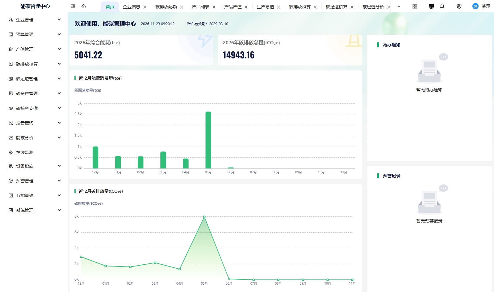

### 2.2 完整菜单树（含前端路由）

> 说明：`menuType=1` 为目录（无页面），`menuType=2` 为页面；第三层为按钮级权限点，不产生页面。

| 一级模块 | 路由前缀 | 二级页面 | 页面路由 |
|---|---|---|---|
| 首页 | `/home` | 工作台 | `/home` |
| 企业管理 | `/org` | 企业信息 | `/enterprise/info` |
| 预算管理 | `/budget` | 碳排放配额 | `/carbon-emission/quota/list` |
| 产值管理 | `/carbon-output` | 产品列表 | `/carbon-product/product/list` |
| | | 产品产值 | `/carbon-output/production-value/list` |
| | | 生产总值 | `/carbon-output/total-value/list` |
| 碳排放核算 | `/carbon-computation` | 碳排放核算 | `/carbon-computation/calculation-complete/list` |
| 碳足迹管理 | `/carbon-footprint` | 碳足迹核算 | `/carbon-footprint/product-footprint/list` |
| | | 碳足迹分析 | `/carbon-footprint/product-footprint-analysis/index` |
| | | 供应链碳管理 | `/carbon-footprint/supplier-footprint/list` |
| | | 供应链碳管理分析 | `/carbon-footprint/supplier-footprint-analysis/index` |
| 碳资产管理 | `/carbon-asset` | 碳配额资产管理 | `/carbon-asset/asset/list` |
| | | 信用资产管理 | `/carbon-asset/ccer/list` |
| | | 交易管理 | `/carbon-asset/trade/list` |
| 碳核查支撑 | `/carbon-verify` | 原始凭证管理 | `/carbon-verify/evidence/list` |
| | | 第三方报告管理 | `/carbon-verify/report/list` |
| 报告查询 | `/carbon-report` | 碳排放报告 | `/carbon-report/calculation-report/query` |
| | | 能源利用报告 | `/carbon-report/energy-utilization-report/query` |
| | | 产品碳足迹报告 | `/carbon-report/product-footprint-report/query` |
| 能碳分析 | `/carbon-analysis` | 能耗查询 | `/carbon-analysis/energy-consumption-query/index` |
| | | 能源消费分析与策略推荐 | `/carbon-analysis/energy-strategy-recommend/index` |
| | | 能效对标 | `/carbon-analysis/energy-efficiency-benchmarking/index` |
| | | 碳排放查询 | `/carbon-analysis/energy-usage-management/index` |
| | | 碳配额核算 | `/carbon-analysis/carbon-quota-calculation/index` |
| | | 能源结构 | `/carbon-analysis/energy-structure-analysis/index` |
| 在线监测 | `/carbon-monitor` | **无子菜单（页面空白，见 7.1）** | `/carbon-monitor` |
| 设备设施 | `/carbon-facility` | 设施管理 | `/carbon-facility/facility/list` |
| | | 设备管理 | `/carbon-facility/device/list` |
| | | 设备数据 | `/carbon-facility/device-data/list` |
| 预警管理 | `/common-warning` | 事件预警 | `/common-warning/event/list` |
| | | 预警设置 | `/common-warning/setting/list` |
| | | 预警记录 | `/common-warning/record/list` |
| 节能管理 | `/carbon-economize` | 节能改造项目 | `/carbon-economize/renovation-project/list` |
| | | 能源管理情况 | `/carbon-economize/management-situation/list` |
| 系统管理 | `/sys` | 地区管理（**无页面**） | — |
| （独立大屏） | `/visualization` | 综合展示 / 报告下载 / 在线监测 / 系统管理 | `/visualization/CarbonEnergy` |

---

## 3. 模块详解

### 3.1 首页（工作台）

**入口**：登录后默认页 `/home`

**页面结构**
1. 欢迎区：欢迎语 + 当前时间 + 账户有效期
2. KPI 卡片 ×2：`2026年综合能耗(tce)`、`2026年碳排放总量(tCO₂e)`（实测值 5041.22 / 14943.16）
3. 图表 ×2：近 12 月能源消费量（柱状，单位 tce）、近 12 月碳排放量（面积/折线，单位 tCO₂e）
4. 右栏 ×2：待办通知（空态"暂无待办通知"）、预警记录（空态"暂无预警记录"）

**核心功能**：年度累计指标看板、近 12 月趋势、待办与预警聚合。

**数据来源**：`platform-home/ToBeDoneNotice/queryList`、`platform-home/WarningRecord/queryList`、`platform-home/CarbonEnergy/queryList`

**前后置条件**：KPI 依赖碳排放核算与设备/能源数据；无数据时卡片为 0，页面不报错。

---

### 3.2 企业管理 → 企业信息

**入口**：`/enterprise/info`（菜单"企业管理"唯一子项）

**页面结构**：只读的"标签—值"明细表，字段包括：
企业名称、企业简称、企业 Logo（带"预览"）、企业类型、统一社会信用代码、法定代表人、营业执照（图片预览）、注册日期、注册资本、联系人、联系人电话、联系人邮箱、企业简介、企业图片、备注。

**核心功能**：企业档案展示；Logo/营业执照图片预览。

**前后置条件**：数据来自 `system/enterprise/detail/{enterpriseId}`；**本账号未见编辑入口**（页面上没有保存/编辑按钮），推断企业档案由平台方或上级管理员维护。

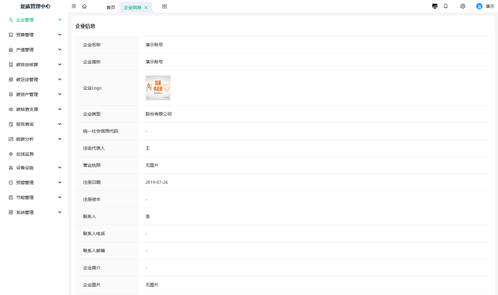

---

### 3.3 预算管理 → 碳排放配额

**入口**：`/carbon-emission/quota/list`

**列表**
- 筛选：年度（起止年份区间）
- 列：年度、配额量、配额量单位、下年度配额量、备注、企业、操作
- 操作：新建、批量删除、**切换图表**、导入、导出、编辑、删除
- 演示数据：2020—2026 共 7 条，2026 年配额量 3,011,111 tCO₂e（明显为演示值），下年度配额量全部为空

**图表视图**：点击"切换图表"变为柱状图（Y 轴单位 tCO₂e，图例"配额量 / 下年度配额量"，X 轴为各年度记录），按钮变为"切换表格"。

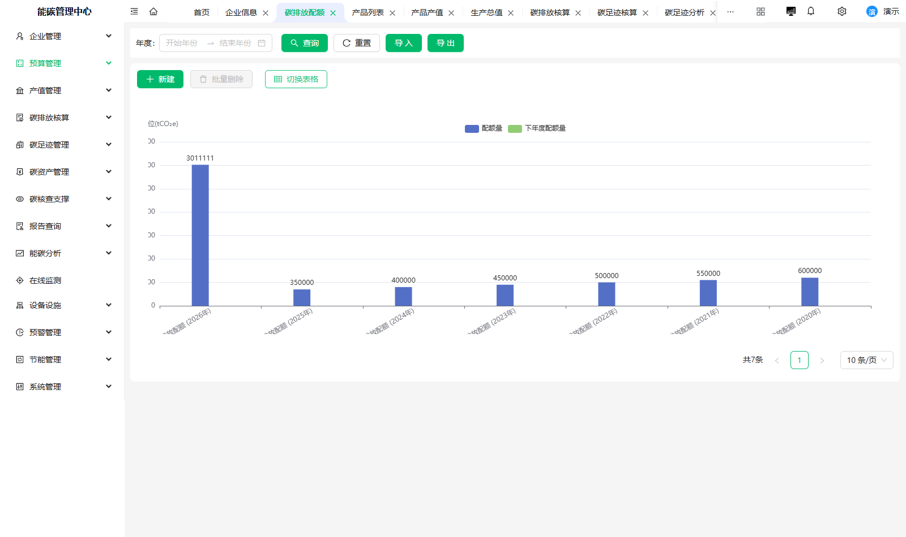

**新增表单**（弹窗标题"添加"）

| 字段 | 必填 | 说明/占位 |
|---|---|---|
| 年度 | 是 | 选择年度（月份选择器） |
| 配额量 | 是 | 数值 |
| 下年度配额 | 否 | 占位提示"默认与本年配额量一致，可修改" |
| 备注 | 否 | 文本 |

**导入弹窗**（标题"导入配额数据"）
1. 下载模板（Excel）
2. 上传 Excel（`.xls/.xlsx`，单文件，≤10MB）
3. 勾选"更新数据（如果存在相同数据，是否更新现有数据）"
4. 开始导入

> 导入说明原文：请先下载标准模板；只能上传一个 Excel 文件；删除已上传的文件可重新上传；勾选"更新现有数据"会覆盖已有记录。

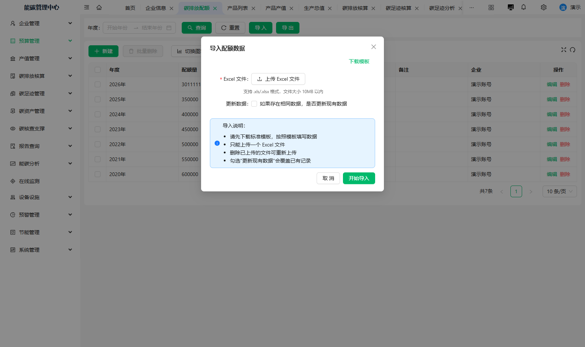

**业务含义**：企业年度碳排放配额的预算台账，是"碳配额核算"分析页的配额基数来源。

---

### 3.4 产值管理（3 个页面）

#### 3.4.1 产品列表

- 路由：`/carbon-product/product/list`
- 筛选：产品名称
- 列：产品名称、产品介绍、产品类型、规格型号、产品功能、产品分类、单位、**1/2/3 级单位产品能耗值**、产品图片、企业、禁用状态、备注、操作
- 操作：新建、批量删除、导入、导出、编辑、删除（**无禁用按钮**，仅展示禁用状态列）
- 演示数据：9 条灯具类产品（吸顶灯/筒灯/壁灯/吊灯等），单位多为"个/件/吨"

**新增表单字段**：产品名称\*、规格型号、产品功能、产品介绍、产品类型（一般产品/工业产品）、产品分类（工业产品）、单位\*、1/2/3 级单位产品能耗值、备注、产品图片（上传）、工艺流程图（上传）。

**下游用途**：产品是"产品产值""碳足迹核算""产品碳足迹报告""能效对标-产品对标"的前置主数据；1/2/3 级单位产品能耗值用于产品对标的分级判定。

#### 3.4.2 产品产值

- 路由：`/carbon-output/production-value/list`
- 筛选：日期（月份区间）
- 列：日期、产品名称、产值、产值单位、产值类型、产量、产量单位、备注、企业、操作
- 操作：同标准 CRUD + 导入/导出
- 表单：产品\*（下拉选产品）、产值\*、产量\*、产量单位、月份\*、备注

#### 3.4.3 生产总值

- 路由：`/carbon-output/total-value/list`
- 列：日期、生产总值名称、总产量、总产量单位、总产值、总产值单位、**产值类型**（总值/产品/其他）、备注、企业、操作
- 表单：月份\*、生产总值名称、总产量\*、总产量单位\*、总产值\*、备注
- 演示数据：2025-08 ~ 2026-06 共 17 条，**缺 2026-05**（该缺失直接导致 5 月报告"企业产值=0、碳排放强度=0"，见 5.2 验证）

**业务含义**：产值是强度类指标（tce/万元、tCO₂e/万元、单位产值能耗）的唯一分母来源。

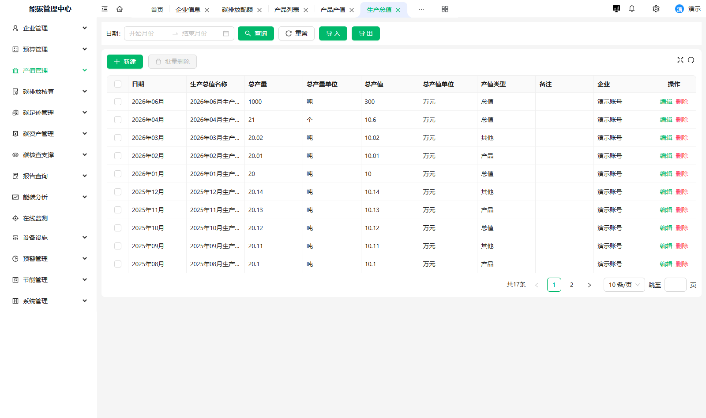

---

### 3.5 碳排放核算（核心模块）

**入口**：`/carbon-computation/calculation-complete/list`

#### 3.5.1 列表页

- 筛选：核算日期（月份起止区间）
- 列：核算日期、温室气体量、温室气体单位（tCO₂e）、能源量、能源单位（tce）、核算标准名称、简称、编码、企业、操作
- 行操作：**查看、编辑**（无删除、无批量删除、无导入）
- 演示数据：14 条月度记录（**2025-05 ~ 2026-06**，第五轮接口全量核对；此前误记为 2025-09 起），如 2026-05：7961.314284 tCO₂e / 2621.85 tce

> 观察：核算记录**不提供删除能力**，只允许编辑，符合碳核算数据的审计留痕要求，是竞品在合规性上的一处刻意设计。

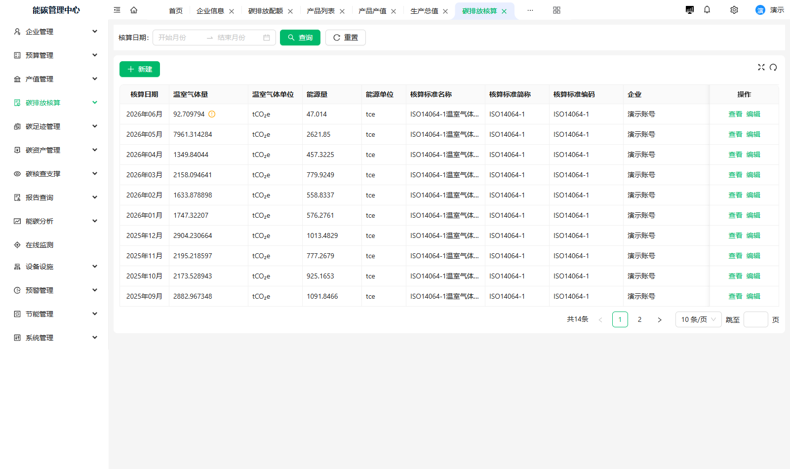

#### 3.5.2 新增/编辑表单（弹窗"新增"）

**固定头部（只读汇总行）**
- 核算标准名称：ISO14064-1 温室气体-第一部：组织层级温室气体排放与移除之量化报告指南
- 核算标准编码：ISO14064-1
- 核算日期：月份选择器（**必填**）

**10 个排放源页签**（每个页签是一张可编辑明细表，行内直接录入）

| 页签 | 列结构（关键字段） |
|---|---|
| 化石燃料 | 化石燃料分类、化石燃料名称、消耗量\*、消耗单位、低位发热量值/单位、单位热值含碳量值/单位、燃料碳氧化率值/单位、折算标准煤系数值/单位、备注 |
| 购入电力 | 购入电力、消耗量、消耗单位、排放因子/单位、折算标准煤系数/单位、备注 |
| 输出电力 | 输出电力、消耗量、消耗单位、排放因子/单位、折算标准煤系数/单位、备注 |
| 购入热水 | 名称、消耗量、消耗单位、温度值/单位、常温常压比热值/单位、排放因子值/单位、折算标准煤系数值/单位、备注 |
| 输出热水 | 同上 |
| 购入蒸汽 | 名称、消耗量、单位、温度值/单位、压力值/单位、热焓值/单位、排放因子值/单位、折算标准煤系数值 |
| 输出蒸汽 | 同上 |
| 购入集中供暖 | 名称、供暖面积值/单位、供暖时长值/单位、室内计算温度值/单位、室外计算温度值/单位、室外平均温度值/单位、热指标值/单位、排放因子、折标系数 |
| 输出集中供暖 | 同上 |
| 废水处理 | 名称、废水量/单位、进口/出口平均 COD 浓度值/单位、甲烷回收量/单位、排放因子值/单位、全球变暖潜能值/单位 |

**内置默认参数（化石燃料行预置，可改）**
- 汽油：低位发热量 43.124 GJ/t、单位热值含碳量 0.0189 tC/GJ、碳氧化率 98%
- 柴油：42.705 GJ/t、0.0202 tC/GJ、98%
- 天然气：322.38 GJ/万Nm³、0.0153 tC/GJ、99%
- 蒸汽行默认带"饱和蒸汽 / 89.96℃ / 0.070MPa / 2660.2"的预设项

**底部按钮**：取消、保存

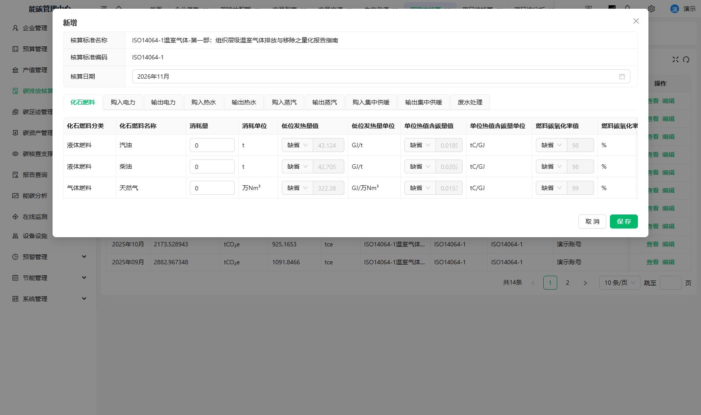

#### 3.5.3 查看（只读详情）

弹窗标题"查看"，结构与新增一致：头部三行汇总（标准名称/编码/核算日期）+ 10 个页签的只读明细，底部仅"取消"。

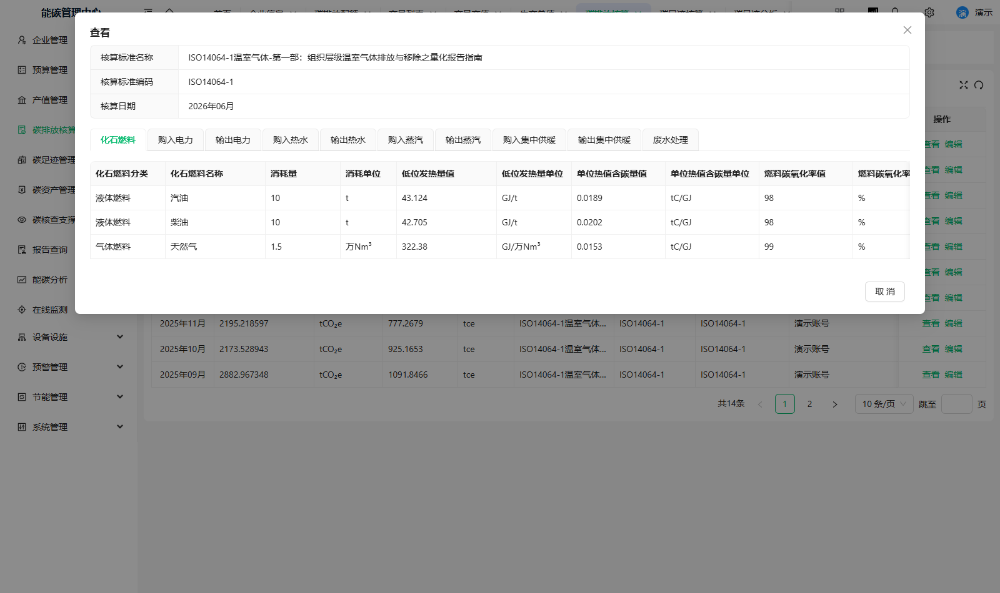

#### 3.5.4 操作流程（新增一条月度核算）

**前置条件**
1. 企业档案已存在（企业信息）
2. 已确定核算标准（**本企业**为 ISO14064-1；产品本身支持 GB/T 32151 行业标准切换，见 §16.4）
3. 已收集该月各排放源活动数据（燃料消耗量、外购/外输电量、热力、蒸汽、废水等）

**步骤**
1. 进入"碳排放核算"列表 → 点"新建"
2. 选择核算日期（月份）
3. 依次在 10 个页签录入该月活动数据（未涉及的页签可留空；每类默认系数已预置）
4. 点"保存"（**本次未提交，保存后的计算与校验逻辑未验证**）
5. 保存成功后列表新增一条记录，显示计算得到的温室气体量（tCO₂e）与能源量（tce）
6. 该记录随即可被"碳排放报告""能耗查询""碳排放查询""能源结构""策略推荐""能效对标""碳配额核算"读取

**后置影响**：新增/修改核算记录会改变报告、分析、大屏与配额核算的所有派生数值（同一数据源 `carbon-report/CalculationReport/queryComplete`）。

**编辑流程**：列表行"编辑" → 同表单预填 → 修改 → 保存（未提交验证）。

---

### 3.6 碳足迹管理（4 个页面）

#### 3.6.1 碳足迹核算

- 路由：`/carbon-footprint/product-footprint/list`
- 筛选：产品名称（下拉，需先选产品）
- 列：产品名称、产品数量、产品单位、产品介绍、碳足迹值、碳足迹单位、碳足迹日期、**核算边界**、备注、企业、操作
- 操作：新建、批量删除、编辑、删除（无导入/导出）
- 演示数据：6 条产品足迹（如"百合花朵吸顶灯 1.45518 tCO₂e/t"）

**新增表单结构（三段式 LCA 录入）**

| 区块 | 字段/列 |
|---|---|
| 头部 | 年度\*、产品\*（下拉）、产品单位\*、产品产量\*、碳足迹值\*、碳足迹单位\*、核算边界\*（下拉，默认"从摇篮到大门"）、备注 |
| 原材料获取阶段排放核算 | 原材料名称、原材料数量、原材料单位、排放因子值、排放因子单位、温室气体量、温室气体单位、备注、操作（行内"新增"） |
| 原材料运输阶段排放核算 | 原材料名称、数量、单位、运输方式、起始地、目的地、里程、排放因子值/单位、温室气体量/单位、备注、操作 |
| 生产阶段排放核算 | 排放源、数量、单位、排放因子值/单位、温室气体量/单位、数据来源、备注、操作 |

**流程要点**：三个阶段的明细行相加得到产品碳足迹值；碳足迹值既是输入项也是计算结果（页面允许直接填，实际业务中应由三段明细汇总——**此联动关系未验证**）。

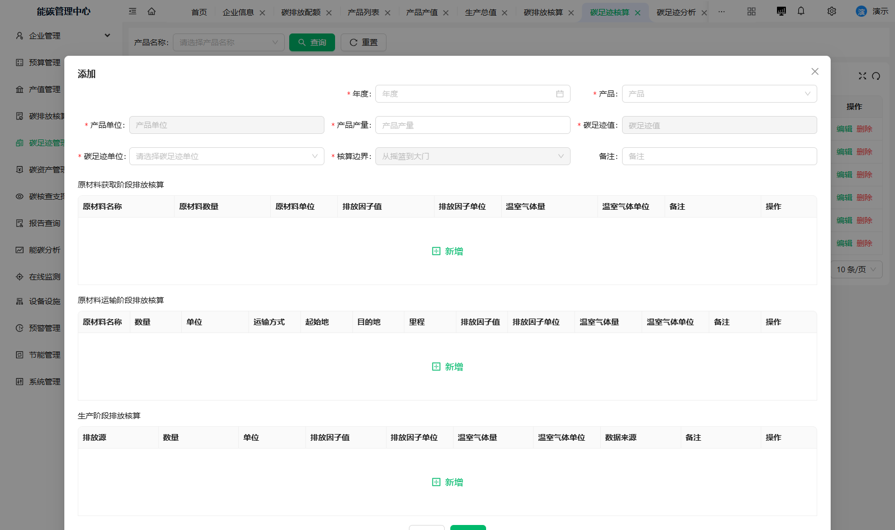

#### 3.6.2 碳足迹分析

- 路由：`/carbon-footprint/product-footprint-analysis/index`
- 筛选：日期（年份）+ 产品名称
- 内容：
  - 产品信息头（产品名称、描述、单位、碳足迹值、碳足迹单位、碳足迹日期）
  - "碳足迹阶段信息"横向条形图，按 **原材料获取-1 / 原材料运输-2 / 生产阶段-3** 三个阶段展示 tCO₂e/t 与占比量级
- 前置条件：该产品在所选年份存在碳足迹核算记录，否则无图

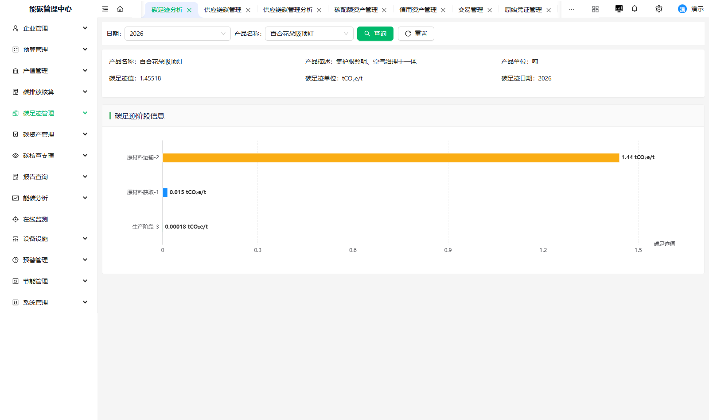

#### 3.6.3 供应链碳管理

- 路由：`/carbon-footprint/supplier-footprint/list`
- 结构：**树形表格**（可展开 `+`），支持多级供应商
- 列：供应商名称、产品名称、产品单位、碳足迹值、碳足迹单位、碳足迹日期、减排目标值、企业、排序、备注、操作
- 行操作：**添加上级**、编辑、删除
- 顶部：新建（新增顶级供应商）
- 筛选：供应商名称、产品名称

**新增表单**：下级供应商（下拉，可为空）、供应商名称\*、产品名称\*、产品单位、碳足迹值\*、碳足迹单位\*、碳足迹日期\*、减排目标值、排序、备注。

> 说明：通过"新建（顶级）+ 添加上级/下级"的组合，可构建供应链层级关系，是竞品中较有差异化的能力。

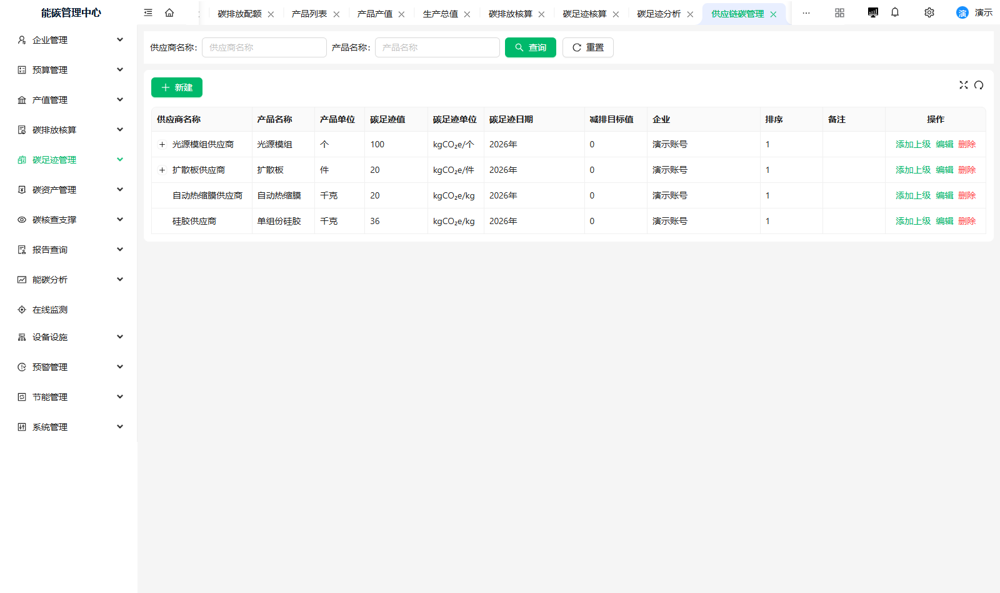

#### 3.6.4 供应链碳管理分析

- 路由：`/carbon-footprint/supplier-footprint-analysis/index`
- 筛选：供应商名称（下拉）、日期
- 内容：链路式节点图（从左到右的上游→下游链路），每个节点显示"供应商-产品 / 碳足迹值-单位"，节点间连线，节点带 `+` 展开更多层级
- 实测链路示例：智慧科技供应商-全品 10 → 防震挂钩供应商-防震挂钩 10 → 光源模组供应商-光源模组 100 kgCO₂e/个

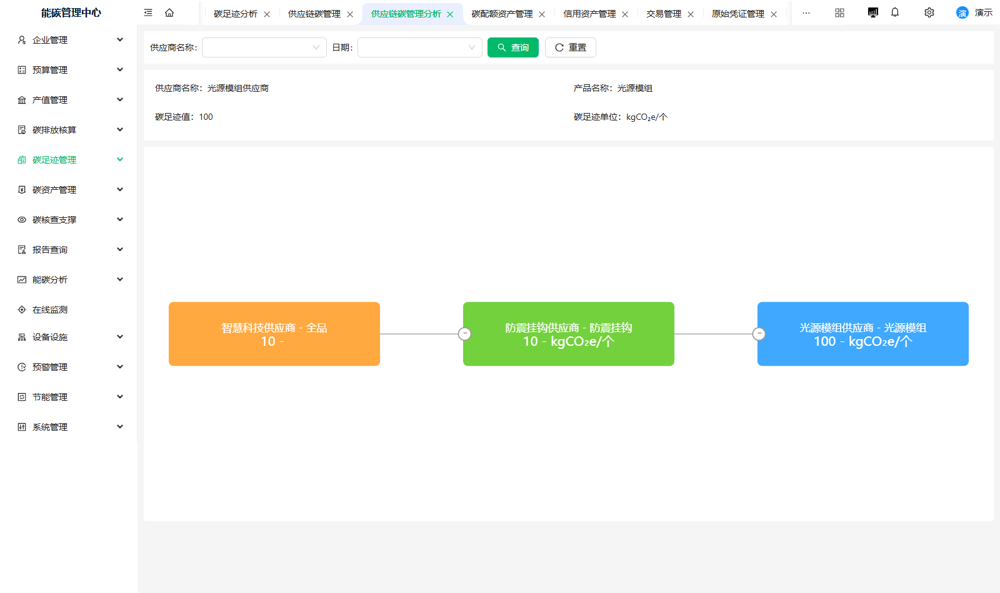

---

### 3.7 碳资产管理（3 个页面）

#### 3.7.1 碳配额资产管理

- 路由：`/carbon-asset/asset/list`
- 筛选：年度
- 列：资产名称、资产数量、单位、资产类型、备注、企业、年度、**禁用状态**、操作
- 操作：新建、批量删除、导入、导出、编辑、删除、**禁用**
- 表单：资产名称\*、资产数量\*、单位\*、资产类型\*（下拉，含"信用资产"）、备注、年度

#### 3.7.2 信用资产管理（CCER）

- 路由：`/carbon-asset/ccer/list`
- 列：资产名称、资产数量、单位、资产类型、**资产状态**、备注、企业、年度、操作
- 表单：资产名称\*、资产数量\*、单位\*、资产类型\*（如"光热发电"）、资产状态\*（如"待申请"）、备注、年度
- 操作：同配额资产（本页未见"禁用"按钮，状态通过表单字段维护）

#### 3.7.3 交易管理

- 路由：`/carbon-asset/trade/list`
- 筛选：成交日期（区间）、资产类型、交易方向
- 列：资产类型、交易数量(tCO2e)、交易金额(元)、**交易类型**（购入/出售）、购买／出售方、用途、交易日期、操作
- 表单：资产名称\*、交易数量(tCO2e)\*、交易单价(元)\*、交易金额(元)（联动）、资产类型\*、交易类型（购入/出售）、成交日期\*、用途/备注

**三者关系（页面可读出的业务语义）**：配额资产/CCER 资产形成企业"碳资产台账"，交易管理记录资产的买入/卖出流水，构成"配额—资产—交易"闭环；页面未提供三者间的数量自动核减联动，属于台账式管理。

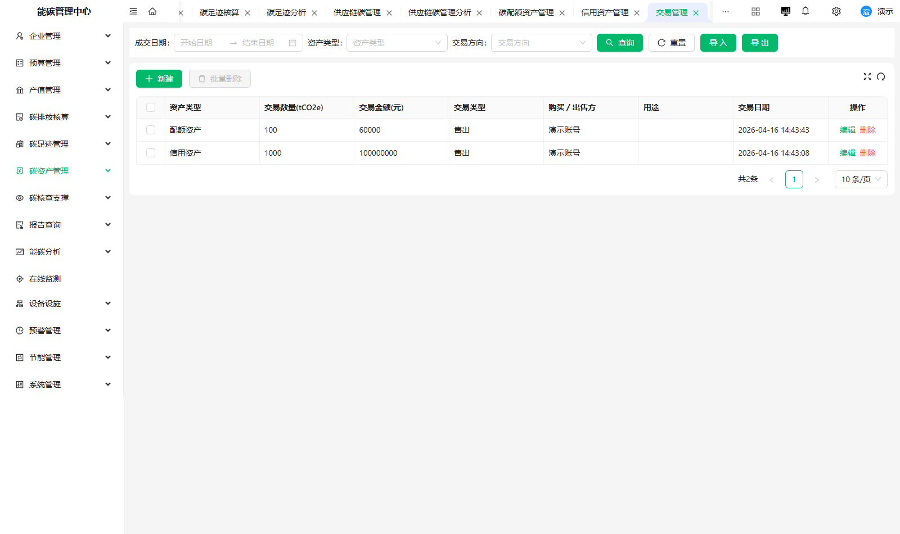

---

### 3.8 碳核查支撑（2 个页面）

#### 3.8.1 原始凭证管理

- 路由：`/carbon-verify/evidence/list`
- 筛选：凭证名称
- 列：凭证名称、凭证编码、凭证描述、有效期限、备注、企业、操作
- 操作：新建、批量删除、编辑、删除、**下载**
- 表单：凭证名称\*、凭证编码、凭证描述、有效期限（区间）、备注 + 附件表格（文件名称、文件类型、备注、操作）

#### 3.8.2 第三方报告管理

- 路由：`/carbon-verify/report/list`
- 列：报告名称、报告描述、报告文件、有效期限、备注、企业、操作
- 操作：新建、批量删除、编辑、删除、**下载**
- 表单：报告名称\*、报告描述、**报告文件\***（上传）、有效期限、备注

**定位**：为第三方核查/审计准备的证据归档库（凭证 + 认证报告），**与核算数据无字段级联动**，仅为附件与台账。

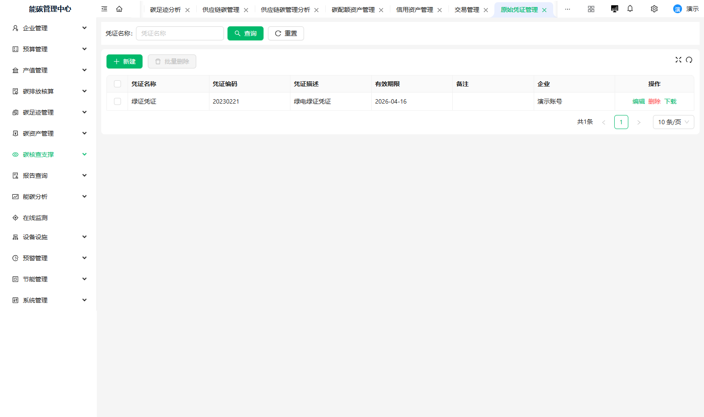

---

### 3.9 报告查询（3 个报告页）

#### 3.9.1 碳排放报告

- 路由：`/carbon-report/calculation-report/query`
- 筛选：日期范围（月份区间，默认当月-次月）
- 按钮：查询、重置、**生成报告**
- 页签 1「核算数据统计」
  - 左图：所选区间能源消耗量（横向条形，按汽油/柴油/天然气/购入电力/输出电力/…分类，单位 tce）
  - 右图：碳排放总量和结构（甜甜圈，图例：汽油、柴油、天然气、电力、热力、生产过程）
  - 明细表：类别 / 明细 / 消耗量·使用量 / 单位 / 标准煤(tce) / 温室气体排放(tCO₂e)
  - 表尾：温室气体排放合计、企业产值(万元)、碳排放强度(tCO₂e/万元)
- 页签 2「核算日期统计」
  - 能耗趋势图(tce)、CO₂ 及产值趋势图
  - 卡片：碳排放强度、能耗强度
  - 能碳数据分析表：日期 / 能量消耗量(tce) / 碳排放量 / 产值(万元)

**生成报告流程（第二轮查清）**
1. 选周期 → 查询（有数据）
2. 点"生成报告" → 全屏加载态"稍等片刻，我在拼命加载中…"
3. 后端调用 `CalculationReport/queryCompletePdf`，约 30–40 秒后返回
4. 加载态消失，页面弹出**两条错误提示**：
   - `java.lang.IllegalStateException: 网页截图失败: http://192.168.1.6:25525/common-template/html/calculation/briefing/fuel?completedEndDate=2026-05-31%2023:59:59&enterpriseId=2031340904327065601&completedStartDate=2026-05-01%2000:00:00`
   - `生成报告失败，请稍后重试`
5. **根因**：报告不是直接生成的 PDF，而是后端按章节（如 `calculation/briefing/fuel`）渲染 HTML → 调无头截图服务逐页出图 → 合成 PDF；模板服务地址被配置为**内网 `192.168.1.6:25525`**，公网演示环境不可达，故每次都在 30–40 s 后失败
6. 结论：**报告功能在本演示环境不可用**，且暴露了内网地址与"截图合成"这一实现路径

**无数据周期**：不发请求，直接提示"生成报告失败，请稍后重试"（实测 2026-10~11 周期）。

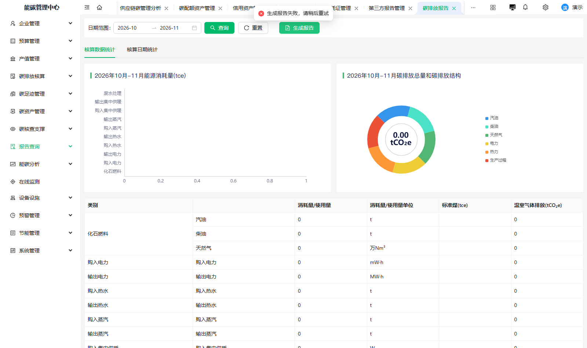

#### 3.9.2 能源利用报告

- 路由：`/carbon-report/energy-utilization-report/query`
- 结构同上（能源消耗条形图 + 用能结构图 + 能源数据分析表）
- 额外指标：**单位产值能耗**、**单位产品能耗**
- 表尾：能源消耗合计(tce)、企业产值(万元)、企业产量(功能单位)
- 生成报告 → `EnergyUtilization/queryCompletePdf`；无数据时提示"**没有查到对应的填报数据，请先进行数据填报**"，随后仍统一提示"生成报告失败，请稍后重试"

#### 3.9.3 产品碳足迹报告

- 路由：`/carbon-report/product-footprint-report/query`
- 筛选：日期（年份）+ 产品名称
- 内容：产品信息头 + 三阶段明细表，每段带"合计碳足迹值 + 占比"

实测示例（百合花朵吸顶灯，2026）：
| 阶段 | 明细 | 合计碳足迹值 | 占比 |
|---|---|---|---|
| 原材料获取 | 1 原材料，100 t，因子 0.75 tCO₂e/t，排放 75 tCO₂e | 0.015 tCO₂e/t | 1.03% |
| 原材料运输 | 2 运输，2000 t，18 km，因子 0.2 tCO₂e/t，排放 7200 tCO₂e | 1.44 tCO₂e/t | 98.96% |
| 生产阶段 | 3 排放源，3 t，因子 0.3，排放 0.9 tCO₂e | 0.00018 tCO₂e/t | 0.01% |

- 生成报告 → `productFootprint/genBriefReport`（简报式报告）；**本账号调用返回 30005 无权限**，仅提示"对不起，您没有权限访问此内容哦~"

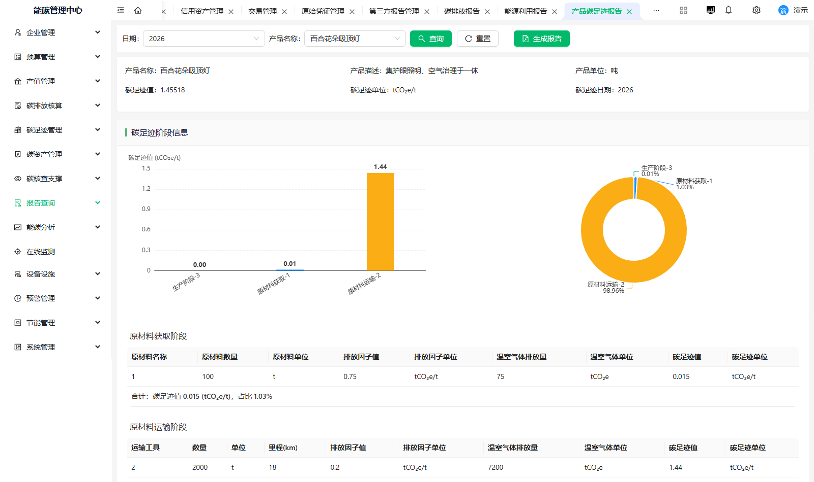

---

### 3.10 能碳分析（6 个页面）

| 页面 | 路由 | 筛选 | 核心内容 |
|---|---|---|---|
| 能耗查询 | `/carbon-analysis/energy-consumption-query/index` | 日期范围（月） | 能源消费量横向条形图、总量与用能结构图；明细表（类别/能源消费量/单位/标准煤/折标系数）；表尾综合能耗合计、企业产值、**能耗强度(tce/万元)** |
| 能源消费分析与策略推荐 | `/carbon-analysis/energy-strategy-recommend/index` | 日期范围 | 用能结构图、能源消耗对比、**用能策略推荐**（分时用能优化建议、用能设备启停负载优化策略）；表（类别/标准煤） |
| 能效对标 | `/carbon-analysis/energy-efficiency-benchmarking/index` | 日期范围 | 页签「行业对标 / 产品对标」；能效对标图、能源消费量与产量趋势图；卡片总能源量/平均能效值；明细表（日期/能源量/产量/能效标杆值/能效基准值/能效值/策略建议/状态"标杆水平"） |
| 碳排放查询 | `/carbon-analysis/energy-usage-management/index` | 日期范围 | 能源消费量图、碳排放量与产值图；表（类别/温室气体排放/同比/环比）；表尾总能耗、总碳排放、**范围一排放合计、范围二排放合计** |
| 碳配额核算 | `/carbon-analysis/carbon-quota-calculation/index` | 年度 | 5 张卡片：碳排放配额、减排目标、碳排放量、配额使用比例、预计下年度配额；"用能和碳排放预算动态调整建议"（可展开）；"月碳排放"图（柱=预算量，线=排放量） |
| 能源结构 | `/carbon-analysis/energy-structure-analysis/index` | 日期范围 | **桑基图**：总能耗 → 化石燃料/购入电力/输出电力/购入热水/…/废水处理 → 明细项，节点标注 tce |

**关键观察**
- 6 个分析页**共用同一核算结果接口** `carbon-report/CalculationReport/queryComplete`（策略推荐另加 `queryEnergyQuantityStrategySuggestion`，配额核算另加 `queryEnergyAndCarbonBudgetSuggestion`）——说明"一次核算、多处复用"是其数据架构主线。
- 能效对标"产品对标"页签实测为**暂无数据**（依赖产品 + 产品产值/产量数据齐全），行业对标默认显示 2 行（2026-10、2026-11，能效值 0，状态"标杆水平"）。
- 碳配额核算实测：配额 3,011,111；减排目标 0.87%；排放量 14,943.16；配额使用比例 0.50%；预计下年度配额 0。核算口径推算为"年度累计排放 ÷ 年度配额"，减排目标与预计配额的算法**未在界面说明，未验证**。

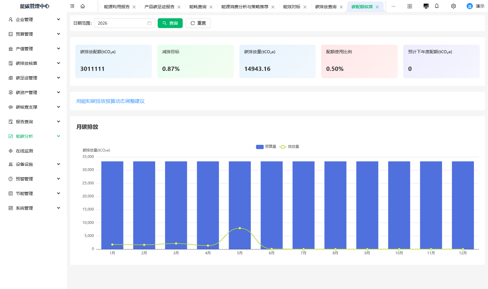

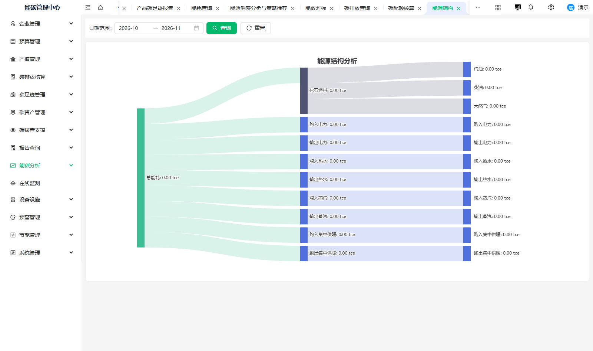

---

### 3.11 在线监测（菜单空白，大屏内可用）

**菜单页面**：`/carbon-monitor`
- 实测：页面主区仅渲染 `div.admin-content` 空容器，**无任何接口请求、无 DOM 内容**，无"暂无数据"提示
- **第二轮查明**：前端主包预加载清单中存在一整套监测组件资源——`RealtimeDashboard`（实时看板）、`device-access-list`（设备接入）、`device-discovery-list`（设备发现）、`device-telemetry`（设备遥测）、`mqtt-monitor`（MQTT 监控）、`energyUnit/list`（能源单元），并含 `device-management-api`、`device-bind-modal`、`monitor-device-link-modal`
- **路由探测**：按组件名尝试 8 个候选路径（`/carbon-monitor/realtime`、`/RealtimeDashboard`、`/device-access/list`、`/device-discovery/list`、`/device-telemetry`、`/energyUnit/list`、`/mqtt-monitor`、`/index`），**全部返回"对不起，您访问的内容不存在！"**
- 结论：产品**具备**完整的设备接入/发现/遥测/MQTT 监测能力（含实时看板与设备绑定），但当前账号/租户下这些子菜单**一个都未挂载**，侧边栏只剩一个空目录。属于"产品有、交付没开"的典型情况

**大屏内"在线监测"（可用）**：`#/visualization/CarbonEnergy` → 顶部"在线监测"
1. 左栏「设备列表」：位置下拉（如"厂区综合部"）、表格（名称/设备编码/状态），点击设备切换右侧详情
2. 顶部 KPI ×3：近 12 月综合能耗(tce)、近 12 月碳排放量(tCO₂e)、近 12 月产值(万元)
3. 中部「设备最新数据」：实测"暂无设备数据"
4. 右栏「设备详情」：状态、终端名称、设备编码
5. 右栏「月份数据统计」：按日列表（11月23号… 0.000 kWh）
6. 右栏「年度数据统计」：折线图（年度用量 kWh）

接口：`carbon-monitor/monitoring/dataDashboard`、`carbon-facility/facility/treeList`、`carbon-facility/device/queryList`

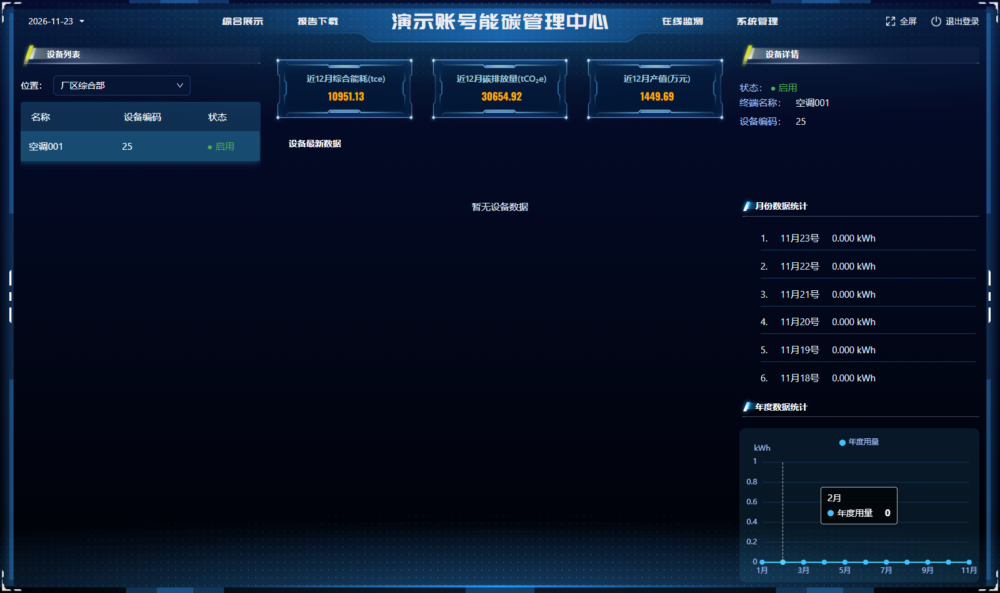

---

### 3.12 设备设施（3 个页面）

#### 3.12.1 设施管理

- 路由：`/carbon-facility/facility/list`
- 结构：**树形表格**（如 生产车间 → 厂区综合部/厂区车间001-005；办公楼 → 前台接待/办公一区-五区；操场）
- 列：设施名称、设施编码、备注、企业、状态、操作
- 行操作：**添加下级**、编辑、删除、禁用
- 顶部：新建、导入、导出；筛选：设施名称
- 表单：上级设施（树选择）、设施名称\*、设施编码\*、排序、备注

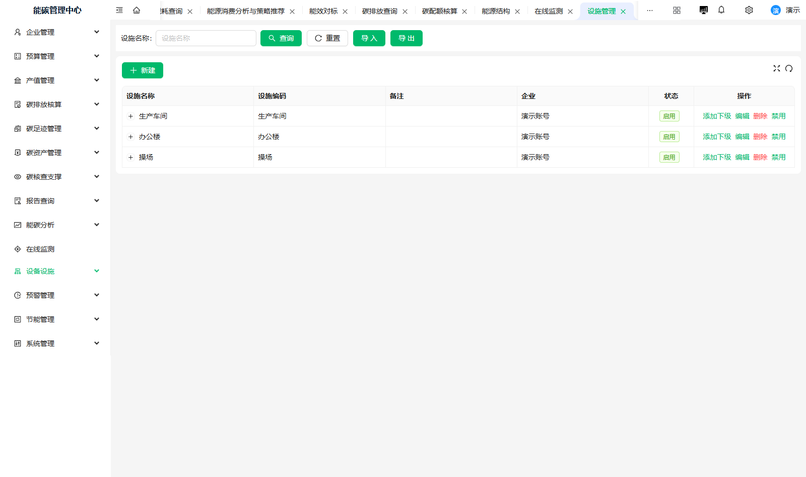

#### 3.12.2 设备管理

- 路由：`/carbon-facility/device/list`
- 布局：**左设施树 + 右设备表**（左侧树点击可过滤设备）
- 列：设备名称、设备编码、备注、企业、设备类型、计量级别、能源种类、禁用状态、操作
- 操作：新建、批量删除、导入、导出、编辑、删除、禁用
- 表单：设施（树选）、设备名称\*、设备编码\*、设备类型、计量级别、能源种类（可自定义，如电力/天然气/蒸汽）、**设备预警规则**（下拉，用于绑定预警设置）、排序、备注
- 演示数据 19 条（电表/空压机/激光器/空调/清洗机等，设备类型多为"电表"，计量级别"主要用能设备"，能源种类"购入电力"）

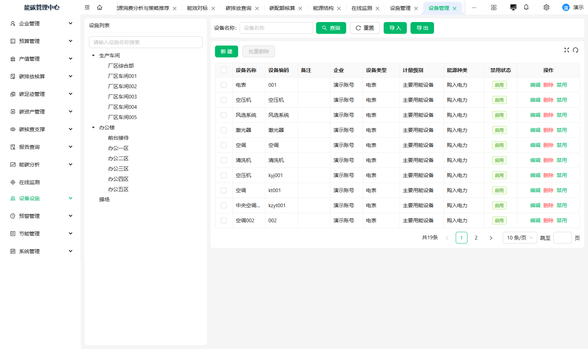

#### 3.12.3 设备数据

- 路由：`/carbon-facility/device-data/list`
- 筛选：设备（下拉）、日期区间、状态
- 列：设备、日期、数值、单位、换算率、来源、状态、备注、操作
- 表单：设备\*、日期\*、数值\*、单位\*、换算率\*、来源（默认"填报"）、状态（默认"正常"）、备注（**换算率**=把填报单位折算成核算标准单位的系数，如 kg→t，手册 16.4 有明确说明）
- 操作：新建、批量删除、导入、导出、编辑、删除

**定位**：设备数据为**人工填报 + 导入**为主（来源字段"填报"）。**第七轮修正**：核算弹窗实际会调 `monitorDeviceLink/previewQuantity`（设备联动取数）与 `carbonGoodwePowerStation/queryEnterpriseMonthPower`（光伏电站月发电量），说明"自动取数"通道存在、只是本租户未接设备/电站。

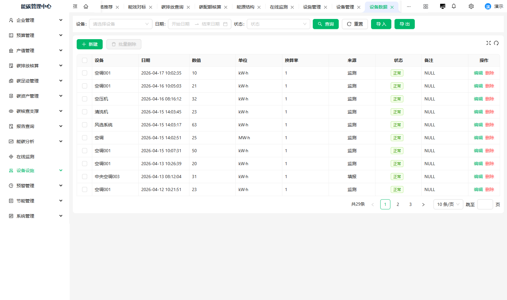

---

### 3.13 预警管理（3 个页面）

#### 3.13.1 事件预警（指标/事件字典）

- 路由：`/common-warning/event/list`
- 列：事件名称、事件编码、事件类型、备注、**内置**、状态、操作
- 操作：新建、批量删除、编辑、删除、禁用
- 表单：事件名称\*、事件编码\*、事件类型\*（如"碳排放"）、备注
- 演示数据 4 条

#### 3.13.2 预警设置（阈值规则）

- 路由：`/common-warning/setting/list`
- 筛选：预警类别、事件等级
- 列：预警事件、预警类别、事件等级、预警条件、预警值、冷却(分钟)、预警描述、备注、企业、状态、操作
- 表单：预警事件\*（下拉，来源于事件预警）、事件等级\*（重要/…）、预警条件\*（大于/…）、预警值\*、冷却时间（分钟）、预警描述、备注
- 实测列表为空（无已配置规则）

#### 3.13.3 预警记录（触发结果）

- 路由：`/common-warning/record/list`
- 筛选：事件类型、预警类别、等级、处理状态、已读状态、指标、设备编码、事件名称、记录日期
- 列：未读、记录日期、等级、事件名称、企业、设备编码、指标、阈值、条件、记录值、处理状态、处理人/时间、操作
- 操作：**标记已读、全部已读**、批量删除
- 实测 0 条

**推断的业务链路（未能实测）**：事件预警（定义指标）→ 预警设置（阈值/等级/冷却）→ 设备（绑定预警规则）→ 设备数据/核算数据越阈值 → 预警记录（未读→标记已读/处理）→ 首页"预警记录"与消息中心"预警"同步。**因演示账号无规则、无触发数据，该链路未验证。**

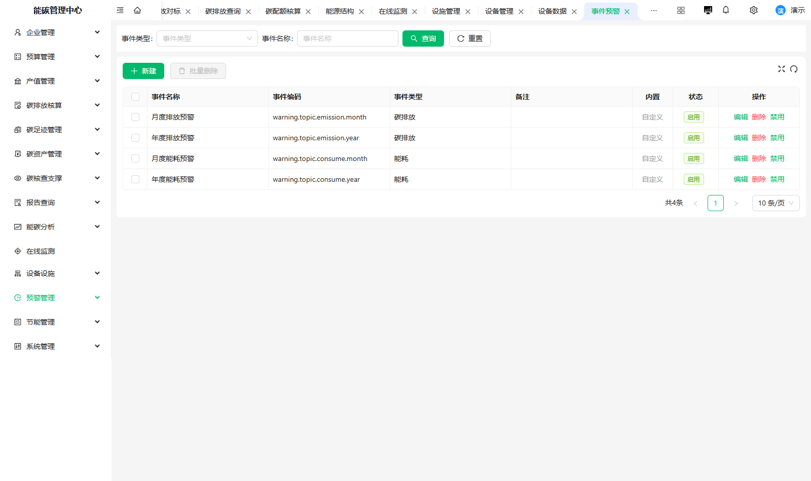

---

### 3.14 节能管理（2 个页面）

#### 3.14.1 节能改造项目

- 路由：`/carbon-economize/renovation-project/list`
- 筛选：年度区间、项目名称
- 列：年度、项目名称、投资金额、投资金额单位、节能量、节能量单位、**是否合同模式**、**完成状态**、企业、备注、操作
- 表单：年度\*、项目名称\*、投资金额、单位（万元）、节能量、单位（tce/年）、主要改造内容、备注、是否合同能源管理模式（是/否）、项目是否已完成
- 操作：新建、批量删除、导入、导出、编辑、删除

#### 3.14.2 能源管理情况

- 路由：`/carbon-economize/management-situation/list`
- 定位：**能源管理体系建设情况的自评/备案填报**（17 个字段，偏合规台账）
- 字段：填报日期\*、能源管理机构名称或所在部门、机构管理人员名单及分工、能源管理岗位、能源管理负责人、报管理节能工作部门备案情况、能源管理体系建立情况、节能管理制度名称、能源统计/能源计量管理情况、节能宣传情况、节能教育及培训情况、是否有无偿提供能源使用或发放能源补贴、是否按要求报送上年度《能源利用状况报告》、填报负责人、填报人、电话、备注
- 列表列：填报日期、能源管理机构名称、人员名单及分工、岗位、负责人、填报负责人、填报人、电话、企业、备注、操作
- 操作：新建、批量删除、编辑、删除、**导出**（无导入）

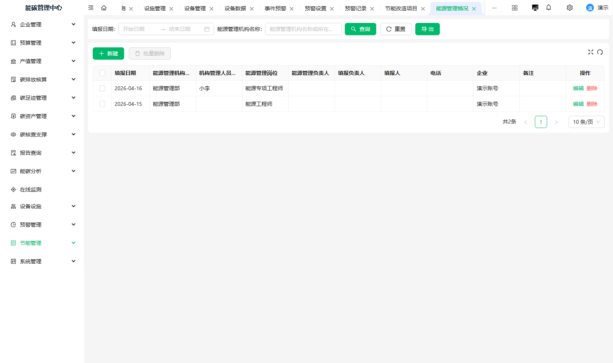

---

### 3.15 系统管理

- 菜单仅有"地区管理"，点击后**不发生路由跳转**（该菜单 `path` 为 null）
- `/sys` 路由渲染空白页
- 后台菜单数据中，系统管理下仅注册了"地区管理"目录及其按钮权限（查询全部省份 / 按省查市 / 按市查区），**无用户、角色、组织、字典等页面**
- **第二轮证据**：个人中心"操作日志"中频繁出现 `系统-用户管理 / 获取密码复杂度 @author 卓大`，说明后端**存在用户管理等系统模块**（RuoYi-Vue-Plus 标准模块），只是前端菜单未对本账号开放
- 结论：本账号可见的系统管理基本不可用；用户/角色/组织等能力在平台侧存在，但未交付到此账号

---

### 3.16 可视化大屏（独立入口）

**入口**：`#/visualization/CarbonEnergy`（登录时若识别为移动端会默认跳转此处）

**顶部导航**：日期选择（2026-06）、综合展示、报告下载、在线监测、系统管理、全屏、退出登录

**综合展示布局**
- 上排 KPI：近 12 月综合能耗 10,951.13 tce、近 12 月碳排放量 30,654.92 tCO₂e、近 12 月产值 1,449.69 万元
- 左上：当月能源消费量甜甜圈（按能源品种，含"天然气 47 tce，16.50/35.10%"双数值）
- 左中：近 12 月能源消费量堆叠柱（化石燃料/电力/热力/购入水 + 合计）
- 左下：近 12 月能源消费强度仪表盘（7.55 tce/万元，带行业标准值刻度 3–10）
- 右上：当月碳排放量甜甜圈（92.71 tCO₂e）
- 右中：近 12 月碳排放量堆叠柱（化石燃料/电力/热力/生产过程）
- 右下：近 12 月碳排放强度折线（285.16 vs 排放强度标准 3）
- 中央：3D 厂区模型/场景 + 企业简介

**顶部"报告下载"**：直接跳转后台"碳排放报告"页（说明大屏与后台同一套报告能力）
**顶部"系统管理"**：未能在无头环境点击进入（同名文本节点定位失败），**未验证**

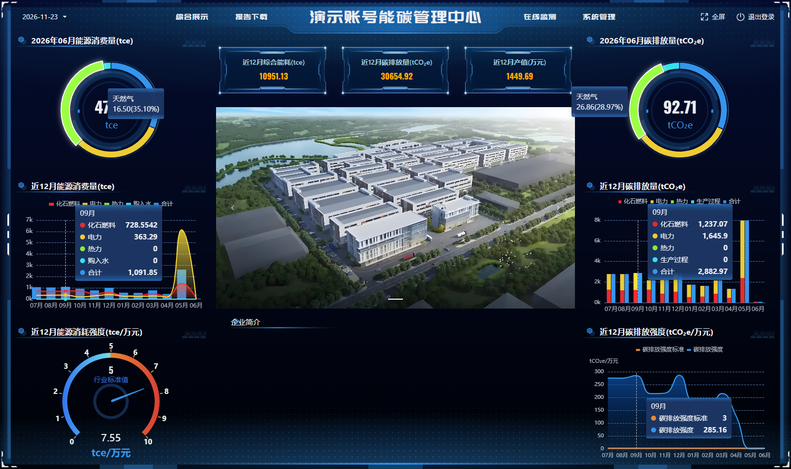

---

## 4. 关键业务流程（端到端）

### 流程 A：组织碳排放核算 → 报告（主线）

```
企业信息 / 设施设备建档
      ↓（活动数据：设备数据 或 直接录入）
碳排放核算（10 类排放源 × 月度）
      ↓ 保存后自动计算 温室气体量(tCO₂e) + 能源量(tce)
 ┌────┴───────────────┬──────────────┬───────────────┐
碳排放报告          能耗查询/碳排放查询   能源结构/策略推荐   碳配额核算
（图表+明细+PDF）    （分类汇总+同比环比） （桑基图/建议）    （配额使用比例+预算建议）
```

**操作步骤（已实测可达）**
1. 打开"碳排放核算" → 查询目标月份，确认是否已存在记录
2. 无记录 → 新建 → 选月份 → 分页签录入活动数据 → 保存
3. 打开"碳排放报告" → 选相同月份区间 → 查询 → 核对合计与明细
4. 需要正式文件 → 生成报告（有数据时进入 loading，约 30–40s 调 `queryCompletePdf`）

**前后置条件**
- 前置：本企业核算标准为 ISO14064-1（**第九轮修正**：产品支持 GB/T 32151 行业标准切换，见 §16.4）；活动数据需人工收集；产值数据需在"生产总值"中已录入，否则强度指标为 0
- 后置：核算记录变更会同步影响报告、6 个分析页、大屏、首页 KPI

### 流程 B：产品碳足迹 → 分析 → 报告

1. "产品列表"建立产品（含单位、1/2/3 级单位产品能耗值）
2. "碳足迹核算"新建 → 选年度/产品 → 填产品产量与碳足迹值 → 分三段（原材料获取/运输/生产）逐条新增明细行 → 保存
3. "碳足迹分析" → 选年份 + 产品 → 查看三阶段条形图（占比结构）
4. "产品碳足迹报告" → 选年份 + 产品 → 查看三阶段明细与合计占比 → 生成报告（简报）

**前置**：产品已建档；三段明细的排放因子已知
**后置**：产品足迹数据被"碳足迹分析""产品碳足迹报告"复用；与组织碳核算**相互独立**（未见数据打通）

### 流程 C：供应链碳足迹 → 链路分析

1. "供应链碳管理" → 新建（顶级供应商）：供应商名称、产品、碳足迹值/单位、碳足迹日期、减排目标值
2. 选中行 → "添加上级"建立层级（或"添加下级"反向挂接，菜单权限含"添加/更新/删除供应商碳足迹"）
3. "供应链碳管理分析" → 选供应商 + 日期 → 查看链路节点图（上游→下游，节点显示碳足迹）

**前置**：至少一条供应商足迹记录
**后置**：链路图为只读分析，不参与组织核算

### 流程 D：配额 → 资产 → 交易

1. "碳排放配额"按年度录入配额量与下年度配额量（可批量导入）
2. "碳配额核算"（分析）查看配额使用比例与预算调整建议
3. "碳配额资产管理"登记配额资产数量/类型/年度（可禁用）
4. "信用资产管理"登记 CCER 等信用资产及状态（待申请/…）
5. "交易管理"登记购入/出售流水（数量、单价、金额、对手方、用途）

**前后置**：配额是分析页基数；资产与交易为台账记录，**未见与配额数量的自动核减/结转联动**

### 流程 E：设备接入 → 在线监测 → 预警

1. "设施管理"建树（车间/办公区/场地）→ "添加下级"细化
2. "设备管理"在设施下建设备（类型、计量级别、能源种类、**设备预警规则**）
3. "设备数据"按日填报数值（数值/单位/换算率/来源/状态）或批量导入
4. 大屏"在线监测"查看设备列表、详情、最新数据、月度/年度统计
5. "事件预警"定义指标 → "预警设置"配阈值/等级/冷却 → "预警记录"查看触发结果并标记已读

**限制**：演示账号下设备无遥测数据、无预警规则、无预警记录，第 4–5 步的实时性与触发效果未能验证

### 流程 F：节能管理（独立台账）

1. "节能改造项目"登记项目（投资、节能量、合同能源管理模式、完成状态）
2. "能源管理情况"按年度填报能源管理体系情况（机构、制度、培训、报送等 17 项）
3. 导出上报

**观察**：该模块**未与核算/分析联动**（无节能量抵扣、无项目减排量计算），属于合规填报台账。

---

## 5. 模块间关系

### 5.1 数据流向图（文字版）

```
[企业信息] ──企业ID──> 所有模块（数据归属）
[设施管理] ──树──> [设备管理] ──> [设备数据] ──┐
                                              ├─> [在线监测/大屏]（最新数据、日月统计）
[产品列表] ──> [产品产值] ──┐                 └─> [预警记录]（阈值触发，推断）
        └────> [生产总值] ──┴─> 强度指标（tce/万元、tCO₂e/万元）、能效对标（产量）、能源利用报告（单位产值/单位产品能耗）
[碳排放核算] ──> [碳排放报告] / [能耗查询] / [碳排放查询] / [能源结构] / [策略推荐] / [能效对标] / [碳配额核算] / 首页KPI / 大屏
[碳排放配额] ──> [碳配额核算]（配额、使用比例、预算建议）
[碳配额资产] + [信用资产] ──> [交易管理]（台账流水）
[碳足迹核算] ──> [碳足迹分析] ──> [产品碳足迹报告]
[供应链碳管理] ──> [供应链碳管理分析]（链路图）
[原始凭证] + [第三方报告] ──> 核查证据库（独立）
[事件预警] ──> [预警设置] ──> [设备(预警规则)] ──> [预警记录]
[节能改造项目] + [能源管理情况] ──> 合规台账（独立）
```

### 5.2 交叉验证（用真实数据证伪/证实）

| 验证点 | 证据 | 结论 |
|---|---|---|
| 核算 → 报告 一致 | 2026-05 核算记录 7961.314284 tCO₂e / 2621.85 tce；报告同月"温室气体排放合计"7961.314284，完全一致 | 报告直接取核算结果，未二次计算（**更正**：报告表**没有标煤合计行**，3687 只是"购入电力"单行标煤值，不能当合计） |
| 产值依赖 | "生产总值"缺 2026-05 → 报告该月"企业产值 0、碳排放强度 0" | 强度指标强依赖产值录入 |
| 配额核算口径 | 14,943.16 ÷ 3,011,111 ≈ 0.496% → 页面显示 0.50% | 配额使用比例 = 年度累计排放/年度配额 |
| 产品对标空态 | 产品列表有 1/2/3 级能耗值，但"产品对标"暂无数据 | 产品对标还需产品产量/产值数据 |
| 在线监测空白 | `/carbon-monitor` 无接口、无 DOM | 该菜单未实现页面 |

---

## 6. 前后置条件汇总

| 业务动作 | 前置条件 | 后置结果 |
|---|---|---|
| 新增碳排放核算 | 月份未重复；活动数据齐备；核算标准固定 | 生成月度核算记录，驱动全部分析与报告 |
| 编辑碳排放核算 | 记录存在 | 派生数据同步变化（不可删除，保审计） |
| 生成碳排放报告 PDF | 周期内存在核算记录 | 约 30–40s 输出 PDF（呈现方式未确认）；无数据则报错 |
| 新增产品 | — | 可用于产品产值、碳足迹、产品对标 |
| 新增产品产值/生产总值 | 产品已建档（产品产值） | 强度指标、单位产值/产品能耗可算 |
| 新增碳足迹 | 产品已建档；三段明细完整 | 碳足迹分析、产品碳足迹报告可用 |
| 添加上级供应商 | 已有供应商记录 | 形成供应链层级，链路分析可视化 |
| 生成配额建议 | 年度配额 + 该年度排放数据 | 配额使用比例、预算调整建议 |
| 新增设备 | 设施已建 | 设备数据、在线监测、预警规则可绑定 |
| 新增设备数据 | 设备已建 | 进入在线监测/预警判定/能耗统计（推断） |
| 配置预警 | 事件预警已定义 | 预警记录可产生（未验证） |
| 导入数据 | 下载模板并按模板填写，≤10MB 单文件 | 新增/覆盖记录（未实测） |

---

## 7. 访问限制与未验证项（如实说明）

| # | 限制 | 现象 | 影响 |
|---|---|---|---|
| 1 | 侧边栏"在线监测"空白 | `/carbon-monitor` 仅空容器；打包含 6 个监测组件，但 8 个候选子路由全部 404 | 该模块在本账号未交付，实时看板/设备接入/MQTT 均不可见（组件存在，功能无法评估） |
| 2 | "系统管理"不可用 | 仅"地区管理"，path 为空；`/sys` 空白；操作日志显示后端有"系统-用户管理" | 用户/角色/字典等系统能力无法评估 |
| 3 | 预警链路无数据 | 预警设置 0 条、预警记录 0 条（共0条）、待办 0 条 | 预警从配置到触发未验证（仅能看到字段设计） |
| 4 | 报告生成全部失败 | 碳排放报告：内网模板 `192.168.1.6:25525` 截图失败；产品碳足迹报告：30005 无权限；能源利用报告：无填报数据 | 三类报告的成品样式、章节结构、下载方式均无法验证 |
| 5 | 无实时遥测 | "设备最新数据"为空；设备数据来源为"填报" | 平台是否已接通网关/MQTT 无法判断（组件存在但未挂载） |
| 6 | 导出/模板下载受限 | 产品导出、设备模板、配额模板均 30005；配额"导出"按钮无任何请求；原始凭证下载 NPE | 导入模板字段、导出列结构无法获取 |
| 7 | 单账号视角 | 仅一个演示账号（非超管，`administratorFlag=false`） | 无法判断多角色、多企业、数据权限隔离 |
| 8 | 二次验证未出现 | `getTwoFactorLoginFlag` 返回 false | 其他账号是否强制邮箱验证码未知 |
| 9 | 大屏"系统管理"跳首页 | 点击后跳转 `#/home`，并非系统管理页 | 大屏侧无独立系统配置能力（或为错误跳转） |
| 10 | 移动端仅实测登录跳转 | 390px 登录后进入大屏，单列适配正常 | 移动端后台（非大屏）适配与功能未验证 |
| 11 | 一次误写入 | 见 §9.6，新增 1 条 2026-11 空核算记录，无删除权限 | 演示数据出现 1 条 0 值记录，需管理员清理 |

> 另：以下内容为**界面可读的推断**，非实测结论——① 核算保存后自动计算；② 设备数据触发预警；③ 碳足迹值由三段明细汇总；④ 配额"减排目标/预计下年度配额"的算法；⑤ 供应链"添加上级"的层级规则。

---

## 8. 竞品观察与可借鉴点（简要）

**做得好的**
1. **核算颗粒度细**：10 类排放源（含购入/输出热水、蒸汽、集中供暖、废水处理）与 ISO14064-1 对齐，默认参数预置，降低填报门槛。
2. **一次核算、全站复用**：所有分析/报告共用 `queryComplete`，口径统一，避免"多套数字"。
3. **核算可编辑、删除受权限控制**：只允许编辑，符合核查留痕逻辑。（**第十七轮补强 → 第十九轮推翻**：146 条菜单里确实没有"删除核算填报"，但拆包发现 `calculation-complete-api` 有 `delete` 方法、`calculation-complete-list` 有确认弹窗 + 调用，**删除功能是做了的，只是当前角色未配置该按钮**；菜单树是权限快照，不能当功能清单）
4. **供应链碳足迹链路图**：树形建档 + 链路可视化，是同类产品中较少的差异化能力。
5. **大屏与后台一体**：大屏"报告下载"直接跳后台报告页，减少重复建设。
6. **配额—资产—交易**闭环台账，覆盖履约型企业真实业务。
7. **审计能力扎实**：登录日志 + 操作日志（23,044 条，可按成功/失败筛选、可看详情），RuoYi-Vue-Plus 标准审计链路完整。

**明显短板**
1. 侧边栏"在线监测"是死菜单（组件齐全但未挂载），"系统管理"几乎为空——功能完整度与宣传口径有落差。
2. 设备数据靠人工填报，"在线监测"缺少实时采集闭环（至少演示环境如此）。
3. 预警模块只有配置壳，无实际规则与记录，闭环未打通。
4. **报告引擎脆弱**：报告由"HTML 模板 + 图表截图 + OpenPDF 合成"实现，图表截图服务指向内网 `192.168.1.6:25525`，部署到公网即全量失败；且耗时 30–40 s。（**第十三轮补充**：PDF 由 Java OpenPDF 2.0.3 生成，含文本层与 2 张图片，不是纯截图拼装，详见 §20.3）
5. **错误处理粗糙**：无权限（30005）、无数据、后端 NPE 一律折叠成"生成报告失败，请稍后重试"，用户无法自助定位。
6. 导入/导出权限默认未开，模板也拿不到，交付到客户手上容易"看着有按钮点不动"。
7. 节能管理、核查支撑与核算主链路脱节，属"孤岛台账"。
8. 缺少移动端/小程序侧的巡检、填报入口（移动端登录只进大屏，无后台功能）。

---

## 9. 第二轮深度验证（补充调研）

> 第二轮聚焦第一轮"未验证/未知"的项：报告为什么失败、导出能不能用、在线监测到底是没做还是没开、审计日志与个人中心、移动端行为。

### 9.1 报告生成链路与失败根因（重要）

**接口**：`POST /api/carbon-report/CalculationReport/queryCompletePdf`（返回 JSON 而非 PDF）

**错误原文**（前端 toast，完整）：
```
java.lang.IllegalStateException: 网页截图失败:
http://192.168.1.6:25525/common-template/html/calculation/briefing/fuel
?completedEndDate=2026-05-31%2023:59:59
&enterpriseId=2031340904327065601
&completedStartDate=2026-05-01%2000:00:00
```

**推断的实现链路**
1. 后端按报告章节组装参数（章节键如 `calculation/briefing/fuel`，即"化石燃料"章节）
2. 请求内部模板服务 `common-template/html/...` 渲染 HTML 页面
3. 调无头浏览器/截图服务对 HTML 逐页截图
4. 将图片按章节拼装成 PDF
5. 任一步失败即抛出 `IllegalStateException`，前端统一提示"生成报告失败，请稍后重试"

**关键结论**
- 模板服务被配置为**内网地址 `192.168.1.6:25525`**（正是 `window.$AppConfig.apiUrl` 的兜底值），公网环境不可达 → 报告功能在演示环境**必然失败**
- 这不是"数据不足"导致的失败，而是**部署配置问题**；同一套模板渲染方式意味着报告排版依赖"网页图表截图 + 服务端合成"（**第十三轮更正**：正文与表格由 OpenPDF 排版，仅图表走截图服务）
- 三类报告失败原因各不相同，说明错误处理未细分：

| 报告 | 触发条件 | 实际返回 |
|---|---|---|
| 碳排放报告 | 有数据（2026-05） | 等待 35 s → `网页截图失败` + `生成报告失败，请稍后重试` |
| 碳排放报告 | 无数据（2026-10~11） | `生成报告失败，请稍后重试` |
| 产品碳足迹报告 | 默认年份 + 产品 | `对不起，您没有权限访问此内容哦~` + `生成报告失败，请稍后重试`（`genBriefReport` 无权限） |
| 能源利用报告 | 无填报数据 | `没有查到对应的填报数据，请先进行数据填报` + `生成报告失败，请稍后重试`（唯一给出明确引导的） |

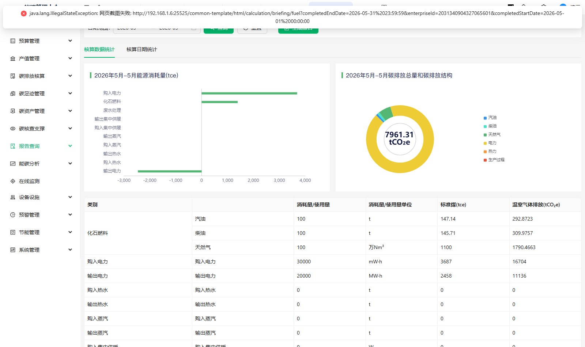

### 9.2 导出 / 下载 / 模板：权限矩阵（实测）

| 页面 | 动作 | 接口 | 结果 |
|---|---|---|---|
| 碳排放配额 | 导出（未选年度） | 无 | 提示"**请先选择年份**"（前置校验） |
| 碳排放配额 | 导出（已选 2026 + 查询） | **无任何请求** | 无响应、无文件、无提示（疑似按钮未绑定/被权限拦截但未提示） |
| 碳排放配额 | 导入 → 下载模板 | `POST /carbon-emission/quota/exportTemplate` | `{"code":30005,"msg":"对不起，您没有权限访问此内容哦~"}` |
| 产品列表 | 导出 | `POST /carbon-product/product/export` | `30005 无权限` |
| 设备管理 | 导入 → 下载模板 | `GET /carbon-facility/device/importTemplate` | `30005 无权限` |
| 原始凭证 | 行内"下载" | `GET /carbon-verify/evidence/downLoad?evidenceId=...` | `{"code":10001,"msg":"java.lang.NullPointerException: Cannot invoke \"...FileMetadataVO.setFileName(String)\"..."}`（附件为空导致后端 NPE） |

**结论**
- 演示账号的导入/导出权限几乎全部未开通，无法获取模板字段与导出列结构
- "原始凭证下载"存在**后端空指针缺陷**：当凭证未挂附件时直接 500 级异常而非友好提示
- 同一产品内导出交互不一致：配额页有前置校验（请先选择年份），产品页直接请求，配额页最终又无请求

### 9.3 "在线监测"：不是没做，是没开

- 前端主包预加载资源中包含：`RealtimeDashboard`（实时看板）、`device-access-list`（设备接入）、`device-discovery-list`（设备发现）、`device-telemetry`（设备遥测）、`mqtt-monitor`（MQTT 监控）、`energyUnit/list`（能源单元）、`device-bind-modal`（设备绑定）、`monitor-device-link-modal`
- 路由探测 8 个候选路径，全部返回"对不起，您访问的内容不存在！"
- 菜单数据中 `/carbon-monitor` 只有目录、无子菜单 → 前端不挂载子路由
- **判断**：产品已具备"设备接入—发现—遥测—MQTT 监控—实时看板"的完整链路。（**第十四轮修正**：该链路后端**已在生产运行**——在线 47 台/离线 4662 台、29 条接入配置、12 条解析规则、EMQX 实时客户端可查；只是前端路由未挂到本租户，详见 §21.3）

### 9.4 个人中心与审计日志（第一轮遗漏）

**入口**：右上角头像 → 个人中心（`#/account`）

| 页签 | 内容 |
|---|---|
| 个人中心 | 登录账号、用户名称、性别、手机号码、邮箱、备注、头像（上传）+ "更新个人信息" |
| 修改密码 | 原密码/新密码/确认密码（本次未操作） |
| 我的消息 / 我的通知 | 消息聚合（本账号为空） |
| 登录日志 | 时间、登录方式、登录设备、IP 地区、IP、结果（实测 10 条，含本次调研的 HeadlessChrome 登录记录，IP 归属"中国|福建省|福州市|移动"） |
| 操作日志 | 请求时间筛选、快速筛选（全部/成功/失败）、操作模块、操作内容、IP 地区、客户端、时间、结果、详情（**共 23,044 条**） |

**操作日志的价值**：
- 逐条记录"操作模块-操作内容"，可直接反推后端模块划分（如 `预警-记录`、`业务支撑-通知`、`系统-用户管理`）
- 其中 `系统-用户管理 / 获取密码复杂度 @author 卓大` 直接暴露底层框架为 **RuoYi-Vue-Plus**
- 说明该产品具备完整的操作审计能力（合规加分项），但**只对本人可见**（个人中心内）

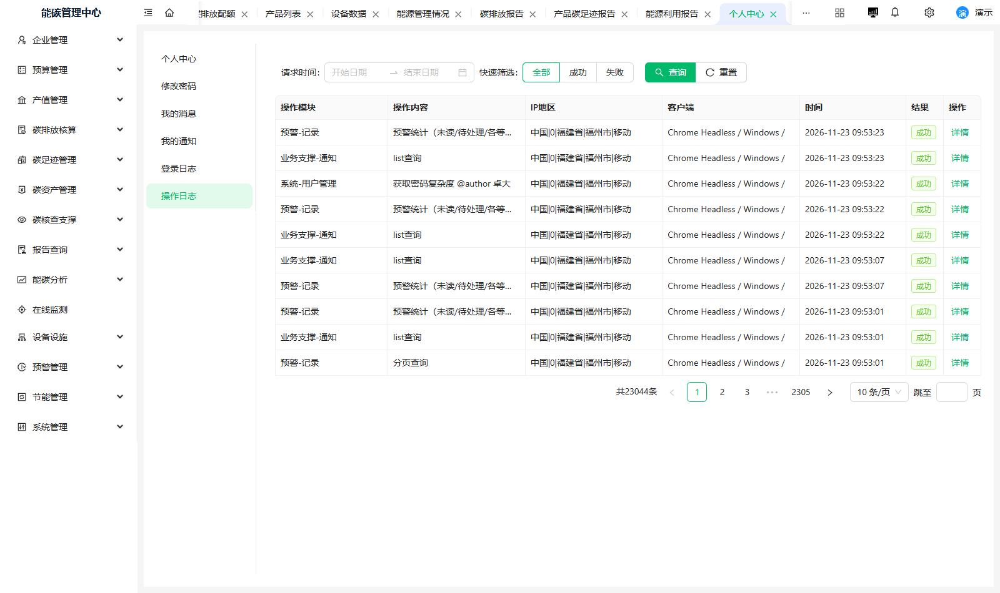

### 9.5 移动端行为（实测）

- 视口 390×844 下登录成功 → 直接跳转 `#/visualization/CarbonEnergy`（大屏），不进入后台
- 大屏为单列滚动布局，KPI、能源消费量、碳排放量、强度仪表盘依次堆叠，可正常阅读
- 移动端默认展示"2026年11月"（当月），近 12 月指标随所选月份滚动

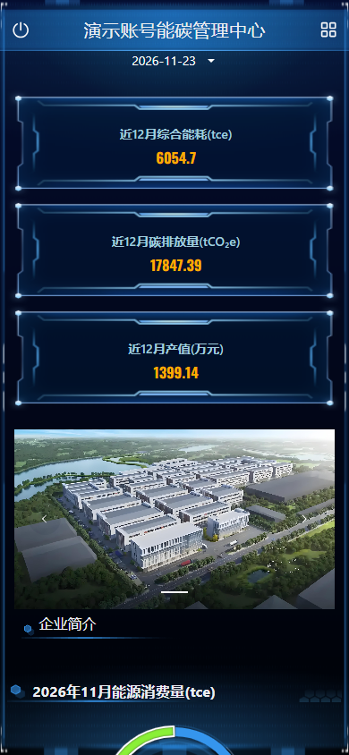

### 9.6 误写入事件（必须说明）

- **经过**：为验证表单必填校验，在"碳排放核算 → 新建"弹窗中点"保存"。该弹窗的**核算日期已默认预填为 2026年11月**，因此校验通过，实际发出 `POST /api/carbon-computation/calculationComplete/add` 并提示"操作成功"
- **结果**：新增 1 条记录，ID `2124684712132026370`，核算日期 2026年11月，温室气体量 0 tCO₂e、能源量 0 tce；列表总数由 14 → 15
- **清理尝试**：`POST /api/carbon-computation/calculationComplete/delete` 返回 `30005 无权限`（该账号对核算记录无删除权限，UI 亦无删除按钮），**无法自行删除**
- **影响**：仅多一条 0 值记录，不改变任何已有数据与指标（0 值不影响合计）；如需清理需由平台管理员处理
- **教训（对后续调研）**：该产品多数"新建"弹窗会预填日期/默认值，**只要点保存就会落库**，不能以"必填为空"为前提判断安全

### 9.7 其他细节修正

| 项 | 第一轮判断 | 第二轮修正 |
|---|---|---|
| 大屏"系统管理" | 未点开 | 点击后跳转 `#/home`（后台首页），并非系统管理页 |
| 导出前置条件 | 未记录 | 配额页必须先选年份，否则提示"请先选择年份" |
| 报告 PDF | 呈现方式未知 | 根本不会产出，后端截图服务不可达 |
| 在线监测 | **后端已在运行** | 前端未挂路由；后端有在线总览/EMQX 客户端/接入配置/解析规则/离线事件等真实数据（§21.3） |
| 系统管理 | 几乎为空 | 后端有用户管理等模块，前端未开放 |
| 移动端 | 仅代码推断 | 已实测：登录直达大屏，单列适配正常 |

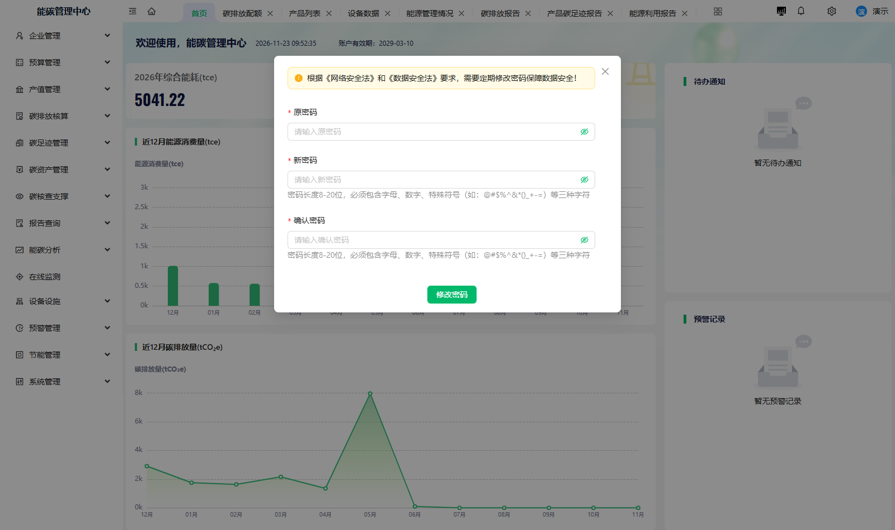

---

## 10. 第三轮：字段、文案与口径细化

> 第三轮不打新页面，专攻"内容层"：智能建议的完整文案、核算默认因子、下拉字典、确认文案、编辑态约束。

### 10.1 预算动态调整建议（全文结构与口径）★

入口：碳配额核算页 → 点"用能和碳排放预算动态调整建议" → 打开弹窗（两段：用能预算 / 碳预算）

**用能预算段的关键数据**
- 实际能源消耗总量 5041.22 tce，占年度总量预算 **2.52%**，相较时间进度**滞后 96.98 个百分点**
- 电力消耗已使用预算 2.33%，是"进度滞后"的首要因素
- 反推年度用能预算 ≈ 5041.22 ÷ 2.52% ≈ 200,048 tce（**第六轮已取到真值：200,000 tce**，见 §13.3）

**碳预算段的关键数据**
- 实际碳排放 14943.16 tCO₂e，占年度碳预算 **3.74%**，滞后 95.52 个百分点
- 实际单位产值/产品碳排放 **10.7582 tCO₂e/万元**
- 电力贡献总排放的 5.28%（原文如此，**第六轮证实这是语义错误**：5.28% 是"电力排放占年度碳预算"的比例，不是"占总排放"，见 §13.3）
- 反推年度碳预算 ≈ 14943.16 ÷ 3.74% ≈ 399,551 tCO₂e（**真值 400,000 tCO₂e**，见 §13.3）

> **重要矛盾**：这个"年度碳预算"（≈39.96 万 tCO₂e）与界面上可维护的"碳排放配额"（3,011,111 tCO₂e）**不是同一个数**，而页面没有任何入口维护"年度用能预算/年度碳预算"。说明系统里还有一套**不可见的预算基线**（可能由平台侧配置或按行业公式生成），这直接影响建议文案的可信度。

**建议文本的四类情景（规则化叙述，非自由文本生成）**
1. **能效偏差型**：能效优于基准 → 结余部分划为"内部能效奖励预算"，其余收回作公司缓冲；劣于基准 → 冻结非关键用能预算 + 限期提交根因分析与整改
2. **价格波动型**：价格下跌结余不鼓励增耗，60% 转"能源价格风险储备金"、40% 投短回收期节能项目；价格上涨 → 上调后续采购预算 + 加大长协比例 + 启动"需求抑制"审查
3. **能源结构/碳市场型**：排放因子官方更新 → 等比例上调碳预算并视为政策性影响；绿电/结构调整 → 用能与碳预算联动审批；被动接受高价高碳能源 → 从风险储备金支出并下调碳预算转入"碳配额储备池"；主动绿色溢价 → 用"隐含减碳成本 C"对比内部碳价与市场碳价分三档决策（C≤内部碳价批准 / 内部碳价<C≤市场碳价有条件批准 / C>市场碳价仅战略投资）
4. **生产计划型**：产量增加按"单位产品碳预算×增量"等比例上调（从储备池或内部碳资产划拨）；产量减少同步核减；用能预算调增必须**关联碳预算调整申请**，实现"能-碳"预算一体化审批

**评价**：这是竞品最有"咨询感"的功能——把预算偏差拆成四类归因并给出处置动作（奖励/冻结/储备金/内部碳资产/专项投资），比单纯图表更有说服力；但文案是模板拼接，数据口径存在上述矛盾。

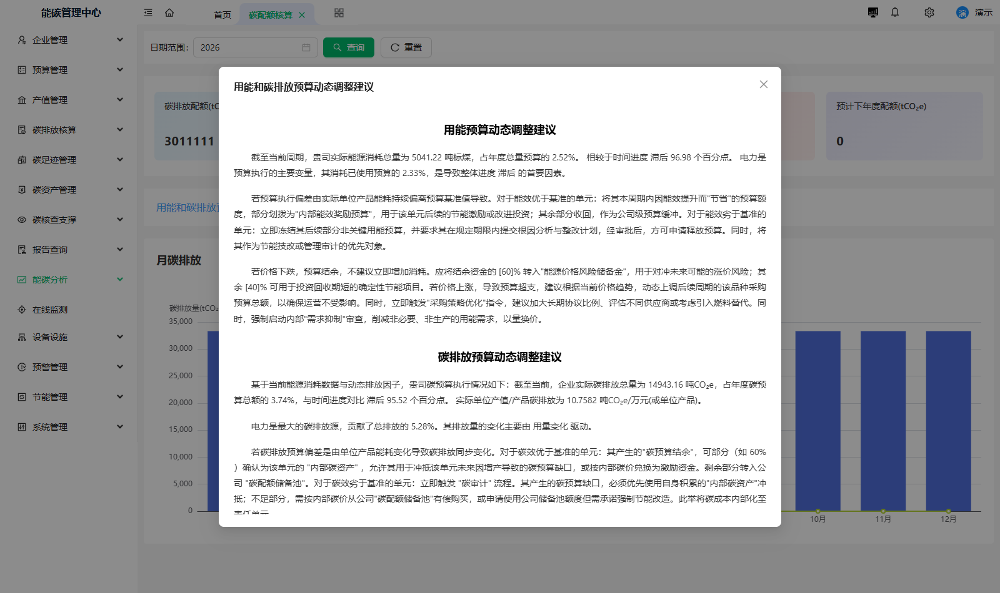

### 10.2 用能策略推荐（两个弹窗全文要点）

| 弹窗 | 结论要点 |
|---|---|
| 分时用能优化建议 | ①高峰用电占比高 → 可调负荷转移至谷/平段；②平段电价与光伏出力高峰重叠 → 提高光伏消纳、调整产线时序；③峰值时段设备负载率偏低 → 上储能做峰谷调节 |
| 用能设备启停负载优化策略 | ①非连续设备设定间歇启停程序、班次交接自动关机；②并联设备组启用智能群控，按实时负荷算最优开机台数（避免"大马拉小车"）；③高负载设备启动与主运行时段挪到谷/平段 |

> 两段均为"定性建议 + 通用话术"，未给出具体到设备/时段的量化方案（如建议转移多少 kW、预计省多少钱），属于**话术型智能**。

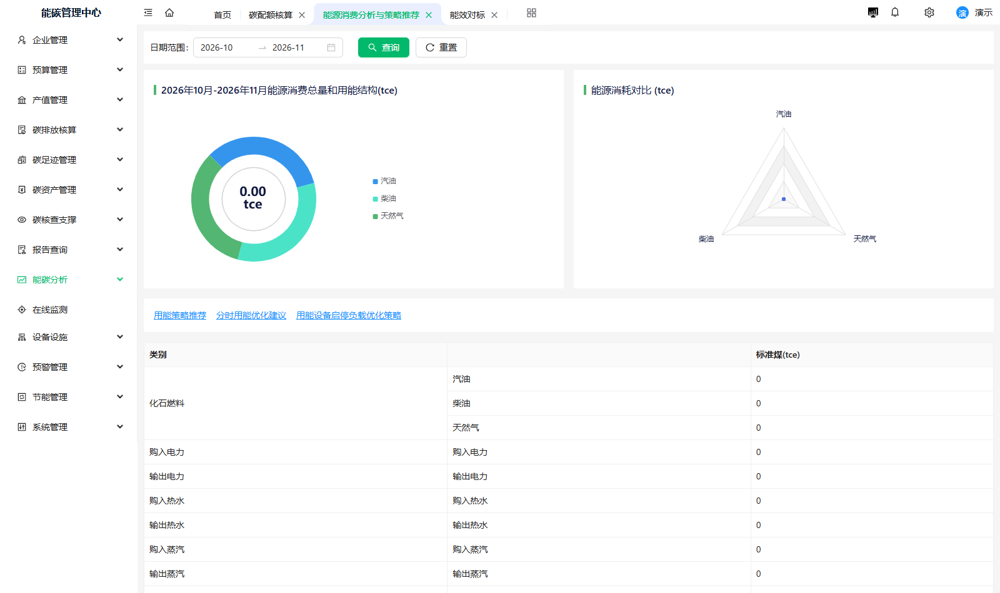

### 10.3 核算表单的两个硬约束（易踩坑）

1. **核算日期默认=当前月**（实测打开即 2026年11月），且**编辑态日期只读**（`readOnly=true`）——即"月度账期一旦落库不可改月份"，只能改数据。这也解释了 §9.6 的误写入：默认值 + 保存 = 直接落库。
2. **排放因子是"缺省 / 自测"二选一**：下拉仅两项，`缺省`=用系统内置因子，`自测`=填企业实测值；化石燃料三行预置了具体系数（汽油 43.124 GJ/t、0.0189 tC/GJ、98%；柴油 42.705、0.0202、98%；天然气 322.38 GJ/万Nm³、0.0153、99%），其余排放源的因子值均为"缺省"占位。


### 10.4 下拉字典（实测枚举，节选）

| 表单 / 字段 | 可选值 |
|---|---|
| 产品 · 产品类型 | 一般产品 / 低碳产品 / 零碳产品 |
| 生产总值 · 总产量单位 | 吨 / 千吨 / 万吨 / 克 / 千克 / 个 / 万个 / 件 / 万件 / 箱 |
| 碳资产 · 单位 | 万元 / tCO₂e / kgCO₂e / gCO₂e / CO₂e / 张 / MW·h |
| 交易 · 资产类型 | 信用资产 / 配额资产 |
| 碳足迹 · 碳足迹单位 | tCO₂e/t / kgCO₂e/kg / gCO₂e/g / tCO₂e/万Nm³ / tCO₂e/Nm³ / tCO₂e/万个 / kgCO₂e/个 / tCO₂e/万件 / kgCO₂e/件 / tCO₂e/万m |
| 碳足迹 · 核算边界 | 从摇篮到大门 |
| 预警设置 · 预警事件 | 系统预置（接口实测共 **8 个**）：月度/年度排放预警、月度/年度能耗预警、电表电压预警、电表电流预警、水表数据预警、蒸汽表数据预警（界面列表默认只显示 4 条，易误判） |
| 事件预警 · 事件类型 | 系统 / 碳排放 / 能耗 |
| 设备 · 设备类型 | 电表 / 水表 / 蒸汽表 / 燃气表 / 油表 / 电子秤 / 其他 |
| 节能改造 · 投资金额单位 | 万元 / 十万元 / 百万元 / 千万元 / 亿元 / 千元 / 百元 / 元 |
| 碳排放核算 · 排放因子来源 | 缺省 / 自测 |

> 说明：预警事件是**内置字典**而非用户自定义，"事件预警"页面虽可新建事件，但预警设置只能从预置事件中选，两处口径不一致。

> 更正（第四轮）：`/common-warning/event/queryPage` 实测 `total=8`，包含设备类事件（电压/电流/水表/蒸汽表）。事件编码为国际化键：`warning.topic.emission.month`、`warning.topic.consume.year`、`warning.topic.deviceData.electric.voltage` 等，说明其预警引擎按"topic"订阅指标。

### 10.5 危险操作确认文案（含两处文案缺陷）

| 操作 | 确认框标题 | 正文 |
|---|---|---|
| 配额 · 删除 | 提示 | 确定要删除选中项吗? |
| 原始凭证 · 删除 | 提示 | 确定要删除**选**吗?（缺字，应为"选中项"） |
| 节能改造 · 删除 | 提示 | 确定要删除**选**吗? |
| 设备 · 禁用 | 状态切换确认 | 确定要将该设备**启用**吗?（按钮为"禁用"，提示却写"启用"，语义相反） |

> 均为"取消 / 删除（确定）"双按钮；本次只读验证，未点击确认。

### 10.6 列表页全局控件与交互

- 工具栏图标：搜索、刷新（reload）、新增（plus）、批量删除（delete）、全屏（fullscreen）、redo（重置/撤销态）、左右翻页、更多（down）
- **表头不支持排序**（`th` 无 sorter 类），排序能力仅体现在后端默认排序（如按年度/日期倒序）
- 分页：默认 10 条/页，可选 5/10/15/20/30/40/50/75/100/150，支持跳页
- 碳足迹三阶段明细为**行内新增**（点"新增"直接在表格追加一行输入框），不是弹窗

### 10.7 大屏指标窗口口径（实测对比）

| 大屏所选月份 | 近12月综合能耗(tce) | 近12月碳排放量(tCO₂e) | 近12月产值(万元) |
|---|---|---|---|
| 2026-06 | 10,951.13 | 30,654.92 | 1,449.69 |
| 2026-11（默认当月） | 6,054.70 | 17,847.39 | 1,399.14 |

> **更正（第五轮实测）**：大屏有两种口径——
> ① `useDate=0`（默认"今天"）→ 标签为"**近12月**"，是以今天为终点的滚动 12 个月；
> ② `useDate=1`（自选历史日期）→ 标签变为"**2026/2025 综合能耗**"，按**自然年**聚合，同年任一日期结果相同。切换日期不是简单平移窗口，而是**切换统计模式**。

---

## 11. 第四轮：权限模型、数据模型与算法验算

> 前几轮看的是"界面有什么"，这一轮看"底层怎么搭"：RBAC 权限点、实体字段、计算公式。**全部只读**（未点保存/删除/确认）。

### 11.1 RBAC 权限模型（完整拆解）

登录接口 `login/getLoginInfo` 返回 `menuList` 共 **146 条**，其中：
- 目录（menuType=1）15 条（14 个一级模块 + 二级目录“地区管理”）
- 页面（menuType=2）32 条
- 按钮权限（menuType=3）99 条，且 `webPerms` 与 `apiPerms` 一一相同

权限编码统一为 `模块:实体:动作`，动作分布：

| 动作 | 数量 | 说明 |
|---|---|---|
| query | 32 | 每页 1 个，含"查询核算标准""查询全部省份"等特殊项 |
| add | 19 | |
| update | 20 | |
| delete | 19 | |
| disabled | 4 | 设施/设备/预警事件/预警设置（启禁用） |
| download | 2 | 原始凭证、第三方报告 |
| queryAllProvince / queryAllCityByProvinceId / queryAllDistrictByCityId | 3 | 地区级联（系统管理唯一条目） |

**推导出的角色设计**：一个"业务管理员"角色即可覆盖全部 CRUD；查看类角色只需 32 个 query；不存在"审批/复核"类权限点（**无审批流**，这点与产品定位一致——单企业填报，不做集团多级审核）。

**权限不一致处（可作竞品弱点）**
1. 碳排放核算只有 `query/add/update` + `standard:query`，**没有 delete**（与 UI 无删除按钮、接口 30005 完全吻合），但其他模块都是标准 CRUD——核算被单独"保护"。
2. 碳足迹分析、供应链分析复用列表页的 query 权限（`carbon-footprint:product:query` / `supplier:query`），未单独设权限点，意味着"能看列表就能看分析"。
3. 预警记录只有 query/update/delete，没有 add（记录由引擎生成），无 `disabled`。
4. 企业信息页无任何按钮权限（纯只读）。
5. 批量导入/导出**没有任何权限点**——这解释了为什么导出按钮点了没反应：功能存在，但权限体系里没有为它建模。

### 11.2 实体字段（接口实测，节选）

| 实体 | 字段数 | 关键字段（业务语义） |
|---|---|---|
| 碳排放配额 | 10 | year、quotaQuantity、quotaQuantityUnit、nextYearQuotaQuantity、enterpriseId |
| 产品 | 21 | name、unit、model、type（1 一般/2 低碳/3 零碳）、category（1 工业产品）、one/two/threeUnitProductEnergyConsumptionValue、productImageVOList |
| 产品产值 | 20 | productId、quantity、value、type、outputDate、productOneUnitProductEnergyConsumptionValue（冗余快照） |
| 生产总值 | 13 | name、quantity、quantityUnit、value、valueUnit、type、outputDate |
| 碳排放核算 | 33 | templateId、calculationStandardId、classification（=3）、greenhouseGasQuantity、energyQuantity、completedDate、productValue、productQuantity、**calculationItemList**、**strategySuggestion**、emissionIntensityStandardValue、energyEfficiencyBenchmarkValue 等基准字段 |
| 供应链足迹 | 17 | supplierName、productName、carbonFootprintValue、targetValue、sort、**parentId**、**children**（自关联树） |
| 配额资产 | 17 | name、quantity、unit、year、type、startDate、endDate、disabledFlag |
| 信用资产(CCER) | 16 | name、quantity、unit、type（如 6）、**status**（如 2） |
| 交易 | 21 | quantity、price、amount、type、**direction**（1/2 = 购入/出售）、tradeDate |
| 原始凭证 | 10 | name、code、description、periodDate、evidenceDocumentList（附件数组，实测为 null → 下载 NPE） |
| 第三方报告 | 9 | name、document[]（fileId/fileName/fileKey/fileUrl，MinIO 路径 `/minio/app-carbon-energy/public/...`） |
| 设施 | 23 | parentId、children、**devices**、**allDeviceIdList**、**deviceCount**、preId/nextId（同级排序链） |
| 设备 | 21 | facilityId、deviceType（elec…）、measureLevel（=3）、energyType（"购入电力"）、**warningRuleId**、**accessConfigId**（接入配置） |
| 设备数据 | 12 | deviceId、quantity、unit、conversionRate、dataDate、dataSource（=2）、status（=1） |
| 预警事件 | 8 | code（`warning.topic.*`）、type、warningCategory（1 能碳/2 设备）、builtInFlag |
| 节能改造 | 15 | year、investmentAmount、energySavingQuantity、modelFlag（合同能源管理）、completeFlag |

> 值得注意的三个"隐藏设计"：
> ① 设备表有 `accessConfigId`（接入配置）与 `warningRuleId`，说明**设备接入与预警规则是独立实体**，只是前端未开放；
> ② 核算记录带 `strategySuggestion` 与一组 `*StandardValue` 字段，说明"策略建议"和"对标基准"是**随核算结果一起持久化**的，不是实时算的；
> ③ 产品产值里冗余了产品的三级能耗值（快照），意味着产品能耗值改动不会回溯影响历史产值。

### 11.3 核算公式验算（用 2026-05 真实数据反推）

以 2026-05 报告数据为样本（汽油 100 t、柴油 100 t、天然气 100 万Nm³、购入电 30000 MW·h、输出电 20000 MW·h）：

**① 化石燃料燃烧排放**
`排放量 = 消耗量 × 低位发热量 × 单位热值含碳量 × 碳氧化率 × 44/12`
- 汽油：100 × 43.124 × 0.0189 × 0.98 × 44/12 = **292.8723** tCO₂e ✓（页面 292.8723）
- 柴油：100 × 42.705 × 0.0202 × 0.98 × 44/12 = **309.9757** ✓
- 天然气：100 × 322.38 × 0.0153 × 0.99 × 44/12 = **1790.4663** ✓

**② 电力排放（含外输扣减）**
`净排放 = (购入电量 − 输出电量) × 排放因子`
- 购入：30000 × **0.5568** = 16704 ✓
- 输出：20000 × 0.5568 = 11136 ✓（作为负项扣减）

**③ 合计**
292.8723 + 309.9757 + 1790.4663 + 16704 − 11136 = **7961.3143** ✓（列表 7961.314284）

**④ 折标煤（tce）**
`折标量 = 消耗量 × 折标系数`，实测系数：汽油 1.4714、柴油 1.4571、天然气 11 tce/万Nm³、电力 0.1229 tce/MW·h
- 147.14 + 145.71 + 1100 + 3687 − 2458 = **2621.85** ✓（列表 2621.85）

> 结论：**公式与因子完全可复刻**，且保留 4–6 位小数、不做中间四舍五入（否则合计对不上）。输出电力按同因子负扣，属于"净购入电力"口径。

### 11.4 产品碳足迹验算（同法）

以"百合花朵吸顶灯 2026"为例（产品产量 5000 t）：
- 原材料：100 t × 0.75 = **75** tCO₂e
- 运输：2000 t × 18 km × 0.2 = **7200** tCO₂e
- 生产：3 t × 0.3 = **0.9** tCO₂e
- 总足迹 = (75 + 7200 + 0.9) ÷ 5000 = **1.45518** tCO₂e/t ✓（页面 1.45518）
- 阶段占比：0.015/1.45518 = **1.03%**、1.44/1.45518 = **98.96%**、0.00018/1.45518 = **0.01%** ✓

> 结论：产品碳足迹 = Σ(各阶段排放) ÷ 产品产量；运输排放按 `数量 × 里程 × 因子`；阶段占比 = 阶段足迹 ÷ 总足迹。该产品 98.96% 的足迹来自运输，属于**演示数据失衡**（运输量 2000 t 明显偏高），不是算法问题。

### 11.5 供应链表单的真相：两个入口一套表单

- 顶部"新建"与行内"添加上级"打开的是**同一个表单**，标题都叫"新增上级"
- 字段完全一致：下级供应商（下拉）、供应商名称\*、产品名称\*、产品单位、碳足迹值\*、碳足迹单位\*、碳足迹日期\*、减排目标值、排序、备注
- 唯一差别：从行内"添加上级"进入时，"下级供应商"已预填当前行供应商
- 由此可推：该模块的层级不是"父—子"两套表单，而是**一条记录同时声明"我是谁"和"我的下级是谁"**，通过 `parentId/children` 自关联成树；"新建顶级"= 不选下级供应商

> 这种设计的好处是表单只有一套、代码简单；坏处是**语义反直觉**（"添加上级"实际是在给当前供应商指定一个上级，而表单里填的是上级自己的信息+"下级供应商"指向当前行）。

### 11.6 本轮修正汇总

| 项 | 之前 | 现在（第四轮证据） |
|---|---|---|
| 预警事件数量 | 4 个 | **8 个**（含电压/电流/水表/蒸汽表设备类；界面默认页只显示 4 条） |
| 设备类型字典 | 未取到 | 电表/水表/蒸汽表/燃气表/油表/电子秤/其他 |
| 设备计量级别 | 曾以为是下拉 | **不是下拉**（空选项），按数值分级（实测 measureLevel=3） |
| 设备预警规则 | 未知 | 下拉仅 1 项"水表漏水预警(小流量持续)"，规则库几乎为空 |
| 供应链"新建/添加上级" | 两个入口 | 同一套表单，靠"下级供应商"字段决定挂载位置 |
| 导出按钮无反应 | 疑似前端 bug | 权限体系里**根本没有 export 权限点**（99 条权限点中无 import/export） |
| 核算无删除 | 以为按钮隐藏 | 权限表里**确实没有 delete**（只有 query/add/update） |

---

## 12. 第五轮：全量复核与纠错

> 这一轮做两件事：把前面所有"可验证的断言"重新独立验证一遍（不依赖旧截图），并记录被推翻/被修正的部分。**只读，无新增写入。**

### 12.1 验证通过（结论成立）

| 断言 | 复核证据 | 结论 |
|---|---|---|
| 首页 KPI = 自然年累计 | 接口取 2026 年 7 条核算：能源合计 **5041.2212**、碳合计 **14943.1601**，页面显示 5041.22 / 14943.16 | ✔ 成立 |
| 核算 → 报告同源 | 2026-05 记录 7961.314284，报告"温室气体排放合计"完全一致 | ✔ 成立 |
| 2026-06 数据也可用公式复算 | 化石燃料 87.141794 / 45.785 + 购入电力 5.568 / 1.229（10 MW·h × 0.5568 / 0.1229）= 92.709794 / 47.014 | ✔ 成立 |
| 报告失败根因 | 复现同一 `网页截图失败: http://192.168.1.6:25525/...` | ✔ 成立 |
| 在线监测未挂载 | 8 个候选路径仍全部 404 | ✔ 成立 |
| 系统管理未注册 | **新增 12 条路径**（/system/user、/system/role、/system/menu、/system/dict、/system/config、/system/notice、/system/dept、/monitor/online、/monitor/operlog、/monitor/logininfor、/system/tenant、/system/client）**全部"内容不存在"** | ✔ 是"前端未注册路由"，不是权限隐藏 |
| 权限点 99 条 | menuList 计数一致（15 目录 + 32 页面 + 99 按钮） | ✔ 成立 |
| 交易金额联动 | 记录 quantity=100、price=600、amount=60000 | ✔ 成立 |

### 12.2 需要修正的结论（3 处）

**（1）核算记录期间写错了**
- 原写"14 条月度记录（2025-09 ~ 2026-06）"
- 实际：**2025-05 ~ 2026-06 共 14 条**（2025-05 起，不是 09）；误建后 15 条
- 影响：附录 B 与 §3.5.1 已更正

**（2）"报告标煤列合计 3687"是误读**
- 报告表**根本没有"标准煤合计"行**，只有"温室气体排放合计/企业产值/碳排放强度"三行
- 3687 只是"购入电力"这一行的标煤值（30000 × 0.1229）
- 影响：§5.2 交叉验证表已更正

**（3）大屏不是"终点平移的滚动窗口"**
- 默认（今天，`useDate=0`）：标签"近 12 月"，是以今天为终点的滚动 12 个月
- 自选历史日期（`useDate=1`）：标签变为"2026/2025 综合能耗"，按**自然年**聚合，同年任意日期结果相同
- 证据：2025-05-15 与 2025-12-15 返回同一组数（8423.2224 / 22204.315），2026 年内四个日期也全部相同
- 影响：§10.7 结论已重写

### 12.3 本轮新发现的 4 个缺陷

**① 报告表"输出"行显示正数，但合计按负值扣减 → 没法核对**
2026-05 报告：各列可见值相加 = 30233.31 tCO₂e，而页面合计 = 7961.31，差额恰为 **2 × 输出电力 11136**。原因是"输出电力/输出热水/输出蒸汽/输出集中供暖"以正数展示，合计时却做了负项扣减。用户在页面上永远加不出这个合计。

**② 产品碳足迹报告的"名称"列显示 1 / 2 / 3**
三张明细表里，原材料名称=**1**、运输工具=**2**、排放源=**3**。**第六轮查接口确认：后端存的就是字符串 "1"/"2"/"3"**（`rawName:"1"`、`transport:"2"`、`startPlace:"2"`、`endPlace:"2"`），不是字典 ID 未翻译，而是**录入时填了占位数字**。

**③ 运输阶段因子单位与计算口径不一致**
表头标 `tCO₂e/t`，实际计算走了 `数量 × 里程 × 因子`（2000 × 18 × 0.2 = 7200）。若按表头单位理解，应为 2000 × 0.2 = 400；实际是 7200。合理单位应是 `tCO₂e/(t·km)`，标注错误。

**④ 2025 年度汇总疑似多算次年 1 月**
- 2025 各核算记录之和：**7846.9463** tce / 20456.99 tCO₂e
- 大屏 2025 年度：**8423.2224** / 22204.315
- 差额 = **576.2761 / 1747.322**，正好是 **2026-01** 那条记录
- 2026 年度则精确等于 2026 各月之和（5041.2212 / 14943.1601），无异常
- 判断：跨年边界疑似按"含次年 1 月"处理（或把 2026-01 核算归入 2025 年度），而 2026 年度没有对应偏移 → **口径不一致，需向厂商确认**

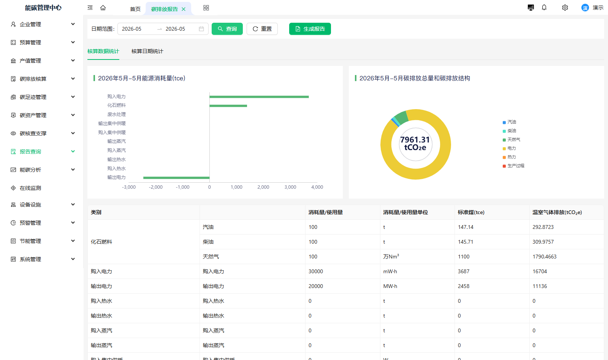

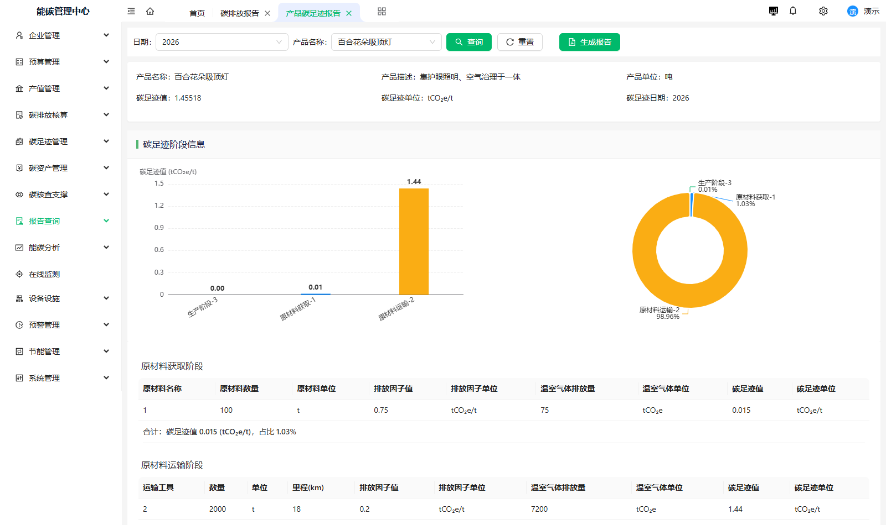

### 12.4 表述严谨性修正

| 原表述 | 修正后 |
|---|---|
| "权限体系里没有为导出去建模" | 当前账号的 99 条**菜单权限点**中没有 import/export；但后端 `product/export`、`device/importTemplate`、`quota/exportTemplate` 接口都存在（均返回 30005），说明**接口有、权限未授予或未在菜单注册**，不能断言"没做" |
| "碳足迹 98.96% 来自运输，属演示数据失衡" | 运输阶段占 98.96%，且其**因子单位标注（tCO₂e/t）与实际计算（数量×里程×因子）不一致**，属数据 + 标注双重问题，不能只归因于"数据填大了" |
| "系统管理几乎为空" | 前端**完全未注册**系统管理类路由（12 条探测全 404），不是"权限不足看不到" |
| "核算保存后自动计算"（推断） | 仍未验证写入逻辑；但 2026-06 的 92.709794 可由明细复算，说明**存在服务端计算**，只是触发时机未知 |

### 12.5 复核后的剩余未知项（诚实清单）

1. 核算保存时后端是否重新计算（而非信任前端传值）——未做写入测试。
2. 2025 年度汇总多算 2026-01 是 bug 还是"核算年度归属"设计——需厂商确认。
3. 足迹明细的 1/2/3 是 ID 未翻译还是录入文本——无法从外部判定。
4. ~~设备 conversionRate 的作用未知~~ → **第八轮已解决**：换算率=单位折算系数（kg→t 等），见 §15.6。
5. 预警从"设置 → 触发 → 记录"的完整链路——仍无数据可触发。
6. 报告 PDF 的正常样式——模板服务不可达，始终未能产出。

---

## 13. 第六轮：继续推翻与补证

> 目标：专挑"上一轮只能推断、没有直接证据"的点去验证。结果有 2 处被推翻、3 处被精确化、4 条新证据。

### 13.1 推翻：大屏 2025 的偏差不是全局口径，而是大屏自身

上一轮只写到"2025 年度汇总多算次年 1 月，疑似年度边界 bug"，但没确认这是"全站口径"还是"大屏口径"。

第六轮直接调核算引擎 `POST /carbon-report/CalculationReport/queryComplete`（2025-01-01 ~ 2025-12-31）：

| 指标 | 引擎返回值 | 大屏 2025 年度值 | 差异 |
|---|---|---|---|
| 总能耗(tce) | **7846.95** | 8423.2224 | +576.2761 |
| 总排放(tCO₂e) | **20457.00** | 22204.315 | +1747.322 |
| 产值(万元) | 121.02 | 121.02 | 0 |

**结论修正**：核算引擎按自然年**算得对**（7846.95 / 20457.00，与我按记录求和一致）；**只有大屏**多算了 2026-01 那条（576.2761 / 1747.322）。因此这是**大屏聚合的独立缺陷**，不是全站口径问题。

**边界推测**：2024 与 2027 大屏都返回 0，2026 与引擎一致，唯独 2025 多一个月 → 高度符合"年度右边界取到次年 1 月底"的写法（2024/2026 因无相邻月份数据而看不出来）。

**顺带取到范围拆分（首次）**：2025 范围一 **9369.4345** tCO₂e、范围二 **11087.5584** tCO₂e，合计 20457.00。即范围一=燃烧+过程，范围二=电力/热力净购入。

### 13.2 精确化：预算基线是整数常量，不是反推值

调 `queryEnergyAndCarbonBudgetSuggestion`（body：`{year:"2026-07-01 00:00:00", enterpriseId}`）拿到原值：

| 字段 | 值 | 含义 |
|---|---|---|
| energyQuantity | 5041.2212 | 实际能耗 |
| **energyQuantityQuota** | **200000.000004** | 年度用能预算 = **20 万 tce**（整数配置） |
| energyQuantityPercentage | 0.0252 | 执行率 2.52% |
| greenhouseGasQuantity | 14943.160127 | 实际排放 |
| **greenhouseGasQuantityQuota** | **399999.999996** | 年度碳预算 = **40 万 tCO₂e**（整数配置） |
| greenhouseGasQuantityPercentage | 0.0374 | 3.74% |
| energyTimeSchedule / Percentage | lap / 0.9698 | "滞后 96.98%" |
| energyMajorVariableItem / Quantity / Percentage | 电力 / 4662.826 / 0.0233 | 主要变量项 |
| greenhouseGasMajorVariableItem / Quantity / Percentage | 电力 / **21124.992** / 0.0528 | 主要变量项 |
| greenhouseGasMajorDriver | 用量变化 | 归因 |
| greenhouseGasPerProductValue | 10.7582 | 单位产值碳排 |
| greenhouseGasBudgetDeviationReasons | 生产计划调整 | 偏差归因 |

**三处必须指出的问题**
1. **预算基线是"碳排放预算"模块的数据**（20 万 tce / 40 万 tCO₂e）——**第八轮更正**：不是硬编码常量，而是由未开放的"用能预算/碳排放预算"模块维护（年预算 = 上一年排放 × (1 − 减排率)），本账号无该模块权限（接口 30005），所以界面上既看不到入口也像常量。与"碳排放配额 3,011,111"确实是两套东西。
2. **"电力贡献了总排放的 5.28%"是文案错误**：21124.992 ÷ 400000 = 5.28%，分母是**年度碳预算**，不是总排放（14943）。而且 21125 > 14943（总排放），若按"占总排放"读会直接矛盾。
3. **主要变量项与总量口径不一致**：总量是自然年（14943），但"主要变量项"的 21124.992 明显大于全年总排放，说明该项取自**滚动 12 个月或含未扣减的输出电力**。同一段文案混用两种口径。
4. **时间进度 96.98% 无法复现**：按自然年算今天（2026-11-23）应约 89.6%，按"剩余"算也不符；接口未公开该字段算法。

### 13.3 补证：三个强度公式全部验证通过（用 2026-06）

2026-06 是唯一同时有能耗、排放、产值、产量的月份（47.014 tce / 92.709794 tCO₂e / 300 万元 / 1000 吨）：

| 指标 | 页面显示 | 复算 | 结论 |
|---|---|---|---|
| 碳排放强度（报告 tab2 卡片） | 0.309033 | 92.709794 ÷ 300 | ✔ |
| 能耗强度（报告 tab2 卡片） | 0.156713 | 47.014 ÷ 300 | ✔ |
| 碳排放强度（报告 tab1 表格） | 0.31 | 同上，仅保留 2 位 | ✔（**与卡片精度不一致**） |
| 单位产值能耗（能源利用报告） | 0.16 | 47.014 ÷ 300 | ✔ |
| 单位产品能耗（能源利用报告） | 0.05 | 47.014 ÷ 1000 | ✔ |
| 能效值（能效对标表） | 0.05（卡片 0.0470） | 47.014 ÷ 1000 | ✔ |

**能效分级阈值（首次确认）**：标杆值 1.00、基准值 5.00；能效值 0.047 ≤ 1 → 状态"标杆水平"。由此可推断：≤标杆值=标杆水平，≤基准值=基准水平，>基准值=落后（第三档未实测）。

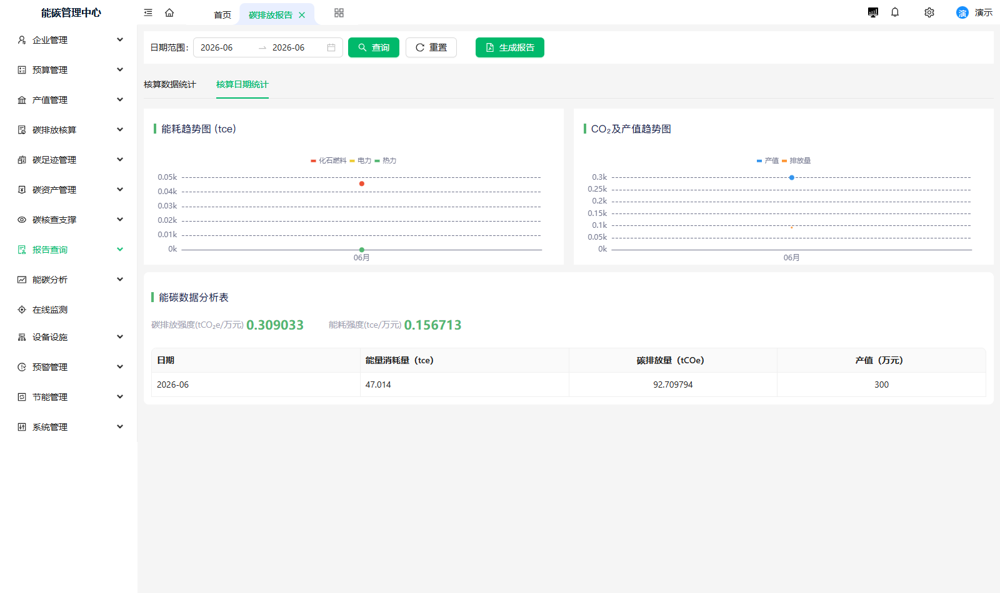

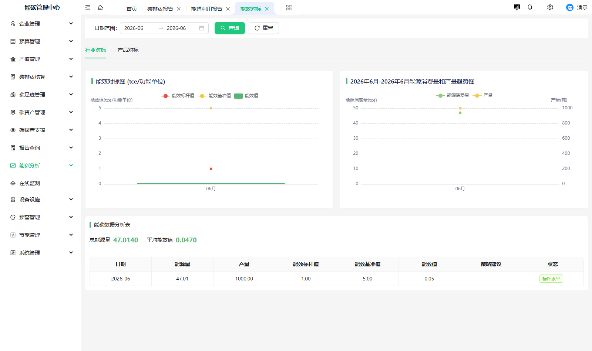

### 13.4 补证：折标系数补齐 + 数据字段确认

- 能源利用报告 2026-06 明细暴露完整折标系数：汽油 1.4714、柴油 1.4571、天然气 11、电力 0.1229、**热水/蒸汽 0.0341 tce/t**（此前只知道前四项）
- 碳足迹记录接口确认 `productQuantity = 5000`（与 §11.4 反推一致），三阶段字段为 `stageRawAcquisitionList / stageRawTransportList / stageProductionList`，另有 `rawQuantityEveryProduct`、`greenhouseGasQuantityEveryProduct` 两个"按产品单位分摊"字段（均为 null）
- `boundary = 1`（核算边界枚举，页面只有"从摇篮到大门"一项）

### 13.5 新缺陷：分析页选不到 2025 年

- "碳排放查询/能耗查询/能效对标"等分析页的日期范围选择器，面板只渲染 **2026 年** 与 **2027 年** 两个月度块，**没有 2025**
- 但 2025 数据确实存在（8 条月度核算），核算页、报告页都能选到 2025
- 结论：分析页的可选时间范围被硬限制在当前年及以后，**无法回看历史年度**，与"报告可跨年"不一致

### 13.6 复核：删除接口确实是权限问题

用三种 payload 打 `POST /carbon-computation/calculationComplete/delete`（`{ids:[id]}`、`{id,ids:[id]}`、`[id]`），**均返回 30005**，排除"参数格式不对"的可能 → 该账号对核算记录确实无删除权限，误建记录只能由管理员处理。

### 13.7 本轮纠错汇总

| # | 上一轮结论 | 第六轮修正 |
|---|---|---|
| 1 | 2025 年度多算次年 1 月，"疑似年度边界 bug" | 引擎算得对，**只有大屏**多算；限定为大屏聚合缺陷 |
| 2 | 年度用能预算 ≈200,048 tce、碳预算 ≈399,551 tCO₂e（反推） | 真值 **200,000 / 400,000**（原文写"整数常量"，第八轮更正：来自"碳排放预算"模块，非硬编码） |
| 3 | 足迹名称列"字典未翻译 or 录入占位"（二选一） | 确认为**录入占位文本**（接口存 "1"/"2"/"3"） |
| 4 | "电力贡献总排放 5.28%"（照抄原文） | 分母是年度碳预算，**文案语义错误** |
| 5 | 强度指标"未验证计算口径" | 已全部验证（÷产值、÷产量），并发现表格/卡片精度不一致 |

---

## 14. 第七轮：接口层深挖（隐藏能力与口径冲突）

> 这一轮全部从接口入手，不看界面。挖到 3 个**前端没暴露**的能力、1 处**权威因子表**、2 处**同指标双口径**。

### 14.1 挖到三个前端未暴露的能力

打开"碳排放核算 → 新建"时，除列表查询外还悄悄调了两个接口：

| 接口 | 作用 | 实测返回 |
|---|---|---|
| `POST /api/carbon-monitor/carbonGoodwePowerStation/queryEnterpriseMonthPower` | **光伏电站（固德威 GoodWe）月度发电量**接入 | `{power: 0}`（已接入、无数据） |
| `POST /api/carbon-monitor/monitorDeviceLink/previewQuantity` | **设备联动取数预览**：把绑定设备的读数预览到核算里 | `[]`（无绑定设备） |
| `GET /api/carbon-computation/calculationStandard/enterpriseId/detail/{id}` | 企业生效的核算标准（含全部因子与基准值） | 59KB 完整标准对象 |

**含义**：产品设计上是"设备/电站自动取数 + 手工填报"双通道，只是演示环境没接设备、没接电站。这修正了第二轮"设备数据纯人工填报"的印象——**自动取数是存在的，只是没启用**。

### 14.2 权威因子表（比界面更全，来自标准接口）

核算标准对象里有 **144 个类目槽位**（`fossilFuelList`、`electricInputList`、`steamInputList`、`paddyMethaneList`、`entericFermentationList`、`refrigerantLeakageList`、`anodeEffectList`、`clinkerProductionList`、`cokingRawList`、`ethyleneCrackingList`…），说明底层是**多行业核算模板引擎**（电力、钢铁、化工、石化、造纸、农业、废弃物等），而前端只渲染了 ISO14064-1 的 10 类页签。

> **第十六轮口径澄清 → 第二十轮精确化**：`144` 不是标准对象的顶层字段，而是**每个 `calculationItem` 项内部内嵌的 144 个 `*List` 槽位**（每项 165 个字段，其中 144 个是空数组）；标准顶层只有 33 个字段 + `calculationItemList`（10 项）。`141` 是类目字典记录数。三者关系见 §27.2。

本企业标准启用的 10 类与默认因子：

| 类目 | 单位 | 默认因子/系数 |
|---|---|---|
| 化石燃料 | t | 汽油 43.124 GJ/t、0.0189 tC/GJ、98%、1.4714 tce/t；柴油 42.705、0.0202、98%、1.4571；天然气 322.38 GJ/万Nm³、0.0153、99%、11 tce/万Nm³ |
| 购入/输出电力 | mW·h / MW·h | 0.5568 tCO₂/MW·h、0.1229 tce/MW·h |
| 购入/输出热水 | t | 比热 4.1868 kJ/(kg·℃)、0.11 tCO₂/GJ、0.0341 tce/GJ |
| 购入/输出蒸汽 | t | 焓值 2660.2 kJ/kg、0.11 tCO₂/GJ、0.0341 tce/GJ |
| 购入/输出集中供暖 | **GJ（明细行写 W）** | 热指标 60 W/m²、0.11 tCO₂/**W**、0.0341 tce/**W** |
| 废水处理 | **t（明细行写 m³）** | 0.075 tCH₄/tCOD、**GWP 21** tCO₂e |

**两个技术细节**
- `*ValueSource = 1` 表示"用缺省值"（对应界面下拉"缺省"），自测值应为 2——这解释了"缺省/自测"二选一的底层实现
- **GWP 取 21**（IPCC 第二次评估报告值），现行常用 28（AR5）；对甲烷排放核算会低估约 25%，属于**方法学滞后**

### 14.3 单位体系存在三处矛盾

| 位置 | 标准 item.quantityUnit | 明细行 quantityUnit | 页面/报告显示 |
|---|---|---|---|
| 购入集中供暖 | **GJ** | **W** | W（热指标模型） |
| 废水处理 | **t** | **m³** | m³ |
| 购入电力 | **mW·h**（小写 m） | mW·h | mW·h；输出电力却是 **MW·h** |

前两处是"能量单位写成功率单位/质量与体积混用"，第三处是大小写不一致（mW 毫瓦 vs MW 兆瓦，差 10⁹）。在核算这种强口径场景里，这类标注错误会直接影响可信度。

### 14.4 同一年产值，两套数字（重要）

| 接口 | 2026 产值(万元) | 2026 产量 | 强度 |
|---|---|---|---|
| `queryComplete`（报告/大屏/建议使用） | **1389** | 6169 | 10.76 |
| `queryList`（配额核算页使用） | **340.63** | 1081.03 | 10.7582 |

- 两套强度几乎相同（10.76 vs 10.7582），说明各自分子分母同源，但**分母差 4 倍**
- 推断：~~`queryComplete` 取"生产总值"，`queryList` 取"产品产值"~~ → **第十五轮已用明细数据解开（结论正好相反）**：`queryList`=生产总值 340.63，`queryComplete`=产品产值 1089 + 6 月兜底 300 = 1389，详见 §22.5
- 界面无任何提示，用户在不同页面会看到"同一年产值 1389 与 340.63"
- 这也解释了 §10.1 的"单位产值碳排放 10.7582"与报告页强度口径不同源的问题

### 14.5 减排目标与月预算的真实来源

`POST /api/carbon-report/CalculationReport/queryList` 返回里带三个关键字段：

| 字段 | 值 | 说明 |
|---|---|---|
| quotaQuotaQuantity | 3011111 | 年度配额（页面"碳排放配额"） |
| nextYearQuotaQuantity | **0** | 页面"预计下年度配额"，来源就是配额记录的"下年度配额"字段（为空→0） |
| **emissionReductionRate** | **0.8672** | 页面"减排目标 0.87%"就是它四舍五入；**算法未公开**，与配额、标准均无明显算式关系 |
| budgetList | 12 项 × **33333.333333** | 月预算 = 400000 ÷ 12，即"月碳排放"图的预算柱 |

**结论**：预算口径再次确认是 **40 万 tCO₂e**（与配额 301 万无关），且按月均分 33,333.33；减排目标 0.8672% 是后端下发值，非前端计算。

### 14.6 复核：范围一/二口径确认（2026-06）

`queryComplete` 单月返回：total 92.709794 = **范围一 87.1418**（化石燃料）+ **范围二 5.568**（购入电力）。
结论：范围一=燃烧/工艺，范围二=外购电力热力净购入，与 ISO14064-1 分类一致；**输出电力作为负项冲减范围二**。

### 14.7 复核：分析页选不到 2025 是前端限制

- 分析页日期面板只渲染 2026/2027；
- 但 `queryComplete` 用 2025 区间调用正常返回（7846.95 / 20457.00）；
- → 数据可查，**限制在前端控件的可选范围**，不是后端能力缺失。

---

## 15. 第八轮：找到官方文档，重新理解这个产品

> 这一轮从"前端打包产物"和"内置帮助中心"入手，拿到了官方《用户操作手册 v2.0》与《系统架构设计文档》，并据此**推翻了自己两处判断**。

### 15.1 三个此前从未访问的路由

主包静态路由里除了业务页，还藏着：

| 路由 | 实际内容 |
|---|---|
| `#/help-doc` | **内置帮助文档中心**（目录：用户手册、本地化部署升级、架构设计文档、12 项功能截图示例、平台验收报告示例、客服） |
| `#/website` | **对外门户站**（首页/新闻动态/政策法规/咨询建议/碳交易/登录），带企业宣传语 |
| `#/403` | 无权限页（文案"对不起，您没有权限访问此内容"，与路由不存在时的"内容不存在"不同） |

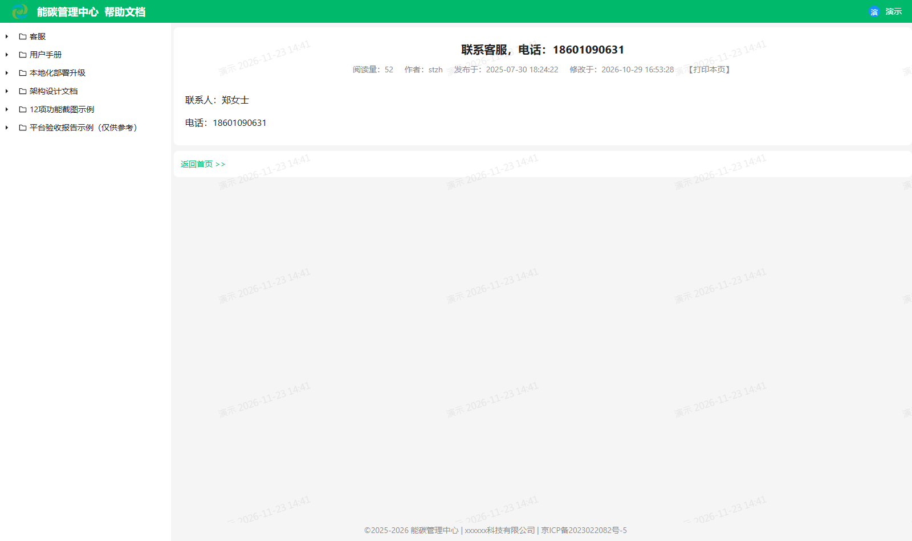

### 15.2 附件里就是官方文档（可直接下载）

帮助文档的附件放在 MinIO 公开桶（`/minio/app-carbon-energy/public/help-doc/...`），无需鉴权即可下载：

| 文档 | 大小 | 价值 |
|---|---|---|
| 企业能碳管理平台用户操作手册 v2.0（51 页） | 8.0 MB | **官方功能蓝图**，含 19 个章节的操作说明 |
| 系统架构设计文档（10 页） | 404 KB | 设计原则/依据/总体架构/技术路线 |
| 功能截图示例.docx | 7.8 MB | 12 项功能截图 |

> 这相当于直接拿到了竞品的"功能清单 + 交付话术"，比逐个点页面高效得多。

### 15.3 官方功能蓝图 vs 当前交付菜单（差异清单）

手册目录（官方口径）与当前账号菜单对比，**缺失的不是零星几个，而是整块模块**：

| 手册章节 | 当前账号 | 说明 |
|---|---|---|
| 8. **用能管理**：用能配额、用能预算、**能量平衡表** | ❌ 完全没有 | 能量平衡表可编"实物量/等价值/当量值 + 购入存储/生产转换/运输分配/终端使用"，损失能量自动换算，是能流分析的支撑 |
| 9.2 **核算标准配置** | ❌ 无菜单 | 手册："进入核算标准点编辑，可改标准值、标杆值、基准值及核算参数" |
| 10. **碳排放管理**：碳排放配额、**碳排放预算**、**碳排放量和结构** | ⚠️ 只有"预算管理→碳排放配额" | 预算与结构图两块缺失 |
| 15.1 **能流分析** / 15.2 **能效平衡与优化** | ❌ 完全没有 | 能效平衡支持**上传能效平衡图→系统自动分析→生成策略建议** |
| 16.3 **设备监测** | ⚠️ 菜单空白 | 手册：按日/月/年三维度查看设备能碳数据 |
| 19. **文档中心** | ❌ 无菜单（仅 `#/help-doc` 可达） | 帮助文档模块 |

**结论修正**：前几轮把"系统管理空白 / 在线监测未挂载"当作产品短板，应改为——**产品功能是齐的，本演示租户只交付了一个子集**。手册里明确有的用能管理、碳预算、能流分析、能效平衡、核算标准配置，在当前账号全部不可见。

### 15.4 推翻：预算基线不是"硬编码常量"

第七轮我写"20 万 tce / 40 万 tCO₂e 是硬编码整数常量，无维护入口"。第八轮从 chunk 里找到 `year-budget-form`（年度碳排放预算）与 `month-budget-list`（月度预算分摊），表单字段是：

| 字段 | 含义 |
|---|---|
| 企业 / 预算年度 | 归属 |
| **上一年碳排放总量** | previousYearEmission |
| **减排率** | 手工输入 |
| **年预算碳排放总量** | annualBudgetQuantity（= 上年排放 ×(1−减排率)） |
| 月度分摊预览 | 12 个月自动均分 |

接口：`/carbon-emission/yearBudget/queryPage|preview|add|update`、`/carbon-emission/monthBudget/queryPage|queryList|queryLatestYear`。
本账号调用 → **均返回 30005 无权限**。

**所以**：
- 400,000 tCO₂e 与 200,000 tce 是“**碳排放预算 / 用能预算**”模块里录的数据，不是代码常量；
- 页面"减排目标 0.87%"= 该年度预算的**减排率**（实测 0.8672%），不是配额算出来的；
- 配额表单字段只有"年度/配额企业/配额量/下年度配额"，**确实没有"计划量"**——手册 v1 的"减排量=配额量−计划量"在 v2 已废弃，减排率移到了预算模块。

这是本轮最重要的一次自我推翻：**"没有维护入口"其实是"没有权限看到入口"**。

### 15.5 手册与实现不一致的三处

| 手册说法 | 实测 | 判断 |
|---|---|---|
| 配额录入含"计划量"，系统自动算减排量与减排比例 | 碳配额表单只有配额量/下年度配额；但**用能配额**页确有"计划量/节约量/节约量比例"（官方截图可见） | **第九轮修正**：不是手册过时，是手册把"用能配额"的字段写进了"碳排放配额"章节；碳配额确实没有计划量 |
| 碳足迹分析"生成报告"可**预览/导出下载** | 生成报告 → 权限 30005 / 模板截图失败 | 手册描述的是完整版能力，交付环境未打通 |
| 设备数据"来源=填报或实时监测" | 只有填报数据，实时监测无数据 | 与 §14.1 的隐藏接口一致（通道在、未接） |

### 15.6 补上"换算率"这个坑

手册 16.4 明确：设备数据的**换算率用于单位统一**——"因为单位要统一换算成碳核算管理中的单位，如能源使用量 kg 要换算成 t"。
之前我把 `conversionRate` 列为"作用未知"，现在确认：**填报值 × 换算率 = 进入核算的标准单位值**。（**第十六轮补充**：29 条实测里有 1 / 2 / 10 三种取值，不是恒为 1；单位除 kW·h 外还有 MW·h 与 KPa，见 §23.5）

### 15.7 前端打包全景：573 个 chunk、141 个排放类目组件

- 主包引用 **573 个 chunk**
- 其中 `calculation-item-*` **141 个**——每个排放类目一个独立表单组件（熟料生产、阳极效应、稻田甲烷、畜禽肠道发酵、制冷剂泄漏、焦化、乙烯裂解、涂料、氟聚合物……），坐实"多行业核算引擎"不是数据模型上的空槽位，而是**真做了界面**
- 未开放模块对应 chunk 一览：`energy-flow-index`（能流分析）、`energy-balance-network`（能量平衡）、`carbon-simulation-index`（碳模拟）、`device-rule-list/form`（设备预警规则）、`advise-list/form`（建议管理）、`annual-report`（年报）、`change-log-list`（变更日志）、`area-list`（地区管理）、`device-telemetry`、`mqtt-monitor`、`InverterDashboard`（逆变器看板）、`CarbonSyntheticalView / CarbonFootprintView / QuotaAssetView / TradeView`（大屏多视图）

### 15.8 白标证据

- 手册里写的登录地址是 **www.tanjiazhi.com**（不是 bjstzh.com）
- 页脚：`©2025-2026 能碳管理中心 | xxxxxx科技有限公司 | 京ICP备2023022082号-5`，链接指向 `carbonyx.cn`
- 客服文档写的是个人手机号

**判断**：这是一套**白标/可换牌的 SaaS**，同一套代码以不同品牌、不同域名、不同权限子集交付。这也解释了为什么文档、域名、公司名对不上——演示租户是"最小可演示集"。

---

## 16. 第九轮：官方 12 项功能截图，看到“完整版”

> 上一轮只读了手册文字，这一轮把《12 项功能截图示例.docx》拆开，拿到了**未开放模块的真实界面**和**完整版侧边栏**。

### 16.1 文档里的 12 项功能清单（官方口径）

大屏看板、能耗查询、能源消费量和强度计算、能源消费分析与用能策略推荐、能效对标、**能流分析**、**能效平衡与优化**、**用能与碳排放预算管理**、碳排放、碳足迹核算、供应链碳管理、碳核查支撑、碳资产管理。

官方对演示环境的备注很坦白：**"功能具备，待填写""待上传"**——与我这八轮的判断完全一致：不是没做，是没填数据/没开权限。

### 16.2 完整版侧边栏（官方截图，非当前账号）

截图里的一级菜单是：

`企业管理 · 填报管理 · 产值管理 · 用能管理 · 碳排放核算 · 碳排放管理 · 碳资产管理 · 碳核查支撑 · 碳足迹管理 · 能碳分析 · 报告查询`

对比当前账号（预算管理/产值管理/碳排放核算/碳足迹管理/碳资产管理/碳核查支撑/报告查询/能碳分析/在线监测/设备设施/预警管理/节能管理/系统管理/企业管理），差异是：

> **第十轮修正**：截图只拍到侧边栏上半部分，下方滚出区域还有"在线监测 / 节能管理 / 预警管理"（见 §16.3 碳足迹评价截图的左下角）。所以差异不是"完整版没有这些模块"，而是**菜单重组 + 部分模块未交付**：完整版把设备/监测归到"在线监测"，把配额/预算/结构归到"碳排放管理"，当前账号则拆成了"预算管理 / 设备设施 / 预警管理"等。

| 完整版有 | 当前账号 |
|---|---|
| **填报管理**（整块） | 无 |
| **用能管理**（用能配额/用能预算/能量平衡表） | 无 |
| **碳排放管理**（配额/预算/排放量与结构） | 只剩"预算管理→碳排放配额" |
| 能碳分析下 **能流分析 / 能效平衡与优化 / 能碳模拟** | 无 |
| 核算标准（碳排放核算子菜单） | 无 |

### 16.3 三个未开放模块长什么样

**① 能流分析（桑基图）**
左侧能源输入（购入电力、天然气）→ 中间生产线（PET 瓶碳酸饮料线、大桶水线、塑料包装箱制造、公用单元）→ 右侧设备；悬浮提示"排放源:购入电力 > 设施:RB碳酸饮料生产线"。
说明：能流是**能源—设施—设备三级**的桑基图，不是简单的能耗占比图。

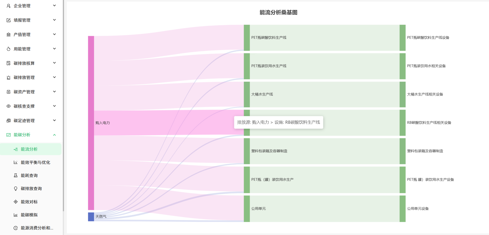

**② 能效平衡与优化（能量平衡表）**
指标卡：总购入能量 420.68 tce、购入存储损失 350（87.28%）、加工转换损失 30（58.82%）、输送分配损失 20（95.24%）、终端使用 0。
表格按"能源名称 × 购入存储/生产转换/运输分配/终端使用"展开，每格填"输入能量/损失能量"；上方还有"策略建议：多能源耦合调方案 / 能效优化建议"。
说明：这就是手册 8.3 的"能量平衡表"，**是真做了的**，且损失率自动算。

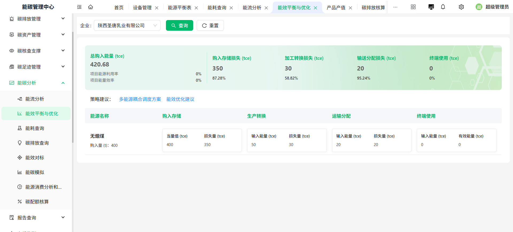

**③ 用能配额**
列：年度、配额量、配额量单位、**计划量**、计划量单位、**节约量**、节约量单位、**节约量比例**、备注、企业；当前 0 条（"待填写"）。
这解释了 §15.5 的疑问：**"计划量"在用能配额里，不在碳配额里**。

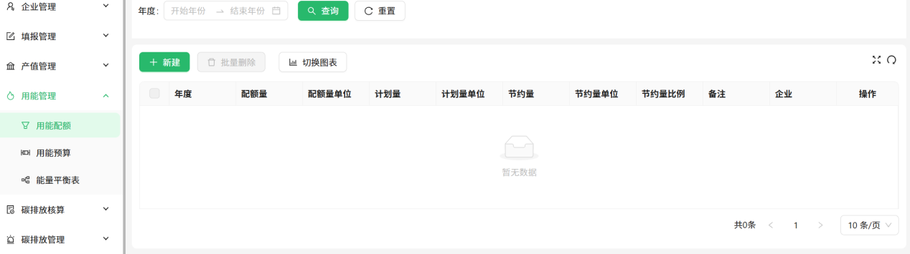

### 16.4 推翻："核算标准固定 ISO14064-1"

官方截图里的另一个租户是**中粮可口可乐**，其核算列表的"核算标准"列显示：

- 名称：温室气体排放核算与报告…（食品、烟草及酒、饮料行业）
- 简称：食品、烟草及酒…
- **编码：GB/T 32151.25—2024**

且列表还有"核算标准名称/简称/编码"三列，说明**企业可在多个标准间切换**（ISO14064-1、GB/T 32151 各行业分册）。

**修正**：第一轮"平台内置 ISO14064-1，不可切换"是错的——那是**当前演示企业所选的标准**，不是产品限制。这也与第七轮发现的 144 个类目槽位、141 个类目表单组件相互印证：产品本来就是按行业标准做的。

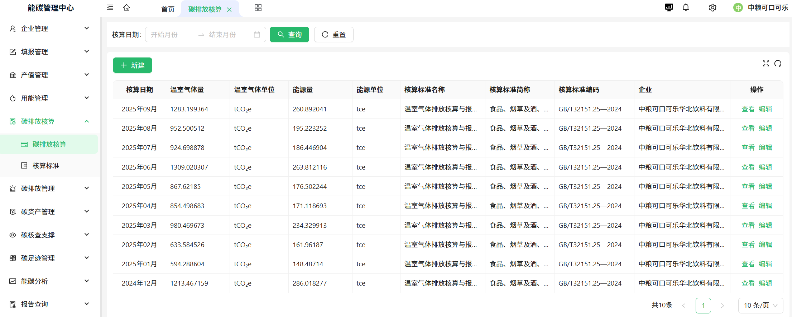

### 16.5 多租户与行业数据（新证据）

官方截图里至少出现三个租户/场景：

| 截图内容 | 企业 | 行业特征 |
|---|---|---|
| 能流分析 | （未显示名称） | PET 瓶碳酸饮料线、大桶水线、塑料包装箱 |
| 能效平衡 | 陕西圣唐乳业有限公司 | 无烟煤、乳制品 |
| 核算/大屏 | 中粮可口可乐 | 饮料、GB/T 32151.25 标准、产值 44693.86 万元 |

**结论**：这是一套**多租户 + 多行业模板 + 白标换牌**的平台；演示账号（bjstzh.com / 演示账号）只是其中一个最小化租户，所以我看到的"缺失"多数是**交付裁剪**，不是产品缺陷。

### 16.6 顺带再证：大屏"本年"口径

中粮大屏（视角 2025-10-22）显示"**本年**综合能耗 1798.77 tce / 本年排放 8399.88 tCO₂e / 本年产值 44693.86 万元"，与我第六轮"自选历史日期=自然年累计"的结论一致；当前演示账号默认视角（今天）= "近 12 月"。

---

## 17. 第十轮：架构文档读完，找到功能蓝图的源头

> 上一轮只看了架构文档的设计原则，这一轮把 10 页全读完，并回过头核对官方截图里的细节。**又修正了上一轮一处判断。**

### 17.1 架构文档说了什么（四层 + 五条技术路线）

| 层 | 内容 |
|---|---|
| 数据采集传输 | 智能电表 / 水表 / 燃气表、温湿度压力传感器、**表单填报**、**与 ERP / MES 对接**、其他系统 |
| 传输 | 智能网关（协议转换、过滤、预处理）+ 5G / 4G / Wi-Fi / 有线 |
| 平台服务 | 设备管理、资源管理、运维管理、故障恢复、安全防护 + 数据清洗、实时计算、数据建模 |
| 业务应用 | 能源管理 + 碳管理两大块 |
| 互动展示 | 可视化大屏（支持触摸/鼠标交互） |

技术路线补全：
- 存储明确写"关系型数据库（如 MySQL）"；实际附件走 MinIO
- 分析提到"数据聚类、关联规则挖掘"，用于发现能耗模式
- 集成明确写"API 对接 OA / 财务系统 / **碳排放交易平台** / **能源监管平台**"
- 安全：防火墙 + 传输/存储加密 + 备份恢复 + **RBAC**

### 17.2 关键定位：整套功能是照着工信部指南做的

设计依据里有一份文件值得单独拎出来：

> 《工业企业和园区数字化能碳管理中心建设指南》（工业和信息化部，**工信厅节〔2025〕13 号**）

这解释了产品为什么会有"能流分析 / 能效平衡与优化 / 用能预算 / 碳排放预算 / 碳报告生成"这些偏工程化的模块——**它们不是产品经理拍脑袋加的，是建设指南的功能项要求**。对竞品分析的意义：这类产品的卖点不是"好用"，而是"**验收合规**"（手册里还专门提供了"平台验收报告示例"）。

### 17.3 文档承诺 vs 前端实现（两处对不上）

| 文档说法 | 前端证据 | 判断 |
|---|---|---|
| 业务应用含"**能源消费预测**" | 573 个 chunk 中没有任何 `predict` / `forecast` 组件 | 方案级描述，**未实现或未打包** |
| 业务应用含"**碳盘查生成 / 碳核算材料汇总**" | 无独立入口，仅"报告查询"下三个报告 | 可能合并进报告模块，未见独立功能 |

> 提醒：架构文档是**投标/方案文档**，写的是"能建成什么"，不等于"已交付什么"。这次对比正好说明差别。

### 17.4 新证据：核算标准决定"页签"和"因子"

上一轮只看到中粮的标准编码。这一轮在它的**核算编辑弹窗**里看到了更硬的证据：

- 页签只有三个：**化石燃料 / 购入电力 / 二氧化碳消耗**（当前 ISO14064-1 账号是 10 个页签，含热水/蒸汽/供暖/废水）
- 天然气：消耗 3.9771 万Nm³，低位发热量 **380.31 GJ/万Nm³**（缺省）、单位热值含碳量 0.0153、氧化率 99%

而 ISO14064-1 账号里天然气的默认低位发热量是 **322.38 GJ/万Nm³**。

**结论**：同一气体在不同标准下**因子不同、页签集合也不同**——核算模板是"标准 → 类目 → 因子"三级配置，不是一套固定表单。这解释了三件事：
1. 为什么标准对象里有 144 个类目槽位（按标准组合）；
2. 为什么有 141 个类目表单组件（按类目渲染）；
3. 为什么当前账号只有 10 类（ISO14064-1 的类目集合）。

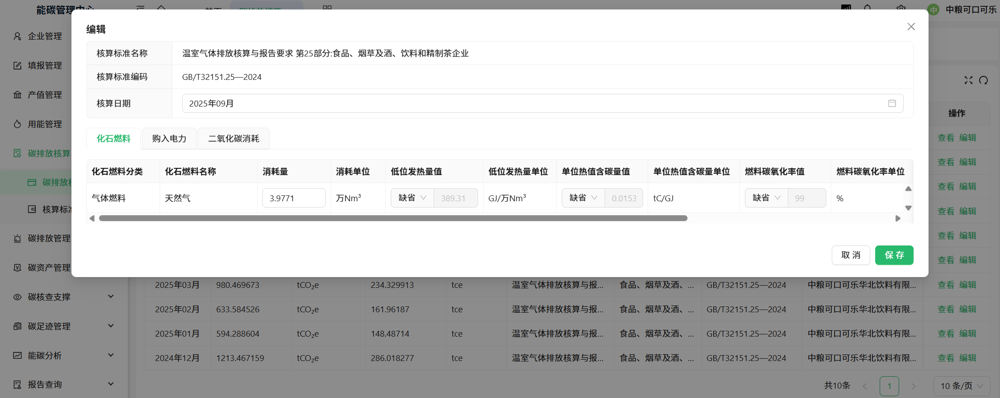

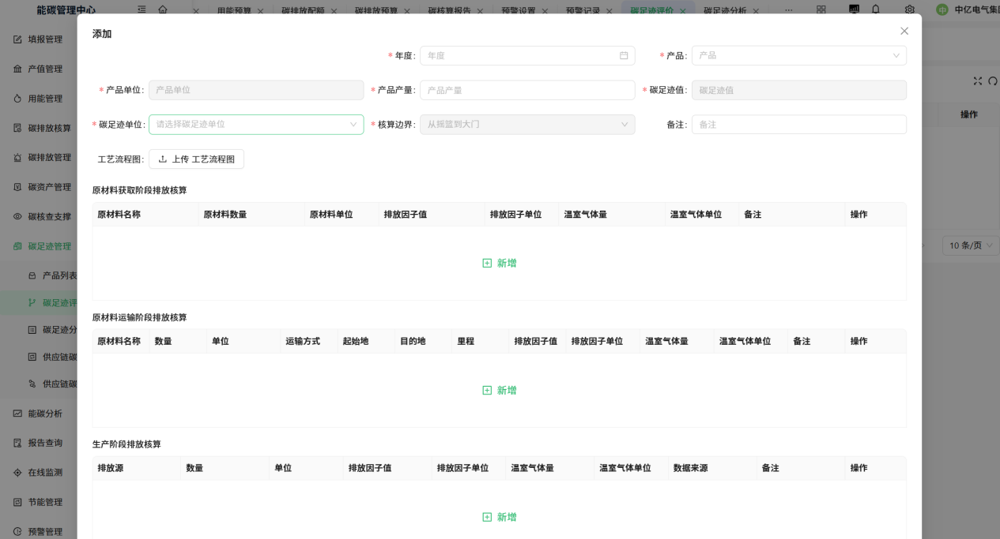

### 17.5 修正第九轮：完整版菜单"下方还有东西"

第九轮我拿截图上半部分做差异对比，说完整版菜单"没有在线监测/节能管理/预警管理"。第十轮在另一张截图（碳足迹评价）左下角看到：**在线监测、节能管理、预警管理都在**。

**修正**：不是"缺模块"，而是**菜单重组**——
- 完整版：设备/监测归入"在线监测"，配额/预算/结构归入"碳排放管理"，另设"填报管理"、"用能管理"
- 当前账号：拆成"预算管理 / 设备设施 / 预警管理 / 节能管理 / 系统管理"等独立一级菜单

差异的实质是**同一产品的两套菜单配置**（可能是版本或租户配置差异），不宜再表述为"完整版功能更多"。

### 17.6 这一轮新发现的 chunk

| chunk | 含义 | 当前账号 |
|---|---|---|
| `material-list / material-form / material-api` | **物料库**（碳足迹原材料与因子库） | 无菜单 |
| `industry-benchmarking` / `product-benchmarking` | 能效对标的**行业对标/产品对标**子组件 | 页面内已有，未拆出 |
| `consume-structure-index(-line)` / `emission-structure-index` | 能源消费结构 / 碳排放结构 | 无独立页（可能嵌在别处） |
| `carbon-simulation-index` | 能碳模拟 | 无菜单 |
| `energy-balance-network` | 能量平衡网络图 | 无菜单 |

### 17.7 对自研的启示（一句话版）

竞品的能力骨架 = **标准（GB/T 32151 分行业 / ISO14064-1）× 类目（144 槽位）× 因子（可缺省可自测）**，外围再套"预算—平衡—对标—报告"四件事。真正值得抄的不是页面，是这套**配置化核算引擎**；相反，它的报告引擎（模板截图拼 PDF）和内网依赖是最不该抄的部分。

---

## 18. 第十一轮：同域名下还有两套大屏，以及一份验收报告

> 这一轮本来只想复核，结果在路由探测里撞见**完全没见过的产品形态**，并把官方《平台验收报告示例》拿下来了。

### 18.1 三套大屏，三端定位（重大修正）

同一个演示账号，可以直接打开三块完全不同的大屏：

| 路由 | 大屏名称 | 面向对象 | 核心内容（实测文字） |
|---|---|---|---|
| `#/visualization/CarbonEnergy` | 能碳管理中心（综合展示） | **单一企业** | 近 12 月能耗/排放/产值、能源消费量、碳排放量、强度仪表盘（前几轮已详述） |
| `#/visualization/CarbonFootprint` | 碳足迹大屏 | **区域农产品品牌 / 零碳产品** | 碳足迹农林/工业产品数量与产值、零碳产品数量、低碳农林产品总量（2000 万吨）、零碳工业产品总量（2000 万件）、**低碳农产品介绍**（低碳蓝莓、低碳香蕉、低碳橙的整段品牌文案） |
| `#/visualization/QuotaAsset`、`#/visualization/CarbonSynthetical` | **碳资产数智化管理平台** | **政府 / 园区** | 全国地图（各省节点"累计 19 个""宁夏 42 个"）、企业碳排放量与强度排名、碳配额总量趋势、配额交易量与金额趋势、CCER 项目结构、企业配额履约、规模以上企业 **2000**、平台交易企业 **2000**、控排企业 **128**、零碳企业/园区 **222**、区域碳汇排名、**普惠方法学 120 个项目 / 减排 22200 tCO₂e**、新能源分布、绿证发放、碳普惠交易趋势 |

**这条修正很关键**：前九轮我一直把它当"单一企业碳管理 SaaS"来写。实际上它有三端：

1. **企业端**（能碳管理中心）：填报→核算→分析→报告→核查
2. **区域品牌端**（碳足迹大屏）：农产品/工业品的碳足迹与零碳认证展示，带品牌故事
3. **政府/园区端**（碳资产数智化平台）：控排企业名录、配额分配与履约、CCER、碳普惠方法学、绿证

三端共用一套用户体系与同一域名，只是租户/角色不同。这说明厂商的真实打法是"**企业能碳 + 区域碳资产**"双轮，而不是单一 SaaS。

> **第十二轮重要修正**：拆包后发现——**只有企业端 `CarbonEnergy` 是接后端接口的**；碳足迹大屏与碳资产数智化平台的 chunk 里**没有任何 api 引用**，数据全是写死的数组和文案（详见 §19.1）。所以"三端"目前是"**一端真实 + 两端演示壳**"，不能据此认定其政府侧已产品化。

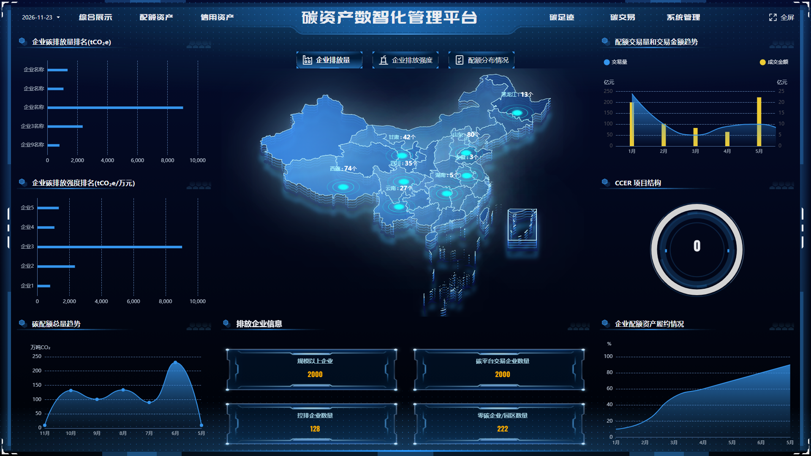

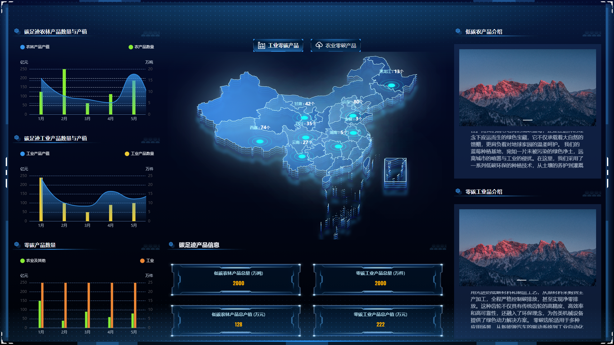

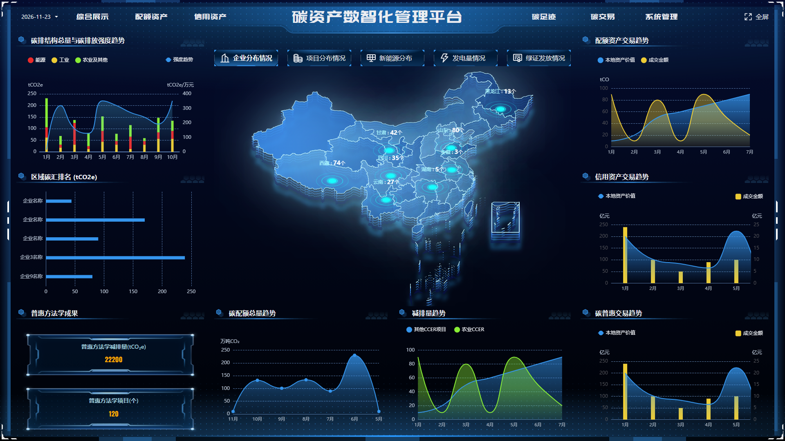

### 18.2 官方《平台验收报告示例》：12 项验收要点

附件（19 KB docx）写得很完整：系统版本 V2.0、验收日期 2026-03-20、验收范围"12 项核心功能 + 安全合规 + 配套文档"，逐项列了验收要点并标"通过"。

| # | 功能模块 | 官方验收要点 |
|---|---|---|
| 1 | 能耗查询 | 多维筛选（时间/能源类型）、趋势图（折线/柱状） |
| 2 | 能源消费量和强度计算 | 折标煤自动计算、强度指标（单位产值/单位产品） |
| 3 | 能源消费分析与用能策略推荐 | 趋势分析、异常告警、策略推荐 |
| 4 | 能效对标 | 国标/行业标杆/同行对标、**差距原因分析** |
| 5 | 能流分析 | 桑基图、**节点损耗率计算**、**层级钻取（区域→设备）** |
| 6 | 能效平衡与优化 | 能量平衡表、**手动优化方案生成** |
| 7 | 用能与碳排放预算管理 | 总预算制定、进度监控（使用占比实时展示）、**超预算告警** |
| 8 | 碳排放核算 | **Scope1/Scope2 自动核算**、核算报告生成 |
| 9 | 产品碳足迹 | LCA 半生命周期计算、图表展示 |
| 10 | 供应链碳管理 | 供应商碳数据填报、供应链总碳排核算 |
| 11 | 碳核查支撑 | 核查资料归集、核查报告提交 |
| 12 | 碳资产管理 | 碳资产台账（CCER/配额）、交易记录管理 |

安全验收：传输 HTTPS + 密码加密、**RBAC 细化到"核查人员只读 + 标记"**、无高危漏洞、**日志留存 ≥ 6 个月**。

> 注意：文件名与标题都写着"**示例（仅供参考）**"，属于交付话术材料，不应视为第三方审计结论。

### 18.3 验收要点 vs 我的实测：5 处对不上

| 验收要点 | 实测 | 差距 |
|---|---|---|
| 超预算告警 | 预警事件字典共 8 个，只有"月度/年度排放/能耗"与"电压/电流/水表/蒸汽表"，**没有预算类事件** | 至少在当前租户**未落地** |
| 能效对标"差距原因分析" | 能效对标表"策略建议"列为**空**（2026-06 实测） | 未实现或需别的数据 |
| 能流"节点损耗率/层级钻取" | 官方截图见桑基图与"设施级"悬浮（排放源→设施），**未见损耗率数值面板** | 部分实现（钻取到设施可见，损耗率未见） |
| 核算报告生成 | 生成必失败（内网模板 `192.168.1.6:25525`） | 部署依赖未打通 |
| "核查人员只读 + 标记"权限 | 99 条权限点里只有 query/add/update/delete/disabled/download，**无"标记"类** | 权限模型未体现 |

**结论**：验收报告描述的是"目标态"，实测是"演示态"。这份材料最大的价值不是证明它通过了验收，而是**给出了这类项目的验收口径**——如果要自研，这 12 条可以直接当成产品需求清单。

### 18.4 顺带确认的两件事

1. **大屏是按主题拆成独立应用的**：`CarbonEnergyView`、`CarbonEnergyView-mobile`、`CarbonFootprintView`、`QuotaAssetView`、`CarbonSyntheticalView`、`CarbonEnergyBigScreen`（后者路由 404，未挂载）。所以"大屏"不是一个页面，而是一组视图。
2. **`#/visualization/Trade` 不存在**，"碳交易"是大屏顶部导航里的一项，跳的是 `QuotaAsset` 的某个视图，不是独立路由。

---

## 19. 第十二轮：拆包验伪——两块大屏其实是演示壳

> 上一轮看到三块大屏就下了"三端并行"的结论。这一轮把三个视图 chunk 全下载下来，逐行看数据从哪来。**结论要往回收。**

### 19.1 证据：三块大屏的数据来源完全不同

| 视图 | chunk 体积 | 是否 import api | 数据特征 | 判定 |
|---|---|---|---|---|
| `CarbonEnergyView`（企业能碳） | 15 KB | **是**，调用 `carbon-visualization/carbonEnergy/query`、`carbon-report/calculation-report/query` | 无硬编码月份数组（`category:["1月"…]` 命中 0 次） | **真实接后端** |
| `CarbonFootprintView`（碳足迹） | 20 KB | **否**（只 import 图表/布局组件） | 硬编码 `Columnar:[240,101,83,165,123,162,203]`、`dataDiscount:[24,10,5,9,10,7,20]`、`dataN:[150,40,90,60,80]`、`category:["1月"…]`；文案数组 `t1` 直接写死"低碳蓝莓/香蕉/橙"整段 | **纯静态演示页** |
| `QuotaAssetView`（配额资产） | 19 KB | **否** | 16 处 `data:` 常量、`2000/128` 反复出现 | **纯静态演示页** |
| `CarbonSyntheticalView`（碳普惠综合） | 26 KB | **否** | 28 处 `data:` 常量 | **纯静态演示页** |

额外旁证：碳足迹大屏的农产品配图指向 **`cube.elemecdn.com`（饿了么 CDN）**——典型的模板代码残留，说明这一页是从公开模板改的，不是自研数据视图。

**修正**：§18.1 的"三端并行"应改为——**企业端是真实产品；区域品牌端与政府/园区端目前只是两块静态演示大屏**（用于投标/POC 演示），没有后端数据链路。它们证明的是"厂商在讲区域碳资产的故事"，不能证明"已有政府侧产品化能力"。

### 19.2 门户站（#/website）实况：架子搭好，内容空转

- 结构：首页 / 新闻动态 / 政策法规 / 咨询建议 / 碳交易 / 登录
- 接口：`/platform-website/news/queryPage`、`/platform-website/policy/queryPage`（有 CMS，可运营）
- 内容：新闻 **0 条**；政策法规 **1 条**，标题就叫"测试标题"，发布部门 `NULL`
- 页脚文案："致力打造全球可持续交通发展的高端智库…"——**与能碳无关的模板文案**，明显照搬
- 联系方式：18601090631 / shutan2024@163.com；友情链接挂的是发改委/交通运输部/生态环境部/自然资源部/中国农科院

**判断**：门户属于"有壳无运营"，是交付套餐里的附属品，不是真实获客渠道。


### 19.3 这轮对结论的净影响

| 项 | 上一轮 | 现在 |
|---|---|---|
| 三端定位 | "企业 + 区域品牌 + 政府园区"三端并行 | **一端真实 + 两端静态演示**；区域/政府侧证据等级降为"演示级" |
| 竞品成熟度 | 产品线完整 | 企业端成熟、To-G 端尚在讲故事阶段 |
| 门户/获客 | 未评估 | 有 CMS 但零运营（测试数据） |

### 19.4 方法上的教训（写给自己）

前十一轮我一直在"看得到什么就信什么"，这轮把 chunk 拆开才发现**页面能打开 ≠ 功能存在**。以后遇到"没有权限验证"的模块，应先看它有没有 API 引用，再决定给多高的证据等级。

---

## 20. 第十三轮：报告体系真相——历史上成功过 15 次

> 前几轮反复看到"生成报告失败"，我把它写成"报告引擎必失败"。这轮翻报告列表接口，发现**历史上有 15 份报告生成成功并归档**，还挂在 MinIO 公开桶里可以直接下载。

### 20.1 报告不止 3 类，接口里有 5 类

从 `calculation-report-api` chunk 里读出的全部报告接口：

| 能力 | 接口 | 当前账号 |
|---|---|---|
| 碳核算报告 PDF | `CalculationReport/queryCompletePdf` | 可用（但生成失败） |
| 能源利用报告 | `EnergyUtilization/queryCompletePdf`、`EnergyUtilization/genReportDoc` | 有数据时失败 |
| 产品碳足迹简报 | `productCarbonFootprint/genReportDoc` | **历史上成功 12 次** |
| 产品碳足迹分析报告 | `productFootprintReport/queryPage` | **历史 3 份（.doc）** |
| 碳核查报告 | `carbonEmission/genInspectReportDoc` | **30005 无权限** |
| 年度报告 | `annualReport/queryPage` / `delete` | **30005 无权限** |

**修正**：产品报告体系是 **5 类 + 年报**，当前菜单只开了 3 个报告页；核查报告与年报有能力但未授权。

### 20.2 归档列表实况：15 份，两个时代

`POST /carbon-footprint/productFootprintReport/queryPage` 返回 **total=15**：

| 时间 | 类型 | 说明 |
|---|---|---|
| 2026-04-15 ~ 05-13（12 份） | **产品碳足迹简报 .pdf** | 文件在 `.../footprintReport/产品碳足迹简报_{时间戳}.pdf` |
| 2026-03-11 ~ 04-03（3 份） | **产品碳足迹分析报告 .doc** | 文件在 `.../footprint/{ts}/产品碳足迹分析报告.doc` |

描述字段里出现过 **演示账号 / 零碳科技 / 演示 / 企业 / 恒诚认证** 五种企业名——说明这些是不同演示租户留下的，报告头取的是**生成时的企业名**。

### 20.3 两代报告的技术形态完全不同

**① 早期（.doc）——其实是 HTML**
下载下来看文件头：`<!DOCTYPE HTML...`，**不是真 Word**，是"生成 HTML 后改后缀为 .doc"（Word 能打开，但排版依赖 HTML）。
内容是一份**完整 LCA 报告**（23 KB HTML）：封面（产品名/规格/生产者/报告编号 `CPTZJ2039873777583042562` /日期）→ 委托单位信息表 → 量化依据（GB/T 24067-2024、PAS 2050、GB/T 2589-2020、2023 电力碳足迹因子公告、CPCD 数据库）→ 核查结论 → 摘要 → 一、概述（生产者信息/产品信息/量化方法）→ 章节继续。

**② 后期（.pdf）——Java 端排版 + 图表截图**
PDF 元数据：`Producer: OpenPDF 2.0.3`，**含 1 个字体、2 张图片、有文本层**（2 页可抽出 631 字）。
所以报告不是"整页截图拼装"，而是：**正文/表格由 OpenPDF 排版，图表图片由内网截图服务渲染后嵌入**。这也解释了为什么截图服务一挂，整个报告就失败。

**结论修正**：技术演进方向其实是"倒退"——从可复制的 HTML/DOC 变成 PDF（虽然仍有文本层，但结构简化成 2 页简报），同时引入了内网截图依赖。

### 20.4 报告内容与系统数据对不上（两代都错）

从 PDF 抽出的原文：

> 演示账号2025年 碳足迹值为 ，各阶段详情如下： 1吨500*60百合花朵吸顶灯 **0.01 kgCO₂e/件**
> 阶段：原材料获取 热轧钢板 0.00 / 原材料运输 热轧钢板 0.00 / 生产 电 0.01 / 生产 柴油 0.00 / 生产 天然气 0.00 / 合计 0.01

对照系统里同一条足迹记录：`productQuantity=5000 吨`、`carbonFootprintValue=1.45518 tCO₂e/t`、三阶段为"1 / 2 / 3"（占位文本）。

三处硬伤：
1. **数值差 100 倍以上**：系统 1.45518 tCO₂e/t vs 报告 0.01 kgCO₂e/件（**第十七轮降级**：报告生成于 2026-05-13，阶段名是"热轧钢板"，系统现值是"1/2/3"，说明数据被改过——这属"快照 vs 模板"二选一，**不能归因为引擎算错**）
2. **单位错配**：功能单位写"1吨"，碳足迹单位却标 `kgCO₂e/件`；早期 .doc 版同样写"1吨产品a … 2.32 kgCO₂e/件"——**两代报告同一个错，且是报告内部自相矛盾，这条成立**
3. **阶段名称不同源**：报告写"热轧钢板/电/柴油/天然气"，系统里是"1/2/3"（同样属快照差异）

**判断**（第十七轮修正）：只能确认"**报告是时点快照，不是实时数据**"，以及"**功能单位与碳足迹单位不匹配**"；不能据此认定报告引擎取数错误。

### 20.5 导入能力：两类模式

拆 `*-import` chunk（12 个），全部只是"上传 Excel + 模板下载"的通用壳，列定义在服务端。差别只有一个开关：

| 带"更新数据"开关（存在则覆盖） | 不带（只新增） |
|---|---|
| 碳排放配额、产品产值、生产总值、节能改造 | 碳资产、CCER、交易、设施、设备、设备数据、产品、碳排放核算 |

也就是说：**配额/产值/节能改造支持"重复导入覆盖"，核算记录反而不支持覆盖**（只能新增，重复则报错）。**第十七轮修正**：这只说明"导入不做覆盖"，不等于"不能改"——菜单里存在"更新核算填报"权限，核算记录**可编辑、不可删除**（146 条菜单无"删除核算填报"）。准确说法是"**可改不可删**"，不是"只增不改"。

### 20.6 本轮修正汇总

| 项 | 之前 | 现在 |
|---|---|---|
| 报告生成 | "必失败/全量失败" | **历史上成功 15 次**；现在失败是图表截图服务不可达（部署问题），不是引擎不能用 |
| 报告引擎 | "HTML→截图→拼 PDF" | **OpenPDF 排版 + 图表截图嵌入**；早期版本是 HTML 改后缀 .doc |
| 报告数量 | 3 类 | **5 类 + 年报**（核查报告/年报无权限） |
| 报告数据 | 未核 | 数值与系统差 100 倍、单位错配、阶段名不同源（两代都错） |

---

## 21. 第十四轮：全量接口扫描（一次把底摸清）

> 用户问"能不能一次性全面检测"。能。这轮不再逐页点，而是：**从前端包里把 375 个接口全抓出来 → 筛出只读接口批量探测 → 生成能力矩阵**。全部只读，无写入。

### 21.1 方法

1. 从 `index.js` + 43 个 `*-api` chunk 里正则提取所有 `"/xxx/yyy"` 路径 → 去重 **375 个接口**
2. 排除写操作（add/update/delete/import/batch/disabled/switch/reset 等）与带路径参数的动态接口 → 剩 **153 个只读接口**
3. 用真实登录 token 逐个调用（POST 带 `{pageNum,pageSize,enterpriseId,year,completedStartDate...}`，GET 带同名 query）
4. 按返回码归类：`0` 可用 / `30005` 无权限 / `30007` 平台端需另一套登录 / `10001` 方法或参数不符 / `30001` 缺必填 / `10002` 不存在

> 踩坑记录：第一遍探测把 30007 当成"token 过期"，重登后重跑仍是同样 38 个 30007 —— 说明那是**接口级的鉴权隔离**，不是会话问题。这一步避免了一整轮错误结论。

### 21.2 结果总览

| 判定 | 数量 | 含义 |
|---|---|---|
| **可用** | **53** | 当前账号能正常调通并返回数据 |
| 无权限 | 12 | 接口存在，权限未授予（报告生成、年报、物料库、预警处理、消息等） |
| 平台端接口 | 38 | `/support/*`、`/system/*`、`/platform-home/*` 返回"未登录" → 需平台管理端账号 |
| 方法/参数不符 | 28 + 18 | 导出类需 POST；设备/光伏类需 pwId、deviceId、核算标准 ID 等 |
| 不存在 | 4 | 前端残留调用（如 `/visualization`、`/system/home/*`） |

按模块统计（探测数 / 可用）：

| 模块 | 探测 | 可用 | 无权限 | 平台端 | 其他 |
|---|---|---|---|---|---|
| carbon-monitor | 30 | **13** | 0 | 0 | 17 |
| support | 24 | 0 | 0 | **20** | 4 |
| system | 20 | 0 | 0 | **14** | 6 |
| carbon-report | 12 | 4 | 5 | 0 | 3 |
| carbon-facility | 11 | 7 | 1 | 0 | 3 |
| carbon-footprint | 7 | 6 | 0 | 0 | 1 |
| carbon-asset | 6 | 3 | 0 | 0 | 3 |
| carbon-computation | 6 | 3 | 2 | 0 | 1 |
| carbon-output | 6 | 2 | 0 | 0 | 4 |
| common-warning | 6 | 4 | 1 | 0 | 1 |
| carbon-product | 5 | 2 | 1 | 0 | 2 |
| login | 5 | 4 | 0 | 0 | 1 |
| platform-home | 4 | 0 | 0 | **4** | 0 |
| carbon-emission | 3 | 1 | 0 | 0 | 2 |
| carbon-economize | 2 | 1 | 0 | 0 | 1 |
| common-datum | 2 | 1 | 1 | 0 | 0 |
| platform-website | 2 | 2 | 0 | 0 | 0 |
| message | 1 | 0 | 1 | 0 | 0 |
| visualization | 1 | 0 | 0 | 0 | 1 |
| **合计** | **153** | **53** | **12** | **38** | **50** |

完整逐条结果（含返回消息）见随报告交付的 **`接口探测结果.csv`**（153 行）。

### 21.3 最重要的发现：在线监测不是"没有"，是"没挂前端"

`carbon-monitor` 模块 13 个接口调通，而且**返回的是真实生产数据**：

| 接口 | 实测返回 |
|---|---|
| `/carbon-monitor/online/overview` | **在线 47 台 / 离线 4662 台**，在线率 1.0，小时级趋势（17:00 起每档 213 台） |
| `/carbon-monitor/online/emqx/clients` | 真实 EMQX 客户端列表：`clientid=shuibiao`、`username=003`、IP `115.231.40.115:7034`、节点 `emqx@emqx`、keepalive 120 |
| `/carbon-monitor/online/events` | 3 条离线事件（设备"压缩机"，2026-08-17，`disconnectReason=normal`） |
| `/carbon-monitor/device-access/config/queryPage` | **29 条接入配置**，例：`信一电力电表`，topic `xinyi/#`，解析规则"信一电力JSON电表解析"，单配置挂 **7 台设备** |
| `/carbon-monitor/parse/rule/queryPage` | **12 条解析规则**，规则体是 JSON 路径映射（`devicesPath:reported`、`EP/Ua/Ia` 等），支持 hex 编码 |
| `/carbon-monitor/parse/rule/types` | 协议类型定义（JSON 模板含 path/regex/requiredFields/conversions/defaults，及"多设备报文 devicesPath"模式） |
| `/carbon-monitor/device-discovery/*` | 待接入 0 条（发现→接收流程就绪但无待处理设备） |

**这推翻了我从第二轮就开始写的判断**（"在线监测未开通/疑似占位"）。但**第十七轮复核发现更严重的问题**——这些数据可能根本不属于当前企业，见 §24.2。真实情况是：

- 平台侧**已经接入真实设备**（信一电力电表等 29 套配置，累计设备量级 4700+，47 台在线）
- 有完整 MQTT（EMQX）+ 可配置协议解析 + 设备发现 + 离线事件
- 只是**当前演示租户的前端没有挂这些路由**，所以在页面上看是空的

也就是说：这家公司的**物联网底座是真的在跑**，比它的报告引擎靠谱得多。

### 21.4 另外两个此前完全不知道的接口

| 接口 | 作用 | 实测 |
|---|---|---|
| `/carbon-report/CalculationReport/queryEnergyEfficiencyOptimizationSuggestion` | **能效优化建议**（规则引擎） | 返回：能效趋势 `down`、能效等级 `top`、异常月份夏季 `2026-06/07`、冬季 `2026-01/02`、能耗与产值/产量变化 `lessThan` |
| `/carbon-facility/energyBalance/queryDetail` | **能量平衡表**结构（购入存储/加工转换/输送分配/终端使用） | 返回 2026-10 空表（`saved:false`），字段与官方截图一致，说明页面未开但接口就绪 |

### 21.5 复核：导出确实是无权限，不是方法错

`POST /carbon-emission/quota/export`（正确的 POST）仍返回 **30005**；`exportTemplate` 同样。
→ 之前判断"导出功能存在但未授权"成立，**不是**"按钮没绑定事件"。

### 21.6 这轮的方法沉淀（可复用）

| 步骤 | 做法 | 产出 |
|---|---|---|
| 1 | 从 `index.js` 抓 chunk 清单 | 573 个模块 |
| 2 | 下载 `*-api` chunk | 43 个，75 KB，含全部端点 |
| 3 | 正则提取路径 + 分类只读/写 | 375 → 153 |
| 4 | 带 token 批量探测（并发 3，8 s 超时） | 153 条结果矩阵 |
| 5 | 按返回码判定能力等级 | 可用/无权限/平台端/缺参/不存在 |

这套流程可以套到任何 Vue/RuoYi 系产品上，比逐页点快一个量级。

---

## 22. 第十五轮：数据资产盘点——把 53 个可用接口的内容全看一遍

> 上一轮只测"通不通"，这轮把每个可用接口的**内容**拉出来看。结果：挖到工业协议引擎、碳资产台账真实数值，并把悬了八轮的"产值双口径"彻底解开。

### 22.1 数据资产底数（接口直读）

| 数据表 | 条数 | 说明 |
|---|---|---|
| 产品产值 productionValue | **34** | 仅 2026-01~04，按产品逐条（60/50/…万元） |
| 生产总值 totalValue | **17** | 2025-10 ~ 2026-06，每月 1 条（单位：万元） |
| 产品 product | 9 | 产品主数据（名称/编码/型号/功能/介绍） |
| 物料库 material | **66** | 无烟煤、烟煤、褐煤、洗精煤、洗中煤、煤泥……（核算与足迹共用主数据） |
| 设备 device | 19 | 含 facilityId/facilityName/uniqueid |
| 设备数据 deviceData | 29 | 含 conversionRate、dataSource、status |
| 碳资产 asset | 3 | 见 §22.4 |
| CCER | 1 | 碳普惠积分 20,000 |
| 交易 trade | 2 | CEA 100×600、CCER 1000×100 |
| 核算类目 calculationItem | **141** | 分类：cat1=11、cat2=6、cat3=13、cat4=9、**cat5=102** |
| 解析协议类型 | **6** | 见 §22.2 |
| 预警事件字典 | 8 | 见 §22.6 |
| 能流树 canflow | 6 棵 | 见 §22.8 |
| 门户碳交易 | 61 | 全为 0 值（空壳，见 §22.7） |

### 22.2 工业协议引擎：6 种协议，不是"只能接 JSON"

`/carbon-monitor/parse/rule/types` 返回的协议清单（含每种的技术说明）：

| 类型 | 名称 | 说明（原文摘要） |
|---|---|---|
| 1 | JSON | 点分路径 + 正则提取，支持"一条报文含多台设备"（devicesPath 模式） |
| 2 | **Modbus-RTU** | 十六进制透传帧，CRC16 校验，按寄存器地址映射解码，兼容"请求+响应拼接帧" |
| 3 | **DLT645** | 十六进制电表帧，数据标识映射，`-0x33` 偏移 + 字节反转 + 小数位还原 + CS 校验 |
| 4 | **Modbus-TCP** | MBAP 头，无 CRC，按寄存器映射 |
| 5 | **Zhongyou（大庆自定义）** | DL/T645 变体：表号 BCD 反转、DI 后 4 字节小端电量÷100 |
| 9 | 自定义 | 预留，按实际协议实现 PayloadCodec |

**这是本轮最硬的能力证据**：DLT645 是国内电表国标、Modbus 是工控标准，说明它的采集端能直接对接现场电表/PLC，而不是只等 Excel 填报。配合 §21.3 的 29 条接入配置与 47 台在线设备，这条链路是**真在生产跑**的。

### 22.3 核算类目 141 条，不是"10 类"

接口返回 141 条类目，按 category 分布：

| category | 条数 | 推测含义 |
|---|---|---|
| 1 | 11 | 化石燃料类 |
| 2 | 6 | 电力类 |
| 3 | 13 | 热力类 |
| 4 | 9 | 废弃物/废水类 |
| 5 | **102** | 工业过程/逸散/农业等细分工艺类 |

这解释了 §14.2 的"144 个类目槽位"与"141 个组件"——**数据、组件、接口三处对得上**。

### 22.4 碳资产台账：有真实数值

| 资产 | 数量 | 类型 |
|---|---|---|
| 碳配额（CEA） | **100,000 tCO₂e** | type=2 |
| 绿电与绿证（RECs） | **23,000 tCO₂e** | type=2 |
| 碳信用（CCER） | **13,000 tCO₂e** | type=1 |
| 碳普惠积分 | 20,000 tCO₂e | type=4 |

交易记录 2 笔：CEA 100 × 600 = 60,000；CCER 1000 × 100 = 100,000（金额联动正确）。

注意：资产台账合计 13.6 万 tCO₂e，而年度排放只有 1.49 万、配额 301 万——**三套数字互不相干**，说明演示数据是分别造的，没有做勾稽。

### 22.5 悬了八轮的"产值双口径"，解开了（而且结论相反）

拉全量明细后按年月聚合：

| 表 | 2026 合计产值 | 2026 合计产量 | 覆盖月份 |
|---|---|---|---|
| 产品产值 productionValue | **1089 万元** | **6169** | 2026-01~04（34 条） |
| 生产总值 totalValue | **340.63 万元** | 1081.03 | 2025-10~2026-06（每月 1 条） |

对照两个汇总接口：

- `queryList` 返回 **340.63 / 1081.03** → **就是生产总值表**（不是"产品产值"，我第七轮推断反了）
- `queryComplete` 返回 **1389 / 6169** → 产值 = 1089 + **300**，产量 = 6169

那个 300 是哪来的？正是 **2026-06 的生产总值**（该月没有产品产值记录）。

**所以 `queryComplete` 的算法是**：产品产值优先，**某月没有产品产值就用生产总值兜底**。
但兜底只补了产值、没补产量（产量仍是 6169，未加 6 月的 1000）。

**结论**：不是"两套口径并存"，而是**一个混合口径 + 半截兜底**。后果：
1. 同一企业同年，两个页面显示 1389 与 340.63，差 4 倍；
2. 强度指标（排放/产值）用哪个都能算，但没人标注；
3. 兜底逻辑不对称，会让"单位产值排放"在某些月份系统性偏低。

### 22.6 预警事件字典复核：确认没有"预算类"

8 个事件：月度排放、年度排放、月度能耗、年度能耗、电表电压、电表电流、水表、蒸汽表。
→ 第十三轮"验收报告里的超预算告警未落地"的判断**成立**。

### 22.7 门户碳交易：61 条，全 0

`/platform-website/trade/queryPage` 返回 61 条，但 `quantity/price/amount` 全为 0，`tradeDate` 为 null，`remark` 写着 "NULL"。
→ 补充第十二轮结论：门户不只是"新闻空"，**碳交易栏目也是占位数据**。

### 22.8 能流树：6 棵树，节点到"设施"级

```
天然气(等价值81) → 办公楼(20) → …设备
柴油(15) → 办公楼(3) → …
柴油(658.61) → 操场(20) → …
汽油(24) → 办公楼(3) → …
购入电力(13.32) → 生产车间(13) → …
购入电力(5000) → 厂区综合部(2300) → …
```
说明能流分析的树是"能源→设施→设备"三层，与 §16.3 官方截图的桑基图一致；数据里还出现了"操场"，说明演示数据是**园区/学校场景**混用。

### 22.9 本轮小结

| 发现 | 价值 |
|---|---|
| 6 种工业协议（DLT645/Modbus） | 竞品采集能力被严重低估，这是它的护城河 |
| 141 类目（cat5 占 102） | 行业工艺覆盖广，不是"10 类" |
| 产值 1389 = 1089 + 300 兜底 | 双口径之谜解开，且发现兜底不对称 |
| 资产台账 13.6 万 vs 排放 1.49 万 | 演示数据无勾稽，不能当真实业务看 |
| 门户交易 61 条全 0 | 对外门户是空壳 |

---

## 23. 第十六轮：把“采集端”拆到底——协议引擎实测通过

> 前几轮只看到"有 6 种协议、12 条规则、29 条接入配置"。这轮直接**构造一条报文，调用解析接口跑一遍**，看它到底能不能解。

### 23.1 MQTT Broker：3 个，接的是真实厂商

`/carbon-monitor/mqtt-broker/list` 返回：

| ID | 名称 | Broker 地址 | 账号 | 状态 |
|---|---|---|---|---|
| 3 | **百度云 IoT（尚顺）** | `tcp://nng287j.iot.gz.baidubce.com:1883` | `nng287j/shangshun` | 启用 |
| 2 | **韦玛 / 荣光共用 Broker** | `tcp://123.60.217.198:1883` | 无 | 启用 |
| 1 | 本地 EMQX | `tcp://emqx:1883` | 无 | 启用 |

这不是演示配置：一个是百度云 IoT 实例（带租户前缀 `nng287j`），一个是公网 IP 的厂商共用 broker，还有一个是容器内的 EMQX。

### 23.2 解析引擎：12 条规则，我构造报文实测通过

规则 `信一电力JSON电表解析`（type=1，JSON）的配置：

```json
{"devicesPath":"reported","deviceCodeFromKey":true,"payloadEncoding":"hex",
 "fields":[{"field":"e1","path":"EP"},{"field":"va","path":"Ua"},{"field":"vb","path":"Ub"},
           {"field":"vc","path":"Uc"},{"field":"ia","path":"Ia"},{"field":"ib","path":"Ib"},
           {"field":"ic","path":"Ic"},{"field":"kw","path":"P"},{"field":"pf","path":"PF"}],
 "outputDefaults":{"dataType":"elec","quantityUnit":"kWh"}}
```

我构造：`{"reported":{"DEV001":{"EP":12.34,"Ua":220.1,"Ub":219.8,"Uc":220.4,"Ia":1.2,"Ib":1.1,"Ic":1.3}}}`，转成 hex 后调 `parse/rule/test`，返回：

```json
{"success":true,"results":[{"deviceCode":"DEV001",
  "fields":{"e1":"12.34","va":"220.1","vb":"219.8","vc":"220.4",
            "ia":"1.2","ib":"1.1","ic":"1.3","dataType":"elec","quantityUnit":"kWh"}}]}
```

**三个关键能力被证实**：
1. **一条报文多设备**：`devicesPath=reported` + `deviceCodeFromKey` → 自动拆出 `DEV001` 一台设备
2. **字段重映射**：EP→e1、Ua→va…（现场点位名 → 平台标准字段）
3. **默认值注入**：`outputDefaults` 自动补 `dataType=elec`、`quantityUnit=kWh`

这说明它的"协议解析"是**可配置、可测试、可执行**的，不是 PPT 能力。

### 23.3 141 个核算类目全貌（按 5 类分）

| category | 数量 | 代表类目 |
|---|---|---|
| 1 燃料 | 11 | 化石燃料、焦化（常规/半焦/回收）、固定源/移动源、船用/非船用、生物质及输出 |
| 2 电力 | 6 | 电力、购入/输出电力、**绿电**、购入/输出绿电 |
| 3 热力 | 13 | 热水/蒸汽/集中供暖/热电（各含购入输出）、**购入新水** |
| 4 回收与销毁 | 9 | SF₆ 回收、CO₂ 气体/回收、甲烷销毁/回收/火炬、沼气甲烷回收 |
| 5 工业过程与逸散 | **102** | 熟料生产、电解铝阳极效应/阳极消耗、石化催化裂化/重整、乙烯裂解、油气勘探/集输逸散、稻田甲烷、畜禽肠道发酵、制冷剂泄漏、涂料、氟化工、尿素、磷酸盐… |

对照物料库 66 条（category 1/2/3/10：燃料 49、电力 6、热力 10、新水 1），可以确认：
- **类目** = 核算项定义（怎么算）
- **物料** = 可计量主数据（算什么）
两者是不同维度，不是同一张表的两个视图。

### 23.4 设备与设备数据：19 台 / 29 条，含脏数据

- 设备 19 台：电表、空压机、风选系统、激光器、空调……分别挂在"办公楼 / 生产车间"
- 设备数据 29 条：单位 `kW·h`(27)、`MW·h`(1)、**`KPa`(1)**；`dataSource` = 1 填报(13) / **2 采集(16)**；`conversionRate` = **1 / 2 / 10 三种**
- 日期跨度异常：出现 **2020-04**、2025-03 等历史/脏数据

**两条修正**：
1. 第七轮说"换算率实测为 1"不准确——实际有 1/2/10，且存在 KPa 这种压力单位（空压机传感器），说明设备数据不止电量
2. `dataSource=2` 占 16 条 → **采集数据确实写进来了**，与 MQTT/解析引擎接通

### 23.5 本轮净增结论

| 项 | 之前 | 现在 |
|---|---|---|
| 采集端 | "有 6 种协议、12 条规则" | **实测解析通过**：多设备拆分 + 字段重映射 + 默认值注入 |
| Broker | 未知 | 3 个真实 broker（百度云 IoT / 厂商共用 / 本地 EMQX） |
| 类目 | "141 条" | 5 大类分布清楚，cat5 覆盖 102 种工艺 |
| 换算率 | "实测为 1" | 1 / 2 / 10 三种，含 KPa 压力数据 |
| 设备数据来源 | 以填报为主 | 29 条中 16 条为采集 |

---

## 24. 第十七轮：结论审计——哪些要推翻，哪些只能算推断

> 这轮不挖新功能，而是把前面 16 轮的结论**全部拉出来重新定级**：哪些是直接实证、哪些只是推断、哪些已经被新证据推翻。

### 24.1 审计方法

给每条结论标一个证据等级，只有 A 级才写进"确定结论"：

| 级别 | 定义 | 判定依据 |
|---|---|---|
| **A 实证** | 接口返回、可复现的计算、文件元数据、HTTP 状态 | 任何人照做都能复现 |
| **B 强推断** | 多条证据交叉支持，但内部逻辑未验证 | 结论合理，存在替代解释 |
| **C 弱推断** | 单点观察、截图、文档口径 | 只能当线索 |
| **D 不可验证** | 无源码/无权限/无数据 | 明确标注，不参与判断 |

### 24.2 本轮新发现（A 级，且是严重问题）：carbon-monitor 缺租户过滤

复核"在线监测在跑"时，把数据归属查了一遍：

| 检查项 | 当前企业 | 接口实际返回 |
|---|---|---|
| 设备数 | **19 台** | `online/overview`：在线 59 / 离线 4650（合计 **4709**） |
| 离线事件归属 | 2031340904327065601 | `online/events` 返回 **enterpriseId=1945674060466724866**（另一家企业） |
| 设备接入配置 | 0 条 | `device-access/config` 返回 **29 条**，分属 **7 个不同企业 ID**（2056583018334584833、2055101816926830594、2046490912294105089、2072210123095506945、2008787636615286786、2019203240730406913、2046491720905584641），合计挂载 **129 台设备**，**没有一条属于当前企业** |
| MQTT Broker | — | 3 个平台级 broker，含他人云账号 `nng287j/shangshun` 与公网 IP `123.60.217.198` |

**判定**：`carbon-monitor` 系列中**至少 `device-access/config`、`online/overview`、`online/events`、`mqtt-broker/list` 这几个接口没有企业维度**（带与不带 `enterpriseId` 都返回同一批全平台数据），企业账号可横向读取其他企业的设备接入配置、MQTT 客户端、离线事件。对比之下 `carbon-facility/device/queryPage` 是**正常按租户过滤**的（返回 19 台）——所以不是"整个模块都缺"，而是**部分接口没做租户隔离**。这在等保/数据安全检查里属于硬伤。

**连带影响**（三处结论要改）：
1. 第十四/十五/十六轮写的"在线 47 台/4662 台、说明平台在真实运行"——**这个读数不属于本租户**，不能当作本企业运行证据；本租户只有 19 台设备、0 条接入配置。
2. "3 个真实 broker 证明厂商接入"——broker 是**平台级配置**，企业账号能读，但**接入归属无法确认**（可能属于其他租户）。
3. "平台已接入 4700+ 台设备"——不能作为产品规模证据，只能说明**演示库被多租户共享**。

### 24.3 五处结论更新（旧 → 新 → 原因）

**① 报告数值"差 100 倍"是硬伤** → **降级为无法归因**

- 旧：报告写 0.01 kgCO₂e/件，系统是 1.45518 tCO₂e/t，判定"报告取数错误"
- 新证据：报告生成于 2026-05-13，里面的阶段名是"**热轧钢板/电/柴油/天然气**"；系统当前记录的阶段名是"**1/2/3**"。说明**数据在报告生成后被改过**（或报告用了模板示例），两者不是同一时点
- 修正：**数值差异不能归因为引擎错误**，只能定性为"快照/模板二选一，无法回溯"。但**单位错配仍成立**——同一份报告里功能单位写"1吨"、碳足迹单位写"kgCO₂e/件"，是报告内部自相矛盾，不依赖外部数据

**② "核算只增不改"** → **错，应为"可改不可删"**

- 旧：导入不支持覆盖 ⇒ 核算数据只增不改
- 新证据：146 条菜单/权限项里存在"**更新核算填报**"，不存在"删除核算填报"
- 修正：导入不做覆盖 ≠ 不能改。准确表述是"**可编辑、不可删除**"

**③ "核算不可删是权限没给"** → ~~升级为"产品设计上无删除"~~ → **第十九轮再推翻：功能存在，只是没授权**

- 旧：三种 payload 都 30005 ⇒ 权限不足
- 十七轮证据：菜单清单里其他模块都有"删除XX"，唯独核算只有查询/添加/更新
- **十九轮决定性证据**：`calculation-complete-api` 里明确有 `delete: e => t("/carbon-computation/calculationComplete/delete", e)`；`calculation-complete-list` 里还有完整删除交互——`St.confirm({content:"确定要删除选吗?", okType:"danger"})` → `await k.delete({id:e.id})`
- **修正**：**删除功能前后端都实现了**（按钮、确认弹窗、API、端点齐全），只是**当前角色没被授予该按钮权限**，所以界面上看不到、调接口返回 30005。十七轮"产品没做删除"是**过度修正**，现回退到最初判断（权限问题）

**④ "在线监测后端在真实运行"** → **改为"能读到全平台数据"**

见 §24.2。本租户 19 台设备，读数 4709 台来自其他租户。

**⑤ "queryComplete 兜底逻辑"** → **保留但降为 B 级**

1089 + 300 = 1389 精确成立，但"某月无产品产值就用生产总值兜底"是**从算术反推的规则**，没有代码/文档佐证。同义替代解释：也可能是"取产品产值 + 最近一次生产总值"。结论保留为"最可能解释"。

### 24.4 结论可靠度分级（核心 30 条）

| # | 结论 | 级别 | 依据/备注 |
|---|---|---|---|
| 1 | Vue3 + Ant Design Vue + RuoYi-Vue-Plus | A | chunk、操作日志 @author 卓大 |
| 2 | 34 个页面 / 146 个菜单节点（含按钮） | A | 接口 menuList 遍历 |
| 3 | 核算标准 ISO14064-1（本租户），支持 GB/T 32151 切换 | A | 标准接口 + 官方截图 |
| 4 | 排放合计 = Σ类目（92.709794 复算一致） | A | 明细求和 |
| 5 | 折标系数/排放因子默认值（天然气 11 tce/万Nm³ 等） | A | 标准对象字段 |
| 6 | 范围一/范围二拆分口径 | A | 87.1418 + 5.568 |
| 7 | 强度公式 = 排放/产值、能耗/产值、能耗/产量 | A | 4 组复算 |
| 8 | 能效阈值 标杆 1 / 基准 5 | A | 标准字段 benchmark/reference |
| 9 | 141 个核算类目、66 条物料 | A | 接口计数 |
| 10 | 6 种工业协议（含 DLT645/Modbus） | A | types 接口原文 |
| 11 | 解析引擎可执行（构造报文返回映射结果） | A | 实测 |
| 12 | 3 个 MQTT broker 配置 | A | 接口 |
| 13 | 历史 15 份报告归档 | A | 列表接口 total=15 |
| 14 | PDF 由 OpenPDF 2.0.3 生成、有文本层 | A | PDF 元数据 |
| 15 | 早期 .doc 实为 HTML | A | 文件头 `<!DOCTYPE HTML` |
| 16 | 报告内单位自相矛盾（吨 vs kg/件） | A | 报告原文 |
| 17 | 产品产值 1089 / 生产总值 340.63 | A | 明细求和 |
| 18 | queryComplete 1389 = 1089 + 300 | A | 算术 |
| 19 | 导出接口 30005（POST 复测） | A | 接口 |
| 20 | 核算类目下无"删除"权限项 | A | 146 菜单遍历 |
| 21 | 预警 8 个事件、无预算类 | A | 接口 |
| 22 | 门户新闻 0 / 政策 1 条测试数据 | A | 接口 |
| 23 | 门户交易 61 条全 0 | A | 接口 |
| 24 | 大屏 2025 = 2025 全年 + 2026-01 | A | 与引擎值差额等于单月 |
| 25 | 碳足迹/碳资产大屏为前端硬编码 | A | chunk 无 api、写死数组 |
| 26 | **carbon-monitor 缺租户过滤** | **A** | **7 个企业 ID 混返** |
| 27 | 帮助文档附件可直接下载 | A | HTTP 200 + 文件可解析 |
| 28 | 白标多品牌（tanjiazhi / carbonyx / 京ICP） | A | 文档与页脚 |
| 29 | queryComplete 兜底规则 | **A**（第 18 轮升级） | 2025 年（无产品产值）返回 121.02 = 生产总值合计；2026 年 1089+300，两年都吻合 |
| 30 | 报告失败因内网截图服务不可达 | B | 错误文案，未直连验证 |

其余 B/C/D 级清单：

| 结论 | 级别 | 为什么不是 A |
|---|---|---|
| 大屏年度右边界取次年 1 月底 | **A**（第 18 轮升级） | 直接复现：查询 2025-01-01 至 2026-01-31 得 22204.32 / 8423.23，与大屏完全一致 |
| 核算"可改不可删"是审计留痕设计 | B | 意图推断，无文档 |
| 多行业模板引擎（标准×类目×因子） | B | 结构证据强，未见模板管理界面 |
| 演示数据无勾稽（资产/排放/配额三套） | B | 无法确认是否为不同期间 |
| 报告数值差异 = 快照 vs 模板 | C | 两种可能未区分 |
| 能流"损耗率/层级钻取"未实现 | C | 仅凭官方截图未见 |
| 对标"差距原因分析"未实现 | C | 单月样本"策略建议"为空 |
| 时间进度 96.98% 口径 | C | 无法复现，可能非"时间进度" |
| 平台权限点 99 条 | D | perms 字段为空，只能数菜单名 |
| 后端数据库类型 | D | 文档称 MySQL，无直连证据 |
| To-G 端产品化程度 | D | 只有静态大屏，无接口 |

### 24.5 方法论局限（必须写在结论前面）

1. **单账号、单租户视角**：所有"没有/不可用"都可能只是本租户配置，不能等同产品能力
2. **写操作一律未执行**（仅误建 1 条核算记录）：新增/删除/导入的真实行为未验证
3. **演示数据**：条数少、无勾稽、含脏数据（2020 年设备数据），不能反映真实业务量级
4. **无源码/无数据库**：所有内部逻辑都是"接口行为反推"，属 B 级
5. **时点快照**：数据会被修改（报告与现值不一致就是例子），旧结论需按当前数据复核
6. **厂商文档口径**：手册/架构/验收报告属自我陈述，不能当第三方证据

### 24.6 收敛：当前最可靠的 8 条

1. **产品形态**：企业能碳 SaaS + 平台级 IoT 接入 + 两套静态演示大屏（区域品牌/碳资产）
2. **核算引擎**：标准（GB/T 32151 分行业 / ISO14064-1）× 类目（141）× 因子（可缺省可自测）三级配置
3. **采集端**：真协议引擎（DLT645 / Modbus-RTU / Modbus-TCP / JSON），实测可跑
4. **报告**：OpenPDF 排版 + 图表依赖内网截图服务，公网部署即失效；历史归档可下载
5. **数据质量**：演示数据无勾稽，产值口径混用（1389 vs 340.63），强度指标口径不统一
6. **权限**：146 菜单节点，核算**可改不可删**，导出未授权，核查/年报无权限
7. **安全**：`carbon-monitor` 缺租户过滤，可横向读取其他企业设备配置与事件（**最严重缺陷**）
8. **商业**：白标多租户交付，门户与 To-G 大屏基本是演示物料

---

## 25. 第十八轮：审计的审计——上一轮哪些结论经得起复现

> 第十七轮做了结论分级，但分级本身也可能错。这一轮专挑上一轮"新下的结论"做**复现实验**，能复现的升级，不能复现的继续往下压。

### 25.1 五项复核结果

| # | 上轮结论 | 上轮级别 | 复核动作 | 结果 | 现级别 |
|---|---|---|---|---|---|
| 1 | carbon-monitor 缺租户过滤 | A | 查账号身份 + 逐接口带参对比 | **成立，但要收窄** | A |
| 2 | 核算类目无"删除"权限项 | A | 检查 146 条节点类型分布 | **成立且证据更硬** | A |
| 3 | 大屏年度右边界取次年 1 月底 | A | 直接查 2025-01-01~2026-01-31 | **完全复现** | A |
| 4 | queryComplete 兜底规则 | B | 用 2025 年（无产品产值）验证 | **吻合，升级** | **A** |
| 5 | 报告数值差属快照 | C | 查当前足迹记录全部年份 | **确认无 2025 记录** | **B** |

### 25.2 越权：结论成立，但要收窄到 4 个接口

先排除一个替代解释：**会不会这个账号本来就是平台超管，能看全平台是正常授权？**

查 `getLoginInfo`：`administratorFlag = false`、`userType = ADMIN_USER`、无 `roleList`、部门为空、企业归属"演示账号"。
→ **不是超管**，那读到他企业配置就是隔离缺陷。

再逐一对比"带 / 不带 enterpriseId"的行为：

| 接口 | 带 enterpriseId | 不带 | 判定 |
|---|---|---|---|
| `carbon-facility/device/queryPage` | 19 台（本租户） | — | **正常过滤** |
| `carbon-monitor/device-access/config/queryPage` | 29 条（7 个企业混返） | 29 条 | **无企业维度** |
| `carbon-monitor/online/overview` | 无此参数 | 4709 台 | **平台级** |
| `carbon-monitor/online/events` | 无此参数 | 他人企业事件 | **平台级** |
| `carbon-monitor/mqtt-broker/list` | 无此参数 | 3 个平台 broker | **平台级** |

**修正表述**：不是"整个 carbon-monitor 模块缺隔离"，而是**这 4 个接口没有企业维度**。同模块的其他接口（如 `device-discovery/pendingCount`）是否同样，未逐一验证。

### 25.3 大屏边界：从"算出来"到"查出来"

上一轮是用"大屏值 − 引擎年值 = 2026-01 单月"倒推的。这轮直接查：

`queryComplete(2025-01-01 ~ 2026-01-31)` → **22204.32 tCO₂e / 8423.23 tce**

而大屏 2025 年度显示 **22204.315 / 8423.2224** —— 一模一样。

**结论**：大屏"年度"用的就是 **1 月 1 日到次年 1 月 31 日** 的区间（多算一个月，不是四舍五入误差）。这条从"反推"升级为"直接复现"。

### 25.4 产值兜底：2025 年给了决定性证据

上一轮只有 2026 一年数据（1089 + 300 = 1389），可能是巧合。这轮用 2025 年验证：

| 年份 | 产品产值表 | 生产总值表 | queryComplete 返回 |
|---|---|---|---|
| 2025 | **0 条**（无记录） | 12 条，合计 **121.02 万 / 241.02** | **121.02 / 241.02** |
| 2026 | 34 条，1089 万 / 6169 | 5 条，340.63 万 / 1081.03 | **1389 / 6169** |

- 2025 年完全没有产品产值 → 引擎**整年退回生产总值**，数值完全相等
- 2026 年有产品产值（1–4 月）→ 用产品产值 1089，缺的 6 月用生产总值 300 补，得 1389

**两年都吻合**，兜底规则从"最可能解释"升级为**实证规则**：
> 产值 = Σ产品产值（有则用）+ Σ生产总值（仅补产品产值为空的月份）；产量只取产品产值，不补。

这也解释了 1389 与 340.63 并存的根因：**同一指标两种口径，且兜底只补产值不补产量**。

### 25.5 "无删除核算"：证据链补全

上一轮只看了菜单名。这轮拆开节点类型：

| menuType | 数量 | 含义 |
|---|---|---|
| 1 | 15 | 目录 |
| 2 | 32 | 页面 |
| **3** | **99** | **按钮级权限** |

146 条里确实含 99 个按钮权限，逐条比对：
- 产品/资产/CCER/交易/产值/配额/凭证/预警/设施/设备/设备数据/认证报告 → 都是"查询+添加+更新+**删除**"四件套
- **核算填报 → 只有"查询 / 添加 / 更新"，没有"删除"**

**结论**：~~不是权限没下发，是产品根本没有做删除核算的功能~~ → **第十九轮推翻**：菜单只是"已配置权限的快照"，不等于功能清单。拆 `calculation-complete-api` 与 `calculation-complete-list` 后确认删除功能已实现（见 §24.3 ③ 与 §26.2），所以这里只能说明"**当前角色未配置删除按钮**"。

### 25.6 报告"数值差"：确认是旧快照

查当前库的足迹记录：**只有 1 条**（百合花朵吸顶灯，5000 吨，1.45518 tCO₂e/t），阶段名是"1"/"3"，且 `footprintDate = 2026-01-01`，**没有任何 2025 年记录**。

而报告描述是"演示账号 **2025** 百合花朵吸顶灯"，阶段是"热轧钢板/电/柴油/天然气"。

→ 报告对应的那条 2025 记录**已不在当前库中**（被改或被删），所以数值不可比。这条从 C 级升到 **B 级**：可以确定"报告是时点快照"，但仍无法确定当时是"模板示例"还是"真实数据"。

### 25.7 本轮更新台账

| # | 结论 | 变化 | 原因 |
|---|---|---|---|
| 1 | carbon-monitor 缺租户隔离 | A（收窄） | 从"整模块"精确到 4 个接口；账号非超管已排除 |
| 2 | 大屏年度=1/1~次年1/31 | A（强化） | 直接查询复现 22204.32 |
| 3 | 产值兜底规则 | **B → A** | 2025 年整年退回总值，数值完全相等 |
| 4 | ~~无删除核算 = 设计~~ | **第十九轮已推翻** | 拆包发现 delete 方法 + 确认弹窗，功能存在，只是未授权 |
| 5 | 报告数值差 = 快照 | **C → B** | 当前库已无 2025 足迹记录 |

### 25.8 修订后的最可靠结论（8 条）

1. **形态**：企业能碳 SaaS + 平台级 IoT 接入 + 两套静态演示大屏
2. **核算**：标准 × 141 类目 × 因子三级配置；本租户 ISO14064-1，支持 GB/T 32151 切换
3. **采集**：真协议引擎（JSON / Modbus-RTU / Modbus-TCP / DLT645），实测可解析多设备报文
4. **口径**：产值 = 产品产值优先 + 生产总值按空月兜底（2025/2026 两年验证）；产量只取产品产值
5. **报告**：OpenPDF 生成 + 图表依赖内网截图，公网即失效；归档 15 份为历史快照
6. **权限**：146 节点（15 目录/32 页/99 按钮），核算**可改、删除按钮未授权**（功能已实现），导出/核查/年报未授权
7. **安全**：`device-access/config`、`online/overview`、`online/events`、`mqtt-broker/list` **无企业维度**，可横向读取（A 级，最严重）
8. **成熟度**：企业侧可用、IoT 底座真实、To-G 端仅演示、门户空壳

---

## 26. 第十九轮：拆代码验“功能是否存在”——上次的修正被推翻了

> 第十八轮我把"核算不能删"从"权限不足"改判为"产品没做删除"，并标成 A 级。这轮拆开 `calculation-complete-api` 与 `calculation-complete-list` 两个 chunk，**发现我改错了**。

### 26.1 决定性证据：删除功能是做了的

三段代码，形成完整链路：

**① API 模块**（`calculation-complete-api-Cmb89iYT.js`）：
```js
delete: e => t("/carbon-computation/calculationComplete/delete", e)
```

**② 列表页交互**（`calculation-complete-list-yassy9JG.js`）：
```js
function X(e){ St.confirm({title:"提示", content:"确定要删除选吗?", okText:"删除", okType:"danger",
  onOk(){ tt(e) }, cancelText:"取消"}) }
async function tt(e){ try{ await k.delete({id:e.id}) ... } }
```

**③ 接口实际返回**：调用 → `30005 无权限`

**结论**：按钮、确认弹窗、API 方法、后端端点全都存在；界面上看不到，是因为**当前角色没有被勾选"删除核算填报"这个按钮权限**。
所以：**"不能删"是授权问题，不是功能缺失**——回到我最早的判断，第十七/十八轮的"设计上无删除"是**过度修正**。

### 26.2 我错在哪：把"权限快照"当成"功能清单"

| 我看到的 | 我推的 | 实际含义 |
|---|---|---|
| 146 条菜单里没有"删除核算填报" | 产品没做删除功能 | 菜单树 = **当前角色被配置的权限项**；未勾选就不下发，不代表功能不存在 |
| 其他模块都有"删除XX" | 核算被刻意排除 | 只能说明其他模块给这个角色勾了删除、核算没勾 |
| 接口返回 30005 | 我一度认为是"没授权"（对），后改成"没做"（错） | 30005 本来就是"功能存在但无权限"的标准返回 |

**方法论教训**：判断"功能是否存在"要看**代码/端点**（chunk、api 模块、接口返回码语义），不能看**配置下发结果**（菜单树）。这条对以后所有"SaaS 权限裁剪"类调研都适用。

### 26.3 差点犯的第二个错：HTTP 200 不等于资源存在

验证"报告模板是否真的不可达"时，我先试了：
```
GET https://www.bjstzh.com/common-template/html/calculation/briefing/fuel → 200
```
看起来"模板在公网存在"，差点把结论改成"服务部署了、只是配置写死内网"。

但拉下正文一看：**496 字节的 SPA 首页 HTML**（`<div id="app">` + `/assets/index-*.js`）——这是 nginx 的 **history fallback**，任何不存在的路径都返回 200 + 首页。
再枚举 electric/hotwater/steam/wastewater/summary/total，**全部 200、全部 496 字节**。

**修正**：模板服务在公网**确实不存在**，`192.168.1.6:25525` 是真内网地址，报告失败根因维持"模板/截图服务不可达"（B 级）。
**教训**：验资源存在性要看 `Content-Type` 与 body 长度，不能只看状态码。

### 26.4 顺带发现的 4 个能力（之前没记录）

`calculation-complete-api` 里还有：

| 方法 | 端点 | 作用 |
|---|---|---|
| `ignoreExceedAverageFlag` | `/ignoreExceedAverageFlag` | **忽略"超行业均值"标记**（核算弹窗里可勾选） |
| `exportExcel` | `/export`（postDownload） | 导出（当前 30005） |
| `importExcel` / `exportTemplate` | `/import`、`/importTemplate` | 导入 + 模板下载（当前 30005） |
| `queryEnterpriseMonthPower` | `/carbon-monitor/carbonGoodwePowerStation/queryEnterpriseMonthPower` | 核算页直接**拉光伏电站月发电量**填入 |

说明核算页不是孤立表单，它同时挂了"光伏发电量取数"和"超均值豁免"两个业务钩子——这两点在前面的页面观察里都没体现。

### 26.5 更新台账

| # | 结论 | 变化 | 原因 |
|---|---|---|---|
| 1 | "核算没做删除功能" | **推翻 → 功能已实现、按钮未授权** | api 有 delete、list 有确认弹窗、端点返回 30005 |
| 2 | "模板服务公网可达（200）" | **否决该想法，维持不可达** | 200 是 SPA fallback，body 仅 496 字节 |
| 3 | 核算页能力 | **新增 4 项** | ignoreExceedAverageFlag / export / import / 光伏月发电量 |

### 26.6 当前最可靠结论（第 19 轮修订版）

1. **形态**：企业能碳 SaaS + 平台级 IoT + 两套静态演示大屏
2. **核算**：标准 × 141 类目 × 因子三级配置；本租户 ISO14064-1，可切 GB/T 32151
3. **采集**：真协议引擎（JSON/Modbus-RTU/Modbus-TCP/DLT645），实测可解析多设备报文
4. **口径**：产值 = 产品产值优先 + 生产总值补空月（2025/2026 双年验证）；产量只取产品产值
5. **报告**：OpenPDF + 内网截图服务（公网不可达，200 是假象）；归档 15 份为历史快照
6. **权限**：146 节点；核算**可改、可删（未授权）**；导出/核查/年报未授权——**功能都在，只是没勾**
7. **安全**：4 个 monitor 接口无企业维度，可横向读取（A 级，最严重）
8. **成熟度**：企业侧可用、IoT 底座真实、To-G 仅演示、门户空壳

---

## 27. 第二十轮：把 144 / 141 / 10 这三个数字彻底对齐

> 前几轮反复出现"144 个槽位""141 个类目""10 类页签"，我先后给过两种解释，但都没真正打开结构数一遍。这轮把标准 detail（103 KB）拉下来逐字段统计，三个数字终于对上。

### 27.1 结构实测

`GET /carbon-computation/calculationStandard/detail/{id}` 返回 103,622 字符，结构是：

| 层级 | 实测 |
|---|---|
| 顶层字段 | **33 个**（id/name/code/templateId/排放强度标准值/能效标杆值/…） |
| 顶层数组 | **只有 1 个**：`calculationItemList`，长度 **10** |
| 每个 item 字段 | **165 个** |
| 每个 item 内 `*List` 槽位 | **144 个**（并集也是 144） |
| 类目字典 | **141 条** |

也就是说：

- **10** = 本企业启用的核算类目项（化石燃料、购入/输出电力、热水、蒸汽、供暖、废水）——**就是前端的 10 个页签**
- **144** = 每个类目项里"预留的明细槽位"总数（`fossilFuelList`、`electricInputList`、`clinkerProductionList`…）
- **141** = 类目字典（`calculationItem`）记录数

**修正**：此前说法"标准对象里有 144 个类目槽位"不准确——**标准顶层只有 33 个字段**，144 是**每个 item 内部的嵌套槽位**（每项都带全套 144 个空数组，实际只用 1 个）。

### 27.2 为什么是 144 而不是 141：多出的 3 个 + 同义重复

对比槽位名与类目 code，能看出 schema 是"历史堆积"而非严格 1:1：

| 现象 | 例子 |
|---|---|
| 同一概念多套槽位 | `methaneRecycleList`、`methaneRecyclingList`、`methaneRecycleDestroyList` |
| 火炬相关三套 | `flareSystemNormalList` / `flareSystemAbnormalList` / `flareNormalEmissionList` / `flareAbnormalEmissionList` |
| 总数/分项并存 | `electricList` 与 `electricInputList`/`electricOutputList`；`hotWaterList` 与 `hotWaterInput/OutputList` |

这解释了 144 与 141 的差额：**多出来的槽位是聚合口径与历史命名遗留**，不是 3 个"隐藏类目"。

### 27.3 这个设计的代价：稀疏宽表

- 10 项 × 165 字段 ≈ **1650 个字段**，其中 1439 个是空数组或 null
- 单次标准 detail **103 KB**，核算记录 detail 也在同量级
- 前端只渲染 10 项，但每次都要传输全部 144 个空槽位

**判断**：这是典型的"宽表 schema"——好处是加类目不用改表，代价是接口体积大、前后端强耦合。自研时如果照抄，移动端/弱网场景会很吃力。

### 27.4 否决一条怀疑：折标系数是合规的

之前我怀疑"天然气折标系数偏低"，这轮把 45 条化石燃料的因子拉出来核对：

| 燃料 | 低位热值 | 含碳量 | 氧化率 | 折标系数 | GB/T 2589 参考 |
|---|---|---|---|---|---|
| 无烟煤 | 24.515 GJ/t | 0.0274 | 94% | 0.9428 tce/t | 0.9428 ✔ |
| 烟煤 | 23.204 GJ/t | 0.02618 | 93% | 0.7143 tce/t | 0.7143 ✔ |
| 褐煤 | 14.449 GJ/t | 0.028 | 96% | 0.4286 tce/t | 0.4286 ✔ |
| 汽油 | 43.124 GJ/t | 0.0189 | 98% | 1.4714 tce/t | 1.4714 ✔ |
| 柴油 | 42.705 GJ/t | 0.0202 | 98% | 1.4571 tce/t | 1.4571 ✔ |
| 液化天然气 | 51.498 GJ/t | 0.0153 | 99% | 1.7572 tce/t | 51.498×0.03412≈1.757 ✔ |

**结论**：系数用的是国标折标煤表，**没有偏低问题**。此前"天然气 11 tce/万Nm³ 偏低"的怀疑基于单位换算误读（万 m³ 与吨不可直接比），**予以撤回**。

### 27.5 更新台账

| # | 结论 | 变化 | 原因 |
|---|---|---|---|
| 1 | "标准对象有 144 个类目槽位" | **修正为"每个 item 内嵌 144 槽位，顶层 33 字段"** | 逐字段统计 |
| 2 | "144 vs 141 差 3 个隐藏类目" | **否定**：是聚合口径 + 同义命名遗留 | 槽位名对比 |
| 3 | "天然气折标偏低" | **撤回** | 45 条因子与 GB/T 2589 一致 |
| 4 | 数据结构 | **新增判断：稀疏宽表（1650 字段/次）** | 103 KB 响应实测 |

### 27.6 当前最可靠结论（第 20 版）

1. **形态**：企业能碳 SaaS + 平台级 IoT + 两套静态演示大屏
2. **核算**：顶层 33 字段 → 10 个类目项 → 每项 144 槽位；类目字典 141 条；因子取国标值
3. **采集**：真协议引擎（JSON/Modbus-RTU/Modbus-TCP/DLT645），实测可解析
4. **口径**：产值 = 产品产值优先 + 生产总值补空月（2025/2026 双年验证）
5. **报告**：OpenPDF + 内网截图（公网不可达，200 是 SPA 假象）
6. **权限**：146 节点；核算可改可删（删除未授权）；功能齐全、配置裁剪
7. **安全**：4 个 monitor 接口无企业维度，可横向读取（最严重）
8. **工程**：稀疏宽表 + 103 KB 单次响应，是它最大的技术债

---

## 28. 第二十一轮：前端交互全覆盖（按钮 / 弹窗 / 状态 / 异常）

> 前二十轮偏"有没有、对不对"，这轮下沉到**交互层**：把 8 个核心页的按钮、弹窗、状态联动、请求序列全部实测一遍。
> 标注：✅ 实测　◐ 静态推断（chunk）　○ 未明确

### 28.1 全局交互框架

```
登录 → 强制"修改密码"弹窗 → 首页
     ↓
左侧菜单（后端 menuList 下发，15 目录/32 页）
     ↓
顶部多页签（打开过的页面累积，可关闭）
     ↓
内容区：查询条件栏 + 工具栏 + 表格 + 分页
```

**统一页面模式**（配额、产值、碳足迹、预警、设备数据都一样）：

| 区域 | 元素 | 行为 |
|---|---|---|
| 查询栏 | 条件 + 查询/重置 | 查询走 `queryPage`，重置清空并重查 |
| 工具栏 | 导入 / 导出 / 新建 / 批量删除 | 见 §28.5 状态规则 |
| 表格 | 首列复选框 + 数据列 + 操作列 | 操作列固定"编辑/删除"（核算为"查看/编辑"） |
| 分页 | 总数 + 页码 | 后端分页 |

### 28.2 页面级交互矩阵（✅ 实测）

| 页面 | 工具栏按钮 | 行操作 | 首屏请求 | 备注 |
|---|---|---|---|---|
| 首页 `/home` | 修改密码 | — | 无（数据由布局接口带出） | 2 张卡片：2026 综合能耗 5041.22、碳排放 14943.16；待办/预警均"暂无" |
| 核算填报 | 查询 / 重置 / **新建** | **查看 / 编辑**（无删除） | `calculationComplete/queryPage` | 11 行；10 列（含核算标准名称/简称/编码） |
| 碳排放配额 | 查询 / 重置 / 导入 / 导出 / 新建 / **批量删除** / 切换图表 | 编辑 / 删除 | `quota/queryPage` | 8 列；7 行 |
| 产品产值 | 同配额（无切换图表） | 编辑 / 删除 | `productionValue/queryPage` | 10 列；11 行 |
| 产品碳足迹 | 查询 / 重置 / 新建 / 批量删除 | 编辑 / 删除 | `productFootprint/queryPage` | 11 列（含核算边界）；7 行 |
| 碳核算报告 | 查询 / 重置 / **生成报告** | — | `CalculationReport/queryComplete` + `queryList` | 4 列（类别/消耗量/标准煤/温室气体）；16 行 |
| 预警设置 | 查询 / 重置 / 新建 / 批量删除 | （行内编辑入口在操作列） | 预警设置列表 | 11 列，含"预警条件/预警值/冷却(分钟)/状态" |
| 设备数据 | 查询 / 重置 / 导入 / 新建(?) | 编辑 / 删除 | `deviceData/queryPage` | 29 条数据，含换算率列 |

**数据流转示例（核算列表）**：
```
点击"查询" → api.queryPage({pageNum,pageSize,enterpriseId})
          → POST /carbon-computation/calculationComplete/queryPage
          → 返回 {total, list[10 字段]}
          → 表格渲染 + 分页总数更新
```

### 28.3 核算弹窗三态对比（本轮最关键发现）

同一入口下有三个动作，实测差异极大：

| 维度 | 新增 | 查看 | 编辑 |
|---|---|---|---|
| 标题 | 新增 | 查看 | 编辑 |
| 页签 | 10 个 | 10 个 | 10 个 |
| 明细表格 | 21 张 | **0 张** | 21 张 |
| 输入框 | 108 | **3** | 108 |
| 只读/禁用输入 | — | 0 | **71**（因子类字段只读） |
| 底部按钮 | 取消 / 保存 | 取消 / 保存 | 取消 / 保存 |

10 个页签：化石燃料、购入电力、输出电力、购入热水、输出热水、购入蒸汽、输出蒸汽、购入集中供暖、输出集中供暖、**废水处理** ✅（与 §27 的"10 项"完全对应）

化石燃料页 12 列：分类、名称、消耗量、消耗单位、低位发热量值/单位、单位热值含碳量值/单位、燃料碳氧化率值/单位、折算标准煤系数值/单位。

**问题**：
- ~~"查看"看不到明细（0 张表、仅 3 个输入框）~~ —— **更正（第八轮复核）**：查看态与新增同构，含 10 个页签只读明细（化石燃料 17 列、购入电力 12 列、热水 16 列、蒸汽 18 列、集中供暖 22 列、废水 17 列），此前结论为弹窗未加载完即取值导致的误判
- 查看态底部为"取消 / 保存"，保存按钮在只读场景下语义不明
- 编辑态 108 个输入 + 21 张表一次渲染，弹窗很重

### 28.4 状态与联动规则（✅ 实测）

| 交互 | 规则 | 证据 |
|---|---|---|
| 批量删除 | 默认 `disabled`；**全选 7 行后自动启用** | before=true → after=false，checked=7 |
| 导出 | 未选年度先拦："**请先选择年份**"；选年后走接口 → **30005** | toast 实测 |
| 生成报告 | 点击后**无 disabled / 无 loading 文案**，8 秒后仍无提示 | before/during/after 三次采样一致 |
| 配额新建 | 弹窗"添加"，字段：年度\*、配额量\*、下年度配额、备注；底部取消/保存 | 必填仅 2 项 |
| 切换图表 | 配额页"切换图表"→ 表格/图表视图切换（用户可切换，数据同源） | 按钮存在 |

### 28.5 异常路径与提示

| 场景 | 前端表现 | 问题 |
|---|---|---|
| 无权限（30005） | toast "对不起，您没有权限访问此内容哦~" | 导出按钮**不做权限隐藏**，用户必点一次才知道没权限 |
| 缺必填（30001） | toast 逐条提示（如"日期 不能为空"） | 提示文案由后端拼接，前端无字段级红框 |
| 报告生成失败 | 30–40 s 后 toast "生成报告失败，请稍后重试" | **无 loading、无超时提示、可重复点击** |
| 空数据 | ant-empty 插图 + "暂无数据" | 正常 |
| 强改密弹窗 | 进入首页即弹，带遮罩（display block / opacity 1 / pointer auto） | **点 X 后仍显示，遮罩不消失** |

### 28.6 问题清单（按严重度）

| 级别 | 问题 | 影响 |
|---|---|---|
| **P0** | 改密提示弹窗**无法关闭**，遮罩常驻并拦截点击 | 真实用户不手动关就点不了任何按钮；自动化测试必须 `force:true` 才能穿透 |
| **P0** | "生成报告"**无防重复**（无 loading/disabled） | 报告耗时 30–40 s，用户易连点，造成重复生成与并发压力 |
| **P1** | "查看"态无明细表（0 表 / 3 输入） | 无法只读核对，被迫进编辑态 |
| **P1** | 导出按钮**不按权限隐藏** | 有按钮、点了报 30005，属于"给了希望再拒绝" |
| **P1** | 核算弹窗一次渲染 108 输入 / 21 表 / 10 页签 | 低端机卡顿；切换页签有性能风险 |
| **P2** | 批量删除默认禁用且无 tooltip | 用户不知道为什么点不了 |
| **P2** | 查看态保留"保存"按钮 | 语义误导 |
| **P2** | 表单校验只靠后端返回文案 | 无字段级定位，长表单体验差 |

### 28.7 尚未明确的环节（○）

| 项 | 为什么没确认 |
|---|---|
| 保存后是否自动关闭弹窗 + 刷新列表 | 未执行写操作（避免污染演示数据） |
| 核算弹窗的必填校验规则 | 弹窗内 `.ant-form-item-required` 数量为 0，校验可能在提交时做 |
| 页签切换是否缓存查询条件 | 未做跨页签对比 |
| 权限指令是否统一（v-perm） | 核算无删除按钮说明生效，但导出未生效，两者矛盾 |
| 图表视图的具体图表类型 | 需切到图表态截图，未采集 |

### 28.8 本轮小结

- 前端整体是**标准 RuoYi 后台模板 + 业务定制**：查询栏/工具栏/表格/弹窗四段式，交互约定统一
- 真正的薄弱点不在"功能有没有"，而在**状态细节**：弹窗遮挡、防重复、权限一致性、只读态信息量
- 这些问题对自研的启示：**表格页模板可以抄，但弹窗状态机要重做**（查看/编辑分离、提交防重、权限驱动显隐）

---

## 29. 第二十二轮：32 个页面交互全量清点

> 上一轮只覆盖 8 页。这轮从 `getLoginInfo.menuList` 取出**全部 32 个页面路径**，逐页扫按钮、表头、表单、图表、请求，做到 100% 覆盖。

### 29.1 页面分型（32 页）

| 类型 | 数量 | 特征 | 页面 |
|---|---|---|---|
| **CRUD 表格页** | 14 | 查询/重置 + 导入/导出 + 新建/批量删除 + 行内编辑/删除 | 企业信息*、产品列表、配额、产值、总值、碳足迹、资产、CCER、交易、节能改造、能源管理情况、事件预警、凭证、第三方报告、设施、设备、预警设置 |
| **分析展示页** | 9 | 只有 查询/重置 + 图表/表 | 能耗查询、碳排放查询、能效对标、能源结构、策略推荐、碳配额核算、碳足迹分析、供应链分析、报告三页（查询+生成） |
| **报告生成页** | 3 | 查询/重置/生成报告 + 图表 2 个 | 碳排放报告、能源利用报告、产品碳足迹报告 |

注：企业信息是**只读档案页**：15 个字段全为纯文本，无编辑按钮、无输入框（表单里仅 3 个输入属于全局改密弹窗）——**企业档案在本端不可编辑**。

### 29.2 按钮能力矩阵（谁有导入、谁有禁用）

| 能力 | 出现的页面 |
|---|---|
| **导入 + 导出** | 产品、配额、产品产值、生产总值、碳资产、CCER、交易、节能改造、设施、设备 |
| **仅导出**（无导入） | 能源管理情况 |
| **无导入导出** | 碳足迹、核算填报、事件预警、凭证、第三方报告、预警设置 |
| **禁用/启用** | 碳资产、事件预警、设施、设备 |
| **下载** | 原始凭证、第三方报告 |
| **添加下级**（树） | 设施管理 |
| **切换图表** | 碳排放配额 |
| **生成报告** | 三个报告页 |
| **特殊行内** | 核算填报用"查看/编辑"（无删除），其余用"编辑/删除" |

结论：导入导出覆盖"基础台账类"，而**核算、足迹、核查三类刻意不给导入导出**——与"核算数据要留痕"的设计一致。

### 29.3 各页字段结构要点（抽样）

| 页面 | 关键列 | 观察 |
|---|---|---|
| 产品列表 | 名称/类型/规格/功能/分类/单位/**1级·2级·3级单位产品能耗值**/图片 | 内置三级能效分级，服务能效对标 |
| 交易管理 | 资产类型/交易数量(tCO2e)/交易金额(元)/交易类型/购买出售方/用途/交易日期 | 数量×单价→金额（后端算） |
| 碳排放查询 | 类别/温室气体排放(tCO₂e)/**同比/环比** | 唯一带同环比的分析页 |
| 能效对标 | 日期/能源量/产量/标杆值/基准值/能效值/**策略建议**/状态 | 策略建议列存在但当前为空 |
| 碳配额核算 | 5 张卡片（见 §29.4） | 预算与建议的落地页 |
| 碳足迹分析 | 日期/产品筛选 + 1 图 + 明细 | 三级联动：日期→产品→数据（3 个接口） |
| 供应链分析 | 供应商/日期 + 1 图 | 调 `supplierFootprint/{id}` 详情 |
| 设施/设备 | 树 + 表；设备含"计量级别/能源种类" | 设备挂在设施下，二级联动 |

### 29.4 新发现：碳配额核算页的 5 个指标

页面卡片实测：

| 指标 | 值 | 校验 |
|---|---|---|
| 碳排放配额 | 3,011,111 tCO₂e | 与配额表一致 |
| 减排目标 | **0.87%** | 与预算字段一致（0.8672） |
| 碳排放量 | 14,943.16 tCO₂e | 与核算合计一致 |
| **配额使用比例** | **0.50%** | 14943.16 ÷ 3011111 = **0.496%** ✔ 精确吻合 |
| 预计下年度配额 | **0** | 未配置 |

这是全站唯一把"配额—排放—使用率"放在一屏的地方，也再次证明"减排目标"是**独立录入字段**，不是算出来的。

### 29.5 交互一致性检查（横向对比发现的不一致）

| 项 | 现象 | 判断 |
|---|---|---|
| 行操作列 | 核算页"查看/编辑"，其余"编辑/删除" | 与"核算无删除权限"一致 |
| 批量删除 | 所有表格页都有，默认禁用、全选后启用 | 统一 |
| 导入按钮文案 | "导 入"（中间带空格） | 全站统一，属样式习惯 |
| 空态 | 预警设置页 `EMPTY:true` 但有 2 行 | 空态与数据并存（可能是行内空数组渲染） |
| 新建容器 | 配额用 modal（标题"添加"）；交易页点击**未打开任何弹窗** | 见 §29.6 |

### 29.6 问题：改密弹窗会"吃掉"其它弹窗

实测交易管理页点"新建"：2 秒后**没有任何 modal/drawer 出现**，DOM 里可见的仍是那个改密弹窗（`labels=["原密码","新密码","确认密码"]`）。
而配额页"新建"能正常打开——差异在于页面加载时机与遮罩层级。

**判断**：常驻改密弹窗的遮罩层会**拦截首次点击**，用户表现为"点了没反应"。这与 §28.6 的 P0 是同一个根因，但影响更广：**不只是挡视线，而是吞事件**。

### 29.7 覆盖率与未明确项

| 项 | 状态 |
|---|---|
| 页面覆盖 | **32/32（100%）** |
| 按钮覆盖 | 全部可见按钮已枚举（含禁用态） |
| 弹窗字段 | 配额"添加"（4 字段/2 必填）、核算三态（10 页签/21 表/108 输入）已确认 |
| 交易新建字段 | **未获取**（被遮罩拦截）○ |
| 保存/删除确认流程 | 未执行（避免写数据）○ |
| 图表类型 | 仅统计 canvas 数量（分析页 1–2 个），未逐图判定 ○ |
| 权限指令是否统一 | 有反例（导出未隐藏、核算删除已隐藏）→ 判定为**不统一** |

### 29.8 本轮小结

- 32 页交互骨架高度统一：**查询栏 + 工具栏 + 表格 + 分页**，分析页退化为"筛选 + 图表"
- 真正的差异化在**按钮权限配置**（导入导出/禁用/下载的有无），这层配置恰好暴露了产品的功能边界
- 前端最严重的问题仍是那一个：**常驻改密弹窗吞事件**，会让人误判"按钮坏了"

---

## 30. 第二十三轮：弹窗字段级拆解与数据流转

> 上一轮做到"页面级"，这轮下沉到**字段级**：三个新增弹窗的字段、必填、联动、请求体结构，逐个实测。

### 30.1 三个新增弹窗的字段与必填（✅ 实测）

**① 产品产值（标题"添加"）**

| 字段 | 必填 | 类型 |
|---|---|---|
| 产品 | ✅ | 下拉（选后**自动带出单位**） |
| 产值 | ✅ | 数字 |
| 产量 | ✅ | 数字 |
| 产量单位 | — | 下拉（选产品后自动填"吨"） |
| 月份 | ✅ | 月份选择器 |
| 备注 | — | 文本 |

联动实测：选"百合花朵吸顶灯"→ 单位自动变"**吨**"（✅ 联动成立）。
**命名不一致**：列表列头叫"日期"，表单字段叫"**月份**"，提交字段却是 `outputDate`（三处不同名）。

**② 设备数据（标题"添加"）**

| 字段 | 必填 | 说明 |
|---|---|---|
| 设备 | ✅ | 下拉（4 个下拉之一） |
| 日期 | ✅ | 日期 |
| 数值 | ✅ | 数字 |
| 单位 | ✅ | 下拉（kW·h / MW·h / KPa…） |
| **换算率** | ✅ | **手填数字**，不随单位自动带出 |
| 来源 | — | 下拉（填报/采集） |
| 状态 | — | 下拉（正常/异常） |
| 备注 | — | 文本 |

**风险点**：换算率是必填且需人工计算（如 kg→t 填 1000）。单位换了但换算率忘了改，就会静默算错——这是最容易出错的一处。

**③ 交易（标题"添加"）**

| 字段 | 必填 |
|---|---|
| 资产名称 | ✅ |
| 交易数量(tCO2e) | ✅ |
| 交易单价(元) | ✅ |
| **交易金额(元)** | —（非必填） |
| 资产类型 | ✅ |
| 交易类型 | — |
| 成交日期 | ✅ |
| 用途 | — |

**可疑点**：金额既非必填、也未确认是否自动计算（数量×单价）。若是手填，会出现"100×600 却填 5 万"的不一致；后端是否能校验未知。

### 30.2 删除流程：有二次确认

点行内"删除"→ 弹出 `ant-modal-confirm`：

> 提示
> 确定要删除选中项吗?
> ［取 消］［删 除］

文案统一、危险按钮标红；点"取消"可退出（✅ 已测，未落库）。

### 30.3 数据流转：查询请求体长什么样

点"查询"抓到的 POST body：

```json
{"outputDate":[],"enterpriseId":"2031340904327065601","pageNum":1,"pageSize":10}
```

三条结论：
1. **日期范围序列化为数组**（`outputDate:[]`），未选时传空数组而不是 null
2. **enterpriseId 由前端注入**（来自登录态），不是后端从 token 取——这也解释了为什么改 URL 参数就能查别家企业（与 §24.2 的越权同源）
3. 分页默认 `pageSize=10`

### 30.4 前端数据流全景（以产值列表为例）

```
[页面挂载] onMounted → queryPage({pageNum:1,pageSize:10,enterpriseId})
      ↓
[渲染] 表格 + 分页(total) + 空态(ant-empty)
      ↓
[查询] 读表单 → 序列化(outputDate 数组) → queryPage
      ↓
[新建] 打开"添加"弹窗 → 选产品(触发联动: 带出单位) → 提交 add
      ↓
[编辑] 打开"编辑"弹窗 → 回填 → 提交 update
      ↓
[删除] 行内删除 → ant-modal-confirm → delete({id}) → 刷新列表
```

### 30.5 新增问题（本轮）

| 级别 | 问题 | 说明 |
|---|---|---|
| **P1** | 换算率必填且手填 | 单位与换算率不联动，易静默算错 |
| **P1** | 交易金额非必填、未确认是否自动算 | 存在数量×单价≠金额 的风险 |
| **P2** | 同一字段三处不同名（日期/月份/outputDate） | 前后端语义漂移，排查成本高 |
| **P2** | 日期范围未选时传空数组 | 与"不传"语义不同，后端需兼容两种 |
| **P2** | enterpriseId 由前端注入 | 租户隔离依赖前端，与越权问题同源 |

### 30.6 尚未明确（○）

| 项 | 原因 |
|---|---|
| 交易金额是否自动计算 | 尝试填数量/单价后读取，弹窗被遮罩逻辑干扰，未取到 |
| 产品产值"产值"与"产量"是否有单位校验 | 未提交 |
| 设备选择后单位是否自动带出 | 未逐项验证 |
| 保存失败时的字段级报错 | 未提交 |
| 页签切换是否缓存查询条件 | 未做跨页签对比 |

### 30.7 小结

前端弹窗层是“**标准表单 + 少量联动**”：
- 联动的只有"产品→单位"这一类主数据带出
- 计算类字段（换算率、金额）都交给用户手填，系统不做反算
- 数据流转简单直白（前端拼 enterpriseId + 日期数组），代价是**租户隔离与参数校验都压在前端**

---

## 31. 第二十四轮：跳转、状态保持、事件触发与异常处理

> 前三轮覆盖了"页面—按钮—弹窗—字段"。这轮补最后四块：**路由与页签、状态是否保持、什么事件会触发请求、接口出错时前端怎么表现**。

### 31.1 页签机制：能切换，但不保状态

| 动作 | 实测 |
|---|---|
| 打开产品产值 | 页签变为 `["首页","产品产值"]` |
| 再打开碳排放配额 | `["首页","产品产值","碳排放配额"]` |
| 点"产品产值"页签切回 | URL 正确回到 `/carbon-output/production-value/list` |
| 切回后的分页 | **回到第 1 页**（原本在第 2 页） |

**结论**：顶部页签只是**路由快捷方式**，不是 keep-alive 缓存——组件重新挂载、查询条件与页码丢失。对"填一半去看别的页再回来"的场景不友好。

### 31.2 什么会触发请求（事件条件）

| 事件 | 是否触发查询 | 证据 |
|---|---|---|
| 点"查询"按钮 | ✅ | 请求带 `pageNum:1` |
| 点分页第 2 页 | ✅ | `{"pageNum":2,"pageSize":10,...}` |
| **输入条件后按 Enter** | ❌ **不触发** | 请求数 3 → 3，无新增 |
| 点设施树节点（设备管理） | ✅ | 请求自动带 `"facilityId":"2044657120953831426"` |
| 日期范围选择器 | 无快捷预设 | `.ant-picker-presets` 为空 |

两条体验缺陷：
- **不支持回车查询**，高频操作必须"移鼠标点按钮"
- **日期没有"近7天/本月/本年"预设**，每次都要手选两个日期

正面证据：**设施→设备是二级联动**，点树节点即按 `facilityId` 过滤，参数拼装正确。

### 31.3 接口出错时：静默失败

用路由拦截把 `productionValue/queryPage` 改成返回业务错误（`code:10002, msg:"模拟异常：服务不可用"`），页面表现：

| 观察项 | 结果 |
|---|---|
| toast 提示 | **无**（`.ant-message` 为空） |
| 表格 | 数据清空，显示空态插图 |
| 用户感知 | 只会以为"这个月没数据" |

**这是本轮最值得记录的问题**：业务错误被吞掉，用户无法区分"没数据"和"接口挂了"。对比之下，表单校验是有提示的（见下）。

### 31.4 表单校验：字段级 + 汇总提示（正常）

空表单直接点"保存"：

- 字段级红字：`产品 必填`、`产值 必填`、`产量 必填`、`月份 必填`
- 汇总 toast：`参数验证错误，请仔细填写表单数据!`
- 弹窗**不关闭**，停留在填写态

说明表单校验是完整的（前端 rules），与"查询接口静默失败"形成鲜明对比：**同一个产品里，两套错误处理策略并存**。

### 31.5 问题清单（累计，前端部分）

| 级别 | 问题 | 来源 |
|---|---|---|
| **P0** | 改密弹窗遮罩常驻、吞点击 | §28/§29 |
| **P0** | 生成报告无防重（可连点） | §28 |
| **P1** | 查询接口业务错误**静默失败**（无提示） | §31 |
| **P2** | 查看态（只读）底部仍有"保存"，语义不明 | §28 / 第八轮复核 |
| **P1** | 导出按钮不按权限隐藏 | §28 |
| **P1** | 换算率必填手填、与单位不联动 | §30 |
| **P1** | 交易金额非必填、未确认是否自动算 | §30 |
| **P2** | 页签不保状态（分页/条件丢失） | §31 |
| **P2** | 不支持回车查询 | §31 |
| **P2** | 日期无快捷预设 | §31 |
| **P2** | 同一字段三处不同名（日期/月份/outputDate） | §30 |
| **P2** | 核算弹窗一次渲染 108 输入/21 表 | §28 |

### 31.6 前端逻辑覆盖度自评

| 维度 | 覆盖情况 |
|---|---|
| 页面 | 32/32（100%） |
| 按钮 | 全部可见按钮枚举（含禁用态） |
| 弹窗 | 配额/产值/设备数据/交易/核算三态，字段与必填已确认 |
| 跳转 | 菜单→路由、顶部页签→路由、设施树→表格过滤 |
| 状态 | 批量删除启用、分页重置、页签不保状态 |
| 事件 | 查询/分页/回车/树点击/日期选择 |
| 异常 | 业务错误静默、表单校验、空态、500 类 |
| **未覆盖** | 保存/删除**成功**路径（未写入）、导入文件解析、图表内交互、移动端 |

### 31.7 小结

前端骨架完整、约定统一，但**错误处理是分裂的**：表单校验做得很细，查询接口却静默吞错。这类"半套体验"在演示时看不出来，上线后最容易被投诉。

---

## 32. 第二十五轮：产出《前端页面规格清单》（独立交付件）

> 按「页面 → 子页面 → 字段 → 按钮 → 交互 → 接口 → 依赖」逐项落成结构化清单，单独成册：`前端页面规格清单.md` / `前端页面规格清单.html`。

### 32.1 清单结构

| 层级 | 内容 |
|---|---|
| 模块 | 14 个一级模块（企业管理/产值/核算/预算/足迹/资产/核查/报告/能碳分析/在线监测/设备设施/预警/节能/产品） |
| 页面 | 32 个页面的路由与组件路径 |
| 字段 | 表单字段 + 必填 + 校验文案（chunk 提取） |
| 按钮 | 工具栏 + 行操作（DOM 实测） |
| 接口 | 该页 api 模块声明的全部端点 |
| 依赖 | list/form/api/import chunk 文件名 + 公共组件 |
| 问题 | 逐页标注已知缺陷 |

### 32.2 本轮新增的结构化信息

- **关键文件映射**：32 页全部定位到打包后的 chunk（如 `production-value-list-*.js`、`quota-form-*.js`），共 20 个 form chunk、17 个 api chunk
- **校验文案**：从 form chunk 提取到真实 rules，例如「产品名称 必填」「换算率 必填」「请填写凭证名称」「请选择企业」
- **接口全集**：如碳排放报告的 api 模块一次性暴露 11 个报告端点（含年报、核查报告）
- **字段全集**：能源管理情况长表单 17 字段、供应链 11 字段、预警设置 8 字段

### 32.3 使用方法

1. 看「路由 + 组件 + 关键文件」定位代码
2. 看「字段 / 必填 / 校验」复刻表单
3. 看「接口」对接后端
4. 看「⚠ 问题」规避已知坑

---

## 附录 A：页面接口映射（节选，可用于逆向其数据模型）

| 页面 | 主要接口 |
|---|---|
| 首页 | `POST /api/platform-home/ToBeDoneNotice/queryList`、`/WarningRecord/queryList`、`/CarbonEnergy/queryList` |
| 企业信息 | `GET /api/system/enterprise/detail/{id}`、`POST /api/system/region/queryAllProvince` |
| 碳排放配额 | `POST /api/carbon-emission/quota/queryPage` |
| 产品 / 产值 | `POST /api/carbon-product/product/queryPage`、`/carbon-output/productionValue/queryPage`、`/totalValue/queryPage` |
| 碳排放核算 | `POST /api/carbon-computation/calculationComplete/queryPage`、`GET /detail/{id}`、`POST /add`、`POST /update`、`POST /delete` |
| 核算标准（新） | `GET /api/carbon-computation/calculationStandard/enterpriseId/detail/{enterpriseId}`（含 144 类目与全部默认因子） |
| 设备联动取数（新） | `POST /api/carbon-monitor/monitorDeviceLink/previewQuantity` |
| 光伏电站（新） | `POST /api/carbon-monitor/carbonGoodwePowerStation/queryEnterpriseMonthPower`（固德威） |
| 碳排放预算（未开放） | `POST /api/carbon-emission/yearBudget/queryPage|preview|add|update`、`/monthBudget/queryPage|queryList|queryLatestYear`（本账号 30005） |
| 帮助文档（新） | `/api/support/helpDoc/user/queryAllHelpDocList`、`/user/view/{id}`、`/helpDocCatalog/getAll`；附件走 MinIO 公开桶 |
| 碳足迹 | `POST /api/carbon-footprint/productFootprint/queryPage`、`/queryProduct`、`/queryDateByEnterpriseId`、`/genBriefReport` |
| 供应链 | `POST /api/carbon-footprint/supplierFootprint/tree`、`/queryList`、`GET /{id}` |
| 碳资产 | `POST /api/carbon-asset/asset/queryPage`、`/ccer/queryPage`、`/trade/queryPage` |
| 核查支撑 | `POST /api/carbon-verify/evidence/queryPage`、`/report/queryPage` |
| 报告/分析 | `POST /api/carbon-report/CalculationReport/queryComplete`、`/queryList`、`/queryCompletePdf`、`/queryEnergyQuantityStrategySuggestion`、`/queryEnergyAndCarbonBudgetSuggestion`、`/api/carbon-report/EnergyUtilization/queryCompletePdf` |
| 设施设备 | `POST /api/carbon-facility/facility/treeList`、`/device/queryPage`、`/deviceData/queryPage` |
| 预警 | `POST /api/common-warning/event/queryPage`、`/setting/queryPage`、`/record/queryPage`、`/record/queryStat` |
| 节能 | `POST /api/carbon-economize/renovationProject/queryPage`、`/managementSituation/queryPage` |
| 大屏 | `POST /api/carbon-visualization/carbonEnergy/query`、`/api/carbon-monitor/monitoring/dataDashboard` |

## 附录 B：演示数据概况（用于判断其行业定位）

- 企业：演示账号（股份有限公司，2019 年注册），区域"吉碳集团"
- 产品：9 款照明灯具（吸顶灯、筒灯、壁灯、吊灯…），单位多为"个/件/吨"
- 设备：19 台（电表、空压机、激光器、空调、清洗机），能源种类均为"购入电力"
- 核算：14 个月度记录（**2025-05 ~ 2026-06**），2026-05 为数据最完整月（含购入/输出电力）；**第二轮误写入后为 15 条**（新增 2026-11 空记录）
- 供应链：4 家供应商（光源模组、扩散板、自动热缩膜、硅胶）
- 大屏：2026-06 视角，碳排放量 92.71 tCO₂e（与后台核算记录一致）

> 结论：演示数据明显是**照明制造企业**场景，与其"产品碳足迹 / 供应链"能力契合。

## 附录 C：错误码与文件类接口（第二轮新增）

**错误码**

| code | level | 含义 | 实测场景 |
|---|---|---|---|
| 0 | — | 成功 | 常规查询 |
| 30005 | user | 对不起，您没有权限访问此内容哦~ | 导出、模板下载、核算删除、产品碳足迹报告生成 |
| 30007 | user | 您还未登录或登录失效，请重新登录！ | token 缺失时调用写接口 |
| 10001 | system | 后端异常（此处为 NullPointerException） | 原始凭证下载（无附件） |
| 10002 | system | NoResourceFoundException（接口不存在） | 猜测删除路径时 |

**文件/导出类接口**

| 功能 | 接口 | 说明 |
|---|---|---|
| 配额导出模板 | `POST /api/carbon-emission/quota/exportTemplate` | 返回 JSON（非文件流），无权限时 30005 |
| 配额导出 | 未见请求 | 按钮点击无网络活动 |
| 产品导出 | `POST /api/carbon-product/product/export` | 30005 |
| 设备导入模板 | `GET /api/carbon-facility/device/importTemplate` | 30005 |
| 原始凭证下载 | `GET /api/carbon-verify/evidence/downLoad?evidenceId={id}` | 附件缺失时 NPE |
| 核算删除 | `POST /api/carbon-computation/calculationComplete/delete` | 30005（账号无删除权限） |
| 报告生成 | `POST /api/carbon-report/CalculationReport/queryCompletePdf` | 依赖内网模板服务，超时后 500 |
| 足迹简报 | `POST /api/carbon-footprint/productFootprint/genBriefReport` | 30005 |

## 附录 D：完整权限点表（32 个页面 × 动作）

> 来源：`login/getLoginInfo` → `menuList`，`menuType=3` 的 99 条按钮权限，`webPerms`=`apiPerms`。

| 页面 | 路由 | 所属模块 | 动作权限 |
|---|---|---|---|
| 企业信息 | /enterprise/info | 企业管理 | — |
| 碳排放配额 | /carbon-emission/quota/list | 预算管理 | query, add, update, delete |
| 产品列表 | /carbon-product/product/list | 产值管理 | query, add, update, delete |
| 产品产值 | /carbon-output/production-value/list | 产值管理 | query, add, update, delete |
| 生产总值 | /carbon-output/total-value/list | 产值管理 | query, add, update, delete |
| 碳排放核算 | /carbon-computation/calculation-complete/list | 碳排放核算 | query, add, update（+ 查询核算标准） |
| 碳足迹核算 | /carbon-footprint/product-footprint/list | 碳足迹管理 | query, add, update, delete |
| 碳足迹分析 | /carbon-footprint/product-footprint-analysis/index | 碳足迹管理 | query（复用产品 query） |
| 供应链碳管理 | /carbon-footprint/supplier-footprint/list | 碳足迹管理 | query, add, update, delete |
| 供应链碳管理分析 | /carbon-footprint/supplier-footprint-analysis/index | 碳足迹管理 | query（复用供应商 query） |
| 碳配额资产管理 | /carbon-asset/asset/list | 碳资产管理 | query, add, update, delete |
| 信用资产管理 | /carbon-asset/ccer/list | 碳资产管理 | query, add, update, delete |
| 交易管理 | /carbon-asset/trade/list | 碳资产管理 | query, add, update, delete |
| 原始凭证管理 | /carbon-verify/evidence/list | 碳核查支撑 | query, add, update, delete, download |
| 第三方报告管理 | /carbon-verify/report/list | 碳核查支撑 | query, add, update, delete, download |
| 碳排放报告 | /carbon-report/calculation-report/query | 报告查询 | query |
| 能源利用报告 | /carbon-report/energy-utilization-report/query | 报告查询 | query |
| 产品碳足迹报告 | /carbon-report/product-footprint-report/query | 报告查询 | query |
| 能耗查询 | /carbon-analysis/energy-consumption-query/index | 能碳分析 | query |
| 能源消费分析与策略推荐 | /carbon-analysis/energy-strategy-recommend/index | 能碳分析 | query |
| 能效对标 | /carbon-analysis/energy-efficiency-benchmarking/index | 能碳分析 | query |
| 碳排放查询 | /carbon-analysis/energy-usage-management/index | 能碳分析 | query |
| 碳配额核算 | /carbon-analysis/carbon-quota-calculation/index | 能碳分析 | query |
| 能源结构 | /carbon-analysis/energy-structure-analysis/index | 能碳分析 | query |
| 设施管理 | /carbon-facility/facility/list | 设备设施 | query, add, update, delete, disabled |
| 设备管理 | /carbon-facility/device/list | 设备设施 | query, add, update, delete, disabled |
| 设备数据 | /carbon-facility/device-data/list | 设备设施 | query, add, update, delete |
| 事件预警 | /common-warning/event/list | 预警管理 | query, add, update, delete, disabled |
| 预警设置 | /common-warning/setting/list | 预警管理 | query, add, update, delete, disabled |
| 预警记录 | /common-warning/record/list | 预警管理 | query, update, delete |
| 节能改造项目 | /carbon-economize/renovation-project/list | 节能管理 | query, add, update, delete |
| 能源管理情况 | /carbon-economize/management-situation/list | 节能管理 | query, add, update, delete |

**页面图标（Ant Design 图标名，可作设计参考）**：企业信息 AuditOutlined、产品列表 InboxOutlined、碳配额资产 AccountBookOutlined、碳排放报告 FundViewOutlined、碳足迹核算 BranchesOutlined、节能改造 FileProtectOutlined、事件预警 FieldTimeOutlined、原始凭证 FlagOutlined、设施 UnorderedListOutlined、信用资产 CreditCardOutlined、产品产值 FundViewOutlined、能源利用报告 LineChartOutlined、能耗查询 ExperimentOutlined、碳足迹分析 ProfileOutlined、能源管理情况 FundViewOutlined、预警设置 SaveOutlined、第三方报告 FileDoneOutlined、设备 PartitionOutlined。

## 附录 E：核算与 footprint 计算参数速查

| 参数 | 值 | 单位 |
|---|---|---|
| 汽油 低位发热量 | 43.124 | GJ/t |
| 汽油 单位热值含碳量 | 0.0189 | tC/GJ |
| 汽油 碳氧化率 | 98 | % |
| 柴油 低位发热量 | 42.705 | GJ/t |
| 柴油 单位热值含碳量 | 0.0202 | tC/GJ |
| 柴油 碳氧化率 | 98 | % |
| 天然气 低位发热量 | 322.38 | GJ/万Nm³ |
| 天然气 单位热值含碳量 | 0.0153 | tC/GJ |
| 天然气 碳氧化率 | 99 | % |
| 电力 排放因子 | 0.5568 | tCO₂/MW·h |
| 汽油 折标系数 | 1.4714 | tce/t |
| 柴油 折标系数 | 1.4571 | tce/t |
| 天然气 折标系数 | 11 | tce/万Nm³ |
| 电力 折标系数 | 0.1229 | tce/MW·h |
| CO₂/C 分子量比 | 44/12 | — |
| 热水 比热 | 4.1868 | kJ/(kg·℃) |
| 热水/蒸汽/供暖 排放因子 | 0.11 | tCO₂/GJ |
| 热水/蒸汽/供暖 折标系数 | 0.0341 | tce/GJ |
| 蒸汽 默认焓值 | 2660.2 | kJ/kg |
| 供暖 热指标 | 60 | W/m² |
| 废水 甲烷排放因子 | 0.075 | tCH₄/tCOD |
| 废水 全球变暖潜能(GWP) | **21** | tCO₂e（IPCC 第二次评估，现行多用 28） |
| 碳排放强度标准 | 3 | tCO₂e/万元 |
| 能耗强度标准 | 5 | tce/万元 |
| 单位能耗碳排放标准 | 0.3 | tCO₂e/tce |
| 能效标杆值 / 基准值 | 1 / 5 | tce/功能单位 |
